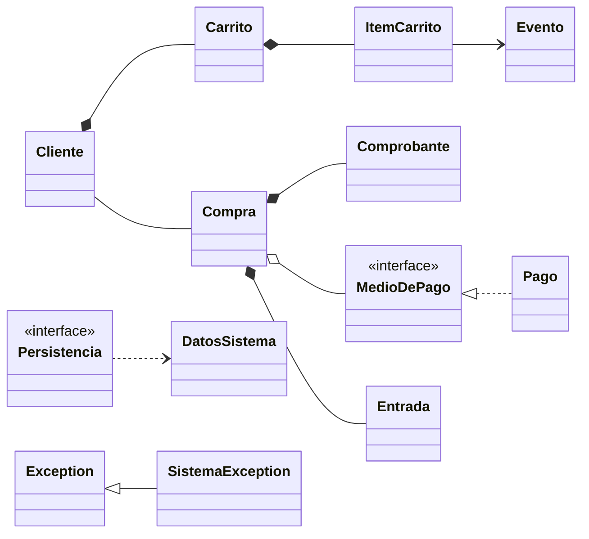

# Bitácora 2026-10-17 · Etapa E1 — Diagrama de clases del modelo (p6)

> **Cómo responder:** editá este archivo en GitHub, en la rama `desarrollo` (botón ✏️). Completá las respuestas a las decisiones, los pedidos y la aprobación al final. Tiene que estar respondido **antes de las 23:30**: a las 00:00 Claude lee este archivo.

## Resumen

Se rehízo el p6 completo: modelo de usuarios, eventos, carrito y compras; la interfaz `MedioDePago` con sus pagos; la interfaz `Persistencia`, y la jerarquía de excepciones. Todo es consistente con el p5, y las pocas diferencias están explicadas. Quedan 5 decisiones para el equipo, entre ellas el reparto de casos de uso y los 5 casos de uso del p8.

## Estado de aprobaciones anteriores

- Bitácora del día anterior: no hay. Es la primera noche, así que no se mergeó nada a `main`.
- Decisiones aplicadas: ninguna (todavía no había decisiones).
- Pedidos del equipo aplicados: ninguno.

## Qué se hizo y por qué

**`docs/diseno/p6-diagrama-de-clases-modelo.md`** (reescrito). El p6 anterior tenía `Entrada` pagada directamente y no tenía `Carrito`, `ItemCarrito`, `Compra` ni `Comprobante`, así que no coincidía con el p5. Ahora:

- **Se divide en cuatro diagramas** (usuarios/eventos/compras, pagos, persistencia, excepciones). Un único diagrama con ~30 clases no se lee en GitHub ni en una diapositiva.
- **Usuario** sigue siendo abstracta, con `getTipo()` abstracto para elegir el menú según el rol sin preguntar por la clase.
- **Evento** pasa a ser el *experto* en su capacidad: guarda `entradasVendidas` y tiene `verificarDisponibilidad`, `ocuparLugares` y `liberarLugares`. Así la regla "no vender más que la capacidad" (RF14) está en un solo lugar.
- **Carrito / ItemCarrito** representan la selección provisoria (CU09). El carrito también vuelve a verificar la disponibilidad al confirmar (CU10, paso 4).
- **Compra** nace `PENDIENTE`, guarda todos los intentos de pago y, con un pago aprobado, se confirma: crea las entradas y el comprobante. Esto respeta el p5 ("si un pago es rechazado y el cliente reintenta, todos los intentos quedan registrados").
- **Pagos:** interfaz `MedioDePago` (Strategy) + clase abstracta `Pago` con `procesar()` como Template Method + `PagoTarjeta` y `PagoTransferencia`. La tarjeta solo guarda los últimos 4 dígitos.
- **Persistencia:** interfaz `Persistencia` con `cargar()` y `guardar()`, implementada por `PersistenciaArchivo`. Todo lo que se guarda está agrupado en `DatosSistema`.
- **Excepciones:** `SistemaException` como base y una subclase por área (datos, usuario, evento, artista, compra, pago, persistencia), más `SinDisponibilidadException`, que guarda cuántas entradas quedan.
- Se agregó una tabla **"Reglas importantes y dónde están"**: para cada regla, qué clase la controla y qué excepción lanza. Sirve mucho para la defensa.
- Se quitaron las dos imágenes del p6 inicial, porque mostraban un diseño que ya no coincide. Siguen en el historial de git (commit `1353493`) por si se quieren recuperar.

**`PLAN.md`**: casilla de E1 marcada. **`README.md`**: el p6 figura como "versión E1, pendiente de aprobación".

## Decisiones tomadas por Claude

- **Artistas como catálogo compartido** entre todos los organizadores. La relación "Organizador registra Artista" del p5 no se navega en el código, porque ningún caso de uso la usa. Se ajusta el p5 en E3.
- **`Compra`–`Entrada` y `Compra`–`MedioDePago` con multiplicidad `0..*`** (el p5 dice `1..*`), porque una compra `PENDIENTE` todavía no tiene ni entradas ni pagos. Se ajusta el p5 en E3.
- **Un solo contador de ids** en `DatosSistema` para todas las clases: más simple y nunca se repiten.
- **Código de entrada** = número de compra + número de entrada (`15-3`). **Número de comprobante** = `C-` + número de compra. Así son únicos sin contadores extra.
- **Agregar al carrito un evento que ya está** suma la cantidad en el mismo ítem, en lugar de crear otro.
- **Rechazo simulado de pagos:** se rechazan las tarjetas terminadas en `0000` y las transferencias con número de operación terminado en `000`, para poder mostrar el caso de rechazo en la demo.
- **Cuotas permitidas:** 1, 3, 6 o 12.
- **Excepciones verificadas** (heredan de `Exception`): el compilador obliga a capturarlas.
- **`DatosSistema` va en el paquete `modelo`**, no en `persistencia`, porque tiene reglas (email único, baja de artistas) y no sabe nada de archivos.
- **`java.time`** (`LocalDate`, `LocalDateTime`) para las fechas. Es parte de Java 8 y evita los problemas de `Date`.

## Cambios en los diagramas

Diagrama oficial actualizado: **p6** (las cuatro partes). Resumen de lo nuevo respecto al p6 anterior:

## Cómo probarlo

Hoy no hay código, solo diseño.

1. Abrir en GitHub `docs/diseno/p6-diagrama-de-clases-modelo.md` en la rama `desarrollo` y verificar que los cuatro diagramas se dibujen.
2. Comparar con el p5: cada concepto del p5 tiene que estar como clase en el p6.
3. Recorrer un caso de uso con el dedo. Por ejemplo, CU09: `Cliente` → `getCarrito()` → `Carrito.agregarItem(evento, 2)` → `Evento.verificarDisponibilidad(2)`.

## Para la defensa

**Recorrido de una compra en el modelo** (todavía sin pantallas): el cliente agrega ítems al `Carrito`, que le pregunta a cada `Evento` si tiene lugar. Al confirmar, el carrito vuelve a preguntar, se crea una `Compra` `PENDIENTE`, se le registra un `MedioDePago` y se llama a `procesar()`. Si el pago se aprueba, `Compra.confirmar` le pide a cada `Evento` que ocupe los lugares, crea las `Entrada` y pasa a `CONFIRMADA`. Por último, `generarComprobante()` crea el `Comprobante` y el controlador guarda todo con `Persistencia.guardar`.

**Preguntas que podría hacer el profesor:**

1. ¿Por qué `MedioDePago` es una interfaz y además existe `Pago` abstracta? — *La interfaz es lo que ve el resto del sistema (`Compra` y los controladores). La clase abstracta evita repetir código entre tarjeta y transferencia. Un medio nuevo podría implementar solo la interfaz.*
2. ¿Qué patrón es `Pago.procesar()`? — *Template Method: el método de la clase padre fija los pasos (autorizar, cambiar el estado, lanzar la excepción si se rechazó) y las subclases solo implementan `autorizar()`.*
3. ¿Dónde se controla que no se vendan más entradas que la capacidad? — *En `Evento`, que es el experto porque tiene la capacidad y las vendidas. Se controla al agregar al carrito y otra vez al confirmar.*
4. ¿Por qué `Carrito` y `Compra` son clases separadas? — *El carrito es provisorio y se puede modificar. La compra es definitiva, tiene pagos, entradas y comprobante.*
5. ¿`DatosSistema` no es una God class? — *No. Solo guarda las listas y hace búsquedas que necesitan recorrerlas todas. Las reglas de cada objeto están en su clase.*
6. ¿Por qué las excepciones heredan de `Exception` y no de `RuntimeException`? — *Para que sean verificadas: el compilador obliga a capturarlas, así ningún error de negocio llega a la pantalla sin control.*
7. ¿Por qué no se guarda el número completo de la tarjeta? — *Por seguridad: no hace falta para nada después de autorizar el pago. Para el comprobante alcanzan los últimos 4 dígitos.*

## Decisiones pendientes

### D-001 · Formato del archivo de persistencia

- **Contexto:** `PersistenciaArchivo` tiene que guardar todo en archivos con la biblioteca estándar. Hay que elegir cómo, antes de la E4 (20/10).
- **Opciones:**
  - (a) **Serialización de Java** (`ObjectOutputStream` / `ObjectInputStream`): un solo archivo binario; las clases del modelo implementan `Serializable`. Unas 40 líneas de código y conserva solas las referencias entre objetos (una entrada apunta al mismo evento).
  - (b) **Archivos de texto** (uno por tipo: `usuarios.txt`, `eventos.txt`…, con campos separados por `;`): se pueden leer con el bloc de notas, pero hay que escribir a mano la conversión de cada clase y reconstruir las referencias por id. Son varios cientos de líneas más para explicar.
- **Recomendación de Claude:** (a). Es mucho menos código para defender y gracias a la interfaz `Persistencia` se puede cambiar después sin tocar nada más.
- **Si no hay respuesta:** se aplica (a).
- **Respuesta del equipo:**
- **Respondió:**

### D-002 · ¿Un evento se crea con artistas?

- **Contexto:** el p5 dice que un evento tiene `1..*` artistas y CU06 (3c) dice que un evento conserva al menos un artista. Pero CU03 (Crear evento) no pide artistas, así que un evento recién creado tendría cero.
- **Opciones:**
  - (a) **CU03 pide elegir al menos un artista** al crear el evento. Se agrega un paso en CU03 y el resto (p5, p6, CU06) queda como está.
  - (b) **Un evento puede no tener artistas:** multiplicidad `0..*` en p5 y p6, y se borra la regla 3c de CU06.
- **Recomendación de Claude:** (a). Cambia un solo documento y es más realista: no hay recital sin artistas.
- **Si no hay respuesta:** se aplica (a) y se actualiza CU03 en `casos-de-uso.md`. El p6 ya está hecho así.
- **Respuesta del equipo:**
- **Respondió:**

### D-003 · ¿Qué pasa con las compras cuando se cancela un evento?

- **Contexto:** CU05 solo dice que se impiden nuevas ventas. En p3 está pendiente: "¿se reintegra automáticamente el dinero de las entradas vendidas?".
- **Opciones:**
  - (a) **Solo se bloquean las ventas nuevas.** Las compras existentes quedan como están y el cliente las cancela él mismo con CU14 (que se le permite porque el evento no se realizó).
  - (b) **Se cancelan automáticamente** todas las compras del evento y se registra el reintegro. Es más completo, pero `Evento` tendría que conocer las compras o habría que recorrer todos los clientes, y una compra puede tener entradas de varios eventos (¿se cancela la compra entera o solo esas entradas?).
- **Recomendación de Claude:** (a). Es lo que dicen CU05 y CU14 y no complica el diseño.
- **Si no hay respuesta:** se aplica (a) y se borra la pregunta de "Pendientes" en p3, con la respuesta anotada.
- **Respuesta del equipo:**
- **Respondió:**

### D-004 · Reparto de casos de uso por integrante

- **Contexto:** cada integrante tiene que tener al menos 3 casos de uso. En la defensa toca uno al azar, pero conviene que cada uno sea "dueño" de un módulo para estudiarlo a fondo.
- **Opciones:** (a) la propuesta de abajo, por módulo · (b) otro reparto que defina el equipo.

  | Integrante | Casos de uso | Módulo |
  |---|---|---|
  | AgustinSimonenco | CU10 Confirmar compra, CU11 Realizar pago, CU12 Generar comprobante | Compra y pagos |
  | michuarcondo | CU03 Crear evento, CU04 Modificar evento, CU05 Cancelar evento, CU06 Asignar artistas | Eventos |
  | simonenconacho | CU01 Registrar usuario, CU02 Iniciar sesión, CU15 Gestionar artistas, CU07 Consultar eventos | Usuarios y artistas |
  | stx-06 | CU08 Consultar disponibilidad, CU09 Agregar al carrito, CU13 Consultar historial, CU14 Cancelar compra | Carrito e historial |

- **Recomendación de Claude:** (a). Agrupa casos de uso que comparten clases, así cada uno estudia menos código.
- **Si no hay respuesta:** se aplica (a) y se anota en `casos-de-uso.md`.
- **Respuesta del equipo:**
- **Respondió:**

### D-005 · Los 5 casos de uso del p8 (diagramas de secuencia)

- **Contexto:** el p8 pide diagramas de secuencia de 5 casos de uso. Se hacen en la E3 (19/10).
- **Opciones:**
  - (a) **CU02 Iniciar sesión** (polimorfismo de `Usuario`), **CU03 Crear evento** (validaciones y excepciones), **CU09 Agregar entradas al carrito** (incluye CU08, control de capacidad), **CU10 Confirmar compra** con CU11 (Strategy y Template Method) y **CU14 Cancelar compra** (anula entradas y libera capacidad). Con el reparto de D-004, cada integrante tiene al menos uno.
  - (b) Otros 5 que elija el equipo.
- **Recomendación de Claude:** (a). Son los que muestran más patrones y reglas del modelo.
- **Si no hay respuesta:** se aplica (a).
- **Respuesta del equipo:**
- **Respondió:**

## Pedidos del equipo

Cambios, correcciones o dudas para la próxima noche. Una línea por pedido.

-

## Aprobación

- **Aprobado:** <!-- SÍ o NO --> Si, aprobado.
- **Comentarios:**
   D-001: (a) Serialización de Java
   D-002: (a) CU03 pide elegir al menos un artista
   D-003: (a) Solo se bloquean las ventas nuevas
   D-004: Esto queda pendiente. De todas formas no me parece muy relevante, todos debemos conocer todo el codigo y estructura a fondo
   D-005: (a) **CU02 Iniciar sesión** (polimorfismo de `Usuario`), **CU03 Crear evento** (validaciones y excepciones), **CU09 Agregar entradas al carrito** (incluye CU08, control de capacidad), **CU10 Confirmar compra** con CU11 (Strategy y Template Method) y **CU14 Cancelar compra** (anula entradas y libera capacidad). Con el reparto de D-004, cada integrante tiene al menos uno.
- **Revisó:** AgustinSimonenco
