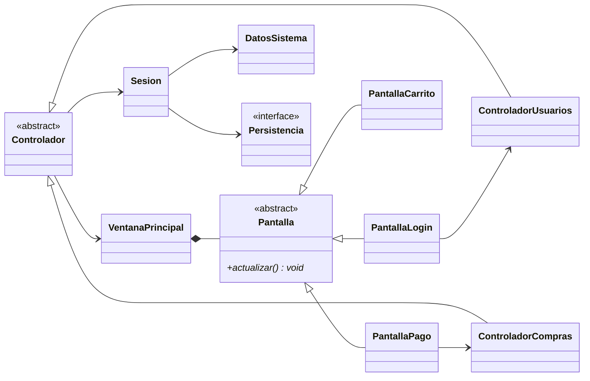

# Bitácora 2026-10-18 · Etapa E2 — Vista y controlador (p7) + navegación (p9)

> **Cómo responder:** editá este archivo en GitHub, en la rama `desarrollo` (botón ✏️). Completá las respuestas a las decisiones, los pedidos y la aprobación al final. Tiene que estar respondido **antes de las 23:30**: a las 00:00 Claude lee este archivo.

## Resumen

Se aprobó y mergeó a `main` el trabajo del 17/10, con las decisiones D-001, D-002, D-003 y D-005 ya aplicadas. Se hicieron el **p7** (10 pantallas, 5 controladores, una clase `Sesion`) y el **p9** (navegación por rol). Incluye una tabla de trazabilidad CU → pantalla → controlador → modelo para la defensa. Queda abierta solo D-004.

## Estado de aprobaciones anteriores

- **Bitácora del 17/10: aprobada** por AgustinSimonenco. Se mergeó `desarrollo` a `main` (commit de merge "Aprobado: avance del 2026-10-17").
  - Nota: la respuesta se escribió como "Si, aprobado." después del comentario `<!-- SÍ o NO -->`. Se tomó como **SÍ**. Para que no haya dudas, conviene escribir solo `SÍ` o `NO` en ese campo.
- **Decisiones aplicadas** (todas respondidas por el equipo, antes del merge):
  - **D-001 (a)** serialización de Java → anotado en el p6, parte 3: `PersistenciaArchivo` usa `ObjectOutputStream` / `ObjectInputStream` y las clases del modelo implementan `Serializable`.
  - **D-002 (a)** CU03 pide al menos un artista → actualizados CU03 en `casos-de-uso.md` (nuevo paso 2 y alternativo 2a "no hay artistas → CU15") y RF03 en el p3.
  - **D-003 (a)** solo se bloquean las ventas nuevas → RF05 del p3 aclara que el cliente cancela con CU14, y la pregunta de "Pendientes" del p3 quedó tachada con la respuesta.
  - **D-005 (a)** los 5 casos de uso del p8 → anotados en la etapa E3 de `PLAN.md`.
  - **D-004: sigue pendiente**, como pidió el equipo. No se aplicó el reparto por defecto (ver abajo).
- Pedidos del equipo aplicados: no hubo pedidos.

## Qué se hizo y por qué

**`docs/diseno/p7-diagrama-vista-controlador.md`** (nuevo). Cuatro partes:

1. **Visión general MVC:** quién llama a quién en cada clic. La pantalla le pasa el texto al controlador; el controlador convierte, llama al modelo, guarda y le dice a la ventana qué mostrar; si el modelo lanza una `SistemaException`, el controlador la captura y la ventana muestra el mensaje.
2. **Vista:**
   - **Una sola ventana** (`VentanaPrincipal`, un `JFrame` con `CardLayout`) y **10 pantallas** (`JPanel`) que heredan de la clase abstracta `Pantalla`. Con `CardLayout` no hay que abrir y cerrar ventanas, y toda la navegación pasa por `mostrar(nombre)`.
   - `Pantalla` obliga a implementar `actualizar()`, que la ventana llama antes de mostrarla para recargar las tablas. Es polimorfismo: la ventana trata igual a todas.
   - Cada pantalla **implementa `ActionListener`**, como pide la regla del proyecto (sin lambdas ni clases anónimas).
   - Los diálogos (errores, confirmaciones, comprobante) están todos en `VentanaPrincipal`, así ningún controlador usa Swing.
   - **No hay pantalla de menú ni de comprobante:** el "menú según el rol" es la pantalla de inicio de cada rol, y el comprobante es un diálogo. Son menos clases (la rúbrica premia eso) sin perder ningún caso de uso.
3. **Controladores:**
   - Cinco, **uno por módulo del p2:** usuarios, eventos, artistas, carrito y compras. Ninguno tiene más de ~12 métodos públicos, así no hay *God class*.
   - Heredan de la clase abstracta `Controlador`, que tiene la `Sesion`, la ventana y los métodos para convertir texto en número o fecha. Esos métodos se escriben **una sola vez**.
   - **`Sesion`** guarda los datos cargados, la persistencia y el usuario que inició sesión. Todos los controladores comparten la misma `Sesion`.
   - Se muestra un ejemplo de método de controlador con su `try/catch`: todos siguen la misma forma.
4. **Trazabilidad:** una tabla con los 15 casos de uso. Para cada uno dice la pantalla y el botón, el método del controlador y los métodos del modelo. Es la base para la defensa y para la guía de la E16.

**`docs/diseno/p9-diagrama-de-navegacion.md`** (nuevo). Tres diagramas de estados (Mermaid `stateDiagram-v2`):

- **Inicio:** login, registro, y a qué pantalla se va según `getTipo()`.
- **Organizador:** mis eventos, formulario (crear y modificar), asignación de artistas y catálogo de artistas.
- **Cliente:** eventos, carrito, resumen, pago (con reintento si se rechaza), comprobante e historial.

Además, cada flecha indica el caso de uso y el flujo alternativo que representa (por ejemplo "Pagar, pago rechazado (CU11, 5a)"). Al final hay una tabla de pantallas y desde dónde se llega a cada una.

**`docs/analisis/p2-descripcion-alto-nivel.md`:** el diagrama de arquitectura mostraba 3 controladores. Se agregaron los de artistas y carrito para que coincida con el p7.

**`PLAN.md`:** casilla de E2 marcada. **`README.md`:** enlaces al p7 y al p9; el p6 figura como aprobado.

## Decisiones tomadas por Claude

- **Una sola ventana con `CardLayout`** en lugar de una ventana por pantalla.
- **Sin pantallas de menú:** cada rol entra directo a su pantalla de inicio (`PantallaMisEventos` para el organizador, `PantallaEventosDisponibles` para el cliente).
- **El comprobante se muestra en un diálogo** (`JOptionPane` con un área de texto), no en una pantalla propia.
- **Un mismo formulario para crear y modificar un evento** (CU03 y CU04). La lista de artistas solo aparece al crear; al modificar, los artistas se cambian en CU06.
- **`Sesion` en el paquete `controlador`:** guarda el estado de la aplicación (quién inició sesión), no reglas de negocio.
- **El controlador captura las excepciones**, no la pantalla. Así la pantalla solo llama un método y no tiene `try/catch`. Coincide con lo que dice el p6.
- **Las pantallas pueden leer el modelo** (por ejemplo, `evento.getNombre()` para armar una tabla), pero nunca modificarlo.
- **Las pantallas pasan los datos como `String`** y el controlador los convierte. Fechas en formato `dd/mm/aaaa`.
- **"Volver" desde el catálogo de artistas siempre va a `PantallaMisEventos`**, aunque se haya entrado desde el formulario o desde la asignación. Es más simple; el costo es que el organizador tiene que volver a entrar al evento.
- **`Main` en el paquete raíz**, porque no es vista, ni controlador, ni modelo: solo arma los objetos.
- **Se guarda también después de cambiar el carrito**, porque el carrito es parte del `Cliente` y se serializa con él. Así, si se cierra la aplicación, el carrito se conserva.

## Cambios en los diagramas

Diagramas oficiales nuevos: **p7** y **p9**. Se actualizó el **p2** (arquitectura). En el **p6** solo cambió el texto de la persistencia (D-001) y de las diferencias con el p5 (D-002); los diagramas de clases del p6 no cambiaron.

Resumen de lo nuevo:

## Cómo probarlo

Hoy no hay código, solo diseño.

1. Abrir en GitHub, rama `desarrollo`, el `p7` y el `p9`, y verificar que se dibujen los diagramas.
2. Elegir un caso de uso, por ejemplo CU11, y seguirlo en la tabla de trazabilidad del p7: `PantallaPago` · *Pagar* → `ControladorCompras.pagarConTarjeta` → `new PagoTarjeta` → `Compra.registrarPago` → `Pago.procesar` (p6).
3. Buscar ese mismo recorrido en el p9: `PantallaPago` → *Pagar, pago aprobado* → diálogo del comprobante → `PantallaEventosDisponibles`.
4. Verificar que cada método del controlador que aparece en la tabla llame métodos que ya existen en el p6.

## Para la defensa

**Recorrido de "Agregar entradas al carrito" (CU09):** el cliente elige una fila de la tabla en `PantallaEventosDisponibles`, escribe la cantidad y toca *Agregar al carrito*. En `actionPerformed`, la pantalla llama a `ControladorCarrito.agregarAlCarrito(evento, "2")`. El controlador convierte `"2"` en número con `convertirEntero` (heredado de `Controlador`), le pide el carrito a `sesion.getCliente()` y llama a `Carrito.agregarItem(evento, 2)`. El carrito le pregunta al evento con `Evento.verificarDisponibilidad(2)`. Si alcanza, el carrito crea o actualiza el `ItemCarrito`, el controlador llama a `sesion.guardar()` (que usa `Persistencia.guardar`) y le pide a la ventana `mostrar(CARRITO)`. Si no alcanza, el evento lanza `SinDisponibilidadException`, el controlador la captura y la ventana muestra "quedan N entradas".

**Preguntas que podría hacer el profesor:**

1. ¿Por qué la pantalla no tiene `try/catch`? — *Porque la pantalla solo muestra cosas y avisa clics. El controlador coordina el caso de uso, así que él decide qué hacer con un error: le pide a la ventana que muestre el mensaje.*
2. ¿Qué patrón es `ActionListener`? — *Observer: el botón tiene una lista de "oyentes" y les avisa cuando lo tocan, sin saber qué clase son. Nuestras pantallas son los oyentes.*
3. ¿Por qué hay una clase `Controlador` abstracta? — *Para no repetir código: todos los controladores necesitan la sesión, la ventana y convertir textos en números o fechas.*
4. ¿Por qué cinco controladores y no uno solo? — *Uno solo tendría más de 40 métodos y conocería todo el sistema: sería una God class. Con uno por módulo, cada uno es chico y cambia por un solo motivo.*
5. ¿Cómo sabe el sistema qué pantalla mostrar después del login? — *`ControladorUsuarios.iniciarSesion` le pregunta al usuario `getTipo()`, que es un método abstracto de `Usuario` implementado por `Cliente` y `Organizador`.*
6. ¿Para qué sirve `actualizar()`? — *Cada pantalla recarga sus datos antes de mostrarse. Por ejemplo, después de crear un evento, la tabla de "mis eventos" lo muestra. Como es abstracto en `Pantalla`, la ventana lo llama sin saber qué pantalla es.*
7. ¿Qué pasa si se rechaza el pago? — *La compra en curso queda `PENDIENTE` con el intento rechazado guardado, el cliente sigue en `PantallaPago` y puede reintentar. Si cancela, `compraEnCurso` vuelve a `null` y la compra nunca se agrega al cliente, así que no se guarda.*

## Decisiones pendientes

### D-004 · Reparto de casos de uso por integrante (sigue abierta)

- **Contexto:** el equipo respondió el 17/10: "queda pendiente; no me parece muy relevante, todos debemos conocer todo el código". Cada integrante tiene que poder defender cualquier caso de uso, porque toca uno al azar. Pero el enunciado pide al menos 3 casos de uso por integrante, así que puede que el profesor pregunte de quién es cada uno.
- **Opciones:**
  - (a) El reparto por módulo propuesto el 17/10, solo como registro en `casos-de-uso.md`. No cambia cómo se trabaja.
  - (b) Otro reparto que defina el equipo.
  - (c) No registrar ningún reparto.
- **Recomendación de Claude:** (a), solo como registro, por si el profesor lo pide. Igual, la guía de defensa (E16) va a cubrir los 15 casos de uso para todos.
- **Si no hay respuesta:** no se hace nada todavía, porque el equipo pidió dejarla pendiente. Se vuelve a preguntar en la E16 (01/11).
- **Respuesta del equipo:**
- **Respondió:**

## Pedidos del equipo

Cambios, correcciones o dudas para la próxima noche. Una línea por pedido.

-

## Aprobación

- **Aprobado:** <!-- SÍ o NO -->
- **Comentarios:**
- **Revisó:**
