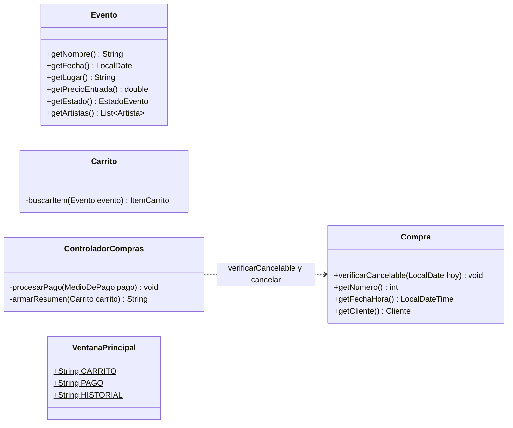

# Bitácora 2026-10-19 · Etapa E3 — Diagramas de secuencia (p8)

> **Cómo responder:** editá este archivo en GitHub, en la rama `desarrollo` (botón ✏️). Completá las respuestas a las decisiones, los pedidos y la aprobación al final. Tiene que estar respondido **antes de las 23:30**: a las 00:00 Claude lee este archivo.

## Resumen

Se aprobó y mergeó a `main` el trabajo del 18/10. Se cerró D-004 (no se registra ningún reparto). Se hizo el **p8**: los 5 diagramas de secuencia elegidos en D-005, cada uno con su explicación paso a paso. Al dibujarlos aparecieron detalles que faltaban, y se corrigieron p5, p6, p7 y p9 para que todo coincida. Con esto queda terminada la documentación de diseño para el Seguimiento II (27/10). Queda una sola decisión abierta, D-006, que no frena nada.

## Estado de aprobaciones anteriores

- **Bitácora del 18/10: aprobada** (`SÍ`) por AgustinSimonenco. Se mergeó `desarrollo` a `main` (commit de merge "Aprobado: avance del 2026-10-18").
- **Bitácora del 17/10:** aprobada y mergeada el 18/10. No quedan días sin respuesta.
- **Decisiones aplicadas:**
  - **D-004 (c), respondida en "Comentarios":** "no registrar ningún reparto". No se agregó nada en `casos-de-uso.md` y la decisión queda cerrada: no se vuelve a preguntar en la E16. La guía de defensa va a cubrir los 15 casos de uso para todos.
- Pedidos del equipo aplicados: no hubo pedidos.

## Qué se hizo y por qué

**`docs/diseno/p8-diagramas-de-secuencia.md`** (nuevo). Es el índice del p8:

- tabla con los 5 casos de uso, el enlace a cada diagrama y por qué se eligió;
- cómo leer las flechas (llamada, respuesta, excepción) y los bloques `alt` y `loop`;
- la forma que se repite en todos: pantalla → un método del controlador → modelo → guardar → ventana; y si hay error, la excepción sube hasta el `catch` del controlador.

**`docs/diseno/secuencias/`** (nuevo), un archivo por caso de uso, como pide CLAUDE.md. Cada uno tiene el diagrama Mermaid, el paso a paso en castellano y una tabla de patrones y decisiones.

| Archivo | Lo más importante para explicar |
|---|---|
| `CU02-iniciar-sesion.md` | `DatosSistema.autenticar` busca el email y `Usuario.validarContrasenia` compara. Después, `getTipo()` (polimorfismo) decide la pantalla. |
| `CU03-crear-evento.md` | El controlador convierte los textos; el constructor de `Evento` valida todo, así nunca existe un evento inválido. |
| `CU09-agregar-entradas-al-carrito.md` | El include de CU08 es la llamada a `Evento.verificarDisponibilidad`. Si el evento ya está en el carrito, se verifica la **suma** de las cantidades. |
| `CU10-confirmar-compra.md` | En tres partes: confirmar el carrito, pagar y cerrar la compra, y cancelar el pago. Se ven Strategy (`MedioDePago`), Template Method (`Pago.procesar` → `autorizar`) y Creador (`Compra` crea `Entrada` y `Comprobante`). |
| `CU14-cancelar-compra.md` | Primero se verifica si se puede cancelar y **después** se pide confirmación, en el mismo orden que el caso de uso. |

**Revisión de consistencia (p5 a p9).** Al dibujar las secuencias, cada llamada tiene que existir en el p6 o en el p7. Faltaban algunas, y se agregaron:

- **p6 (modelo):**
  - `Compra.verificarCancelable(hoy)`. CU14 dice "verifica (paso 2) → pide confirmación (paso 3)". Con solo `cancelar()`, el cliente confirmaría y recién después vería el error. `cancelar()` la vuelve a llamar adentro, así la regla nunca se saltea.
  - *Getters* de `Evento` (`getNombre`, `getFecha`, `getLugar`, `getPrecioEntrada`, `getEstado`, `getArtistas`) y de `Compra` (`getNumero`, `getFechaHora`, `getCliente`). Las pantallas y el comprobante los necesitan, y el p6 no los mostraba.
  - `Carrito.buscarItem(evento)`, privado, para no repetir la búsqueda en tres métodos.
  - En la tabla de reglas: "un evento se crea con al menos un artista" (D-002) y la regla de CU14 con la fecha.
  - Al final del p6 hay una sección nueva que lista estos cambios.
- **p7 (vista y controlador):**
  - Constantes con los nombres de las pantallas en `VentanaPrincipal` (`CARRITO`, `PAGO`, …). El ejemplo de código del p7 ya usaba `VentanaPrincipal.CARRITO`, pero el diagrama no lo mostraba.
  - En `ControladorCompras`, los métodos privados `procesarPago(MedioDePago)`, para no repetir los pasos en `pagarConTarjeta` y `pagarConTransferencia`, y `armarResumen(Carrito)`.
  - La fila de CU14 en la tabla de trazabilidad.
- **p5 (conceptual):** `Compra – Entrada` y `Compra – Pago` pasan de `1..*` a `0..*`, y la compra puede estar "pendiente". El p6 decía que esto se iba a corregir en la E3. La asociación `Organizador – Artista` (registra) se deja en el p5, porque como concepto es cierta.
- **p9 (navegación):** una nota en CU14. Si la compra no se puede cancelar, se muestra el error sin preguntar nada.
- **README:** enlace al p8 y estado de cada diagrama. **PLAN.md:** casilla de E3 marcada.

## Decisiones tomadas por Claude

- **CU10, CU11 y CU12 en un solo archivo** (`CU10-confirmar-compra.md`), en tres diagramas. Se usan juntos y CU10 incluye a los otros dos. Si en la E10 hace falta, se separan.
- **No se dibuja la variante con transferencia:** se explica en una línea, porque solo cambia el `new PagoTransferencia(...)` y después usa el mismo `procesarPago`.
- **No se puede cancelar una compra el mismo día del evento.** Sale de RF15 ("antes de la fecha del evento"), así que no hizo falta preguntarlo.
- **`Evento.liberarLugares(1)` se llama una vez por entrada**, en lugar de agrupar por evento. Es más simple de leer y de programar.
- **`Evento.liberarLugares` vuelve el evento a `ACTIVO` si estaba `AGOTADO`.**
- **La compra recién se agrega al cliente (`Cliente.agregarCompra`) después de `Compra.confirmar`.** Lo hace el controlador, no `Compra`, para que se vea en el diagrama. Así, una compra pendiente o cancelada a mitad del pago nunca aparece en el historial.
- **Los intentos de pago rechazados quedan en la lista de la compra en memoria.** Se guardan en el archivo junto con la compra cuando se confirma. Si el cliente cancela el pago, se pierden con la compra (nunca se guardó).
- **`Compra.generarComprobante()` crea el comprobante la primera vez y después devuelve el mismo.** Así "Ver comprobante" (desde el historial) usa el mismo método sin generar otro número.
- **El controlador pasa la fecha de hoy** a `verificarCancelable` y a `cancelar` (`LocalDate.now()`). Así, en los tests de la E13 se puede probar con cualquier fecha.
- **El mismo mensaje de error para "email inexistente" y "contraseña incorrecta"** en el login. Así no se puede averiguar qué emails están registrados.
- **`getTipo()` devuelve `"CLIENTE"` u `"ORGANIZADOR"`** (un `String`, no un enum).
- **El actor de los diagramas se llama "Persona (cliente)" o "Persona (organizador)"** para no confundirlo con los objetos `Cliente` y `Usuario`, que también aparecen en los diagramas.

## Cambios en los diagramas

Diagramas oficiales nuevos: **p8** y los 5 archivos de `docs/diseno/secuencias/`. Se actualizaron **p5**, **p6**, **p7** y **p9** (solo los detalles de arriba; la estructura no cambió).

Lo que cambió en las clases:

## Cómo probarlo

Hoy no hay código, solo diseño.

1. Abrir en GitHub, rama `desarrollo`, el [p8](../docs/diseno/p8-diagramas-de-secuencia.md) y entrar a cada uno de los 5 diagramas. **Verificar que GitHub los dibuje.** Claude no tiene cómo ver el dibujo de Mermaid de noche: si alguno muestra un error de sintaxis, anotarlo en "Pedidos del equipo".
2. Elegir un diagrama, por ejemplo el de CU09, y buscar cada flecha en el p6 o el p7. Por ejemplo, `Carrito.agregarItem` y `Evento.verificarDisponibilidad` en el p6, y `ControladorCarrito.agregarAlCarrito` en el p7.
3. Verificar que cada `mostrar(...)` del diagrama coincida con una flecha del p9. Por ejemplo, en CU09 con éxito se va de `PantallaEventosDisponibles` a `PantallaCarrito`.
4. Leer el CU14 en `casos-de-uso.md` y comparar el orden de los pasos con el diagrama.

## Para la defensa

**Recorrido de "Confirmar compra y pagar con tarjeta" (CU10 + CU11 + CU12):**

1. En `PantallaCarrito`, el cliente toca *Confirmar compra*. La pantalla llama a `ControladorCompras.iniciarCompra()`.
2. El controlador le pide al `Carrito` que verifique todo con `verificarDisponibilidad()`. El carrito revisa que no esté vacío y le pregunta a cada `Evento` si todavía tiene lugar.
3. Si está todo bien, el controlador arma el resumen y la ventana pregunta "¿confirmás?". Si el cliente acepta, se crea una `Compra` `PENDIENTE` (todavía no está en el historial) y se va a `PantallaPago`.
4. El cliente completa la tarjeta y toca *Pagar*. El controlador crea un `PagoTarjeta`, que valida el formato en su constructor. Después llama a `procesarPago(pago)`.
5. `Compra.registrarPago` guarda el intento y llama a `procesar()`. Ese método, escrito una sola vez en `Pago`, llama a `autorizar()` de `PagoTarjeta`.
6. Si se aprueba, `Compra.confirmar(carrito)` ocupa los lugares en cada evento y crea una `Entrada` por unidad. Después:
   - el controlador agrega la compra al cliente;
   - `Compra.generarComprobante()` crea el `Comprobante`;
   - se vacía el carrito, se guarda con `Sesion.guardar()` → `Persistencia.guardar` y se muestra el comprobante.
7. Si se rechaza, `procesar()` lanza `PagoException`. La excepción sube hasta el `catch` del controlador, que muestra el motivo, y el cliente sigue en `PantallaPago` para reintentar.

**Preguntas que podría hacer el profesor:**

1. ¿Qué es un diagrama de secuencia y para qué sirve acá? — *Muestra qué objetos participan en un caso de uso y en qué orden se llaman. Une la pantalla (p7, p9) con las reglas del modelo (p6), y con él se puede seguir el código línea por línea.*
2. ¿Dónde se ve el patrón Strategy en estos diagramas? — *En CU10, parte 2: `Compra.registrarPago` recibe un `MedioDePago` y llama a `procesar()` sin saber si es tarjeta o transferencia. El medio se elige en tiempo de ejecución, según lo que tocó el cliente.*
3. ¿Y el Template Method? — *`procesar()` está escrito una vez en `Pago`: llama a `autorizar()`, pone el estado y lanza la excepción si se rechazó. Cada subclase solo implementa `autorizar()`.*
4. ¿Por qué se verifica la disponibilidad dos veces, al agregar al carrito y al confirmar? — *Porque agregar al carrito no ocupa lugares. Entre que el cliente agrega y confirma, el organizador pudo cancelar el evento. La segunda verificación es el alternativo 4a de CU10.*
5. ¿Por qué los lugares se ocupan después del pago y no antes? — *Para no tener que deshacer nada si el pago se rechaza. Y como la aplicación la usa una persona por vez, nadie puede comprar esas entradas mientras el cliente paga.*
6. ¿Qué pasa con una excepción que lanza `Evento` dentro de `Carrito.agregarItem`? — *Nadie la captura en el modelo: sube por `Carrito` hasta el controlador, que tiene un `catch (SistemaException e)` y muestra el mensaje. Funciona porque todas nuestras excepciones heredan de `SistemaException`.*
7. ¿Por qué hay `verificarCancelable` y `cancelar`, si `cancelar` ya verifica? — *Porque CU14 pide verificar antes de preguntarle al cliente. `cancelar` verifica de nuevo para que la regla se cumpla aunque alguien la llame sin verificar antes.*
8. ¿Por qué en CU02 el controlador no pregunta `instanceof Cliente`? — *Porque `getTipo()` es abstracto en `Usuario` y cada subclase lo implementa. Java ejecuta el de la clase real del objeto: eso es polimorfismo.*

## Decisiones pendientes

### D-006 · ¿Cómo se "registra el reintegro" al cancelar una compra?

- **Contexto:** CU14 (paso 6), RF15 y el p1 dicen que al cancelar una compra "se registra el reintegro". El dinero no se devuelve de verdad, porque el pago es simulado. Hay que decidir qué queda guardado.
- **Opciones:**
  - (a) **Nada nuevo:** la compra pasa a `CANCELADA` y conserva su total. El historial la muestra como "CANCELADA – reintegro $X". No hay clases ni atributos nuevos.
  - (b) **Un atributo `fechaCancelacion`** (`LocalDateTime`) en `Compra`. Así queda registrado también cuándo se canceló, y el historial lo muestra.
  - (c) **Una clase `Reintegro`** (monto, fecha, compra). Es más completo, pero agrega una clase y la rúbrica premia tener menos.
- **Recomendación de Claude:** (a). Es lo más simple de programar y de defender, y cumple con lo que dice el caso de uso. Si el equipo quiere mostrar la fecha, (b) cuesta muy poco.
- **Si no hay respuesta:** se aplica (a). No cambia ningún diagrama.
- **Respuesta del equipo:**
- **Respondió:**

## Pedidos del equipo

Cambios, correcciones o dudas para la próxima noche. Una línea por pedido.

-

## Aprobación

- **Aprobado:** <!-- SÍ o NO -->
- **Comentarios:**
- **Revisó:**
