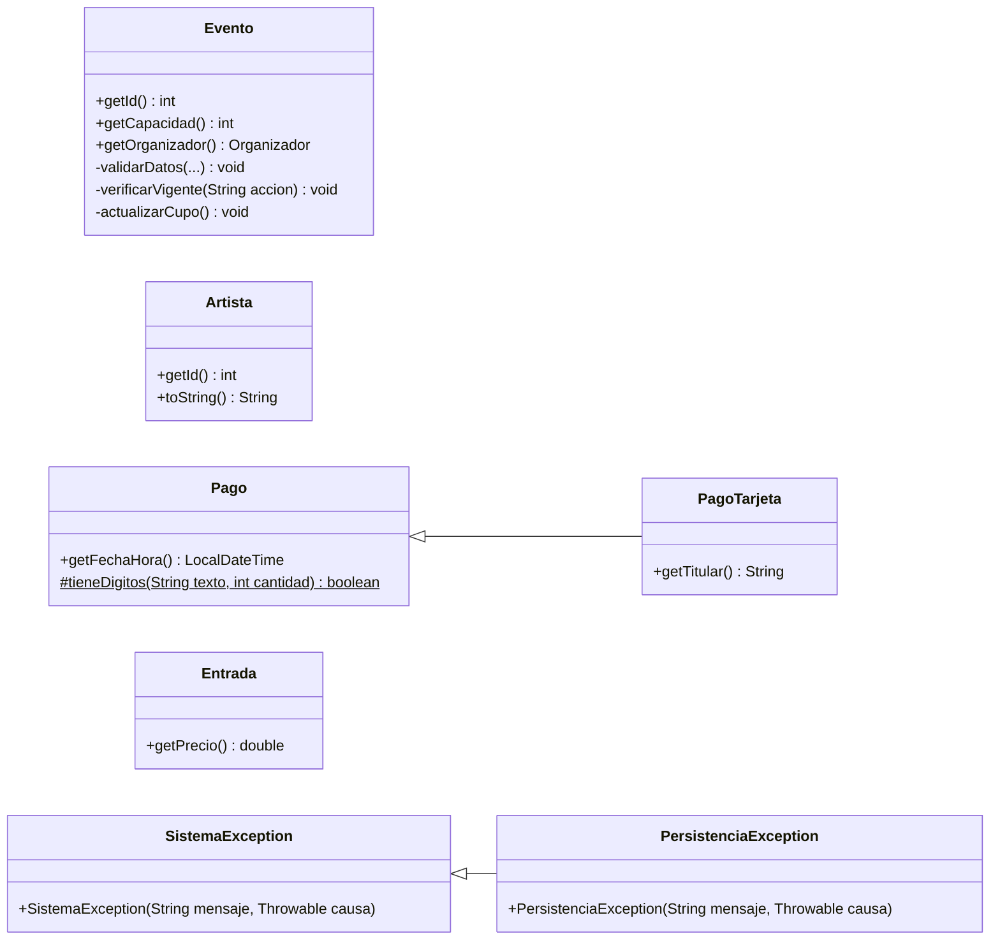

# Bitácora 2026-10-20 · Etapa E4 — Esqueleto del proyecto

> **Cómo responder:** editá este archivo en GitHub, en la rama `desarrollo` (botón ✏️). Completá las respuestas a las decisiones, los pedidos y la aprobación al final. Tiene que estar respondido **antes de las 23:30**: a las 00:00 Claude lee este archivo.

> ⚠️ **Importante: el 19/10 a la noche se hicieron 8 commits directo en `main`** (p4, p5, p6 y p7) que chocaban con la E3, y a las 00:00 el merge no se pudo hacer. **Actualización del 20/10:** AgustinSimonenco pidió revertir esos commits y mergear la E3. Ya está hecho: `main` tiene la E3 completa (p8 incluido) y los RNF del p4 de vuelta. Ver **D-007**.

## Resumen

Empezó la implementación. Quedó armada la estructura del proyecto Java (`src/`, `test/`, `lib/`, `.vscode/`), los scripts para compilar y ejecutar, la jerarquía de excepciones completa, **todas las clases del modelo con sus reglas**, la persistencia en archivo y la ventana principal vacía. Compila con `javac --release 8` sin errores. El merge del 19/10 quedó frenado por un conflicto con cambios hechos directo en `main` (D-007).

## Estado de aprobaciones anteriores

- **Bitácora del 19/10: aprobada** (`SÍ`) por AgustinSimonenco, pero **no se mergeó a `main`**.
  - Al intentar el merge, git dio **conflicto** en `docs/diseno/p5-diagrama-conceptual.md` y `docs/diseno/p6-diagrama-de-clases-modelo.md`.
  - La causa: michuarcondo hizo 8 commits directo en `main` el 19/10 entre las 20:58 y las 21:52 ("Mejoras", "Update p6-…", "Update p7-…"). Esos commits **acortan** las mismas secciones que la E3 **amplió** en `desarrollo`.
  - Claude canceló el merge (`git merge --abort`) sin tocar `main`. Los commits de michuarcondo siguen en `main` tal cual, y `desarrollo` sigue con todo lo de la E3. No se perdió nada.
- **Bitácoras del 17/10 y 18/10:** aprobadas y mergeadas. No quedan días sin respuesta.
- **Decisiones aplicadas:**
  - **D-006 (aplicada por defecto, opción a):** no hubo respuesta. El reintegro queda registrado con la compra en estado `CANCELADA` y su total, que no se borra. No hay clases ni atributos nuevos. Está en el Javadoc de `Compra.cancelar`. El equipo lo puede cambiar a (b) o (c) cuando quiera.
- Pedidos del equipo aplicados: no hubo pedidos.

## Qué se hizo y por qué

### Estructura del proyecto

| Archivo o carpeta | Qué es |
|---|---|
| `src/` | El código, con los paquetes `modelo`, `vista`, `controlador`, `persistencia` y `excepciones`, y `Main.java` en la raíz (como dice el p7). |
| `test/` | Vacía por ahora (tiene un `LEEME.md` para que git la suba). Los tests van en la E13. |
| `lib/` | Ya estaba el jar de JUnit 5. |
| `.vscode/settings.json` | Le dice a VS Code / Antigravity dónde está el código (`src`, `test`), dónde compilar (`bin`) y que use el jar de `lib/`. |
| `compilar.bat` / `compilar.sh` | Borran `bin/`, listan todos los `.java` de `src/` y los compilan con `javac --release 8 -encoding UTF-8`. El `-encoding UTF-8` es para que los acentos de los mensajes salgan bien en Windows. |
| `ejecutar.bat` / `ejecutar.sh` | `java -cp bin Main`. |
| `.gitignore` | Antes ignoraba toda la carpeta `.vscode/`. Ahora ignora todo **menos** `settings.json`, porque CLAUDE.md pide compartirlo. También ignora `datos.dat` (los datos de prueba de cada uno). |

### Excepciones (`src/excepciones/`)

Las 9 del p6, tal cual: `SistemaException` (base, hereda de `Exception`) y sus subclases. `SinDisponibilidadException` hereda de `EventoException` y guarda cuántas entradas quedan. `PersistenciaException` guarda la excepción original de Java (la `IOException`) como "causa", para no perder el detalle del error.

### Modelo (`src/modelo/`)

El plan decía "clases base del modelo". **Claude escribió el modelo completo**, con todas las reglas de la tabla del p6, porque los métodos ya estaban definidos en el diagrama y en los diagramas de secuencia. Así, desde mañana cada etapa solo tiene que agregar el controlador y la pantalla de cada caso de uso, y el modelo ya está probado.

| Clase | Lo más importante para explicar |
|---|---|
| `Usuario`, `Cliente`, `Organizador` | `Usuario` es abstracta y valida que no falte ningún dato. `getTipo()` es abstracto: `Cliente` devuelve `"CLIENTE"` y `Organizador`, `"ORGANIZADOR"`. |
| `Evento` | El constructor valida todo (nombre, lugar, fecha futura, capacidad, precio, al menos un artista), así nunca existe un evento inválido. `verificarDisponibilidad` lanza `SinDisponibilidadException` con la cantidad que queda. El estado pasa solo a `AGOTADO` o a `ACTIVO` según queden lugares (método privado `actualizarCupo`). |
| `Carrito`, `ItemCarrito` | Si se agrega un evento que ya está, se suma la cantidad y se verifica **la suma**. El carrito no ocupa lugares. |
| `Compra` | `registrarPago` guarda el intento y llama a `procesar()` sin saber qué medio es (Strategy). `confirmar` ocupa los lugares y crea una `Entrada` por unidad, con código `compra-número` (por ejemplo `15-1`, `15-2`). `generarComprobante` crea el comprobante una sola vez. `verificarCancelable` y `cancelar` siguen el CU14. |
| `MedioDePago`, `Pago`, `PagoTarjeta`, `PagoTransferencia` | `Pago.procesar()` es el método plantilla: llama a `autorizar()`, que cada subclase implementa. La tarjeta solo guarda los últimos 4 dígitos. Se rechazan las tarjetas terminadas en `0000` y las transferencias con operación terminada en `000`, para la demo. |
| `Comprobante` | `generarTexto()` arma el texto con un `StringBuilder`: número, fecha, cliente, una línea por entrada, total y medio de pago. |
| `DatosSistema` | Las listas de usuarios, eventos y artistas, el contador de ids y las búsquedas que recorren todo (email repetido, eventos de un organizador, eventos disponibles). |
| Enums | `EstadoEvento`, `EstadoCompra`, `EstadoEntrada`, `EstadoPago`. |

Todas las clases que se guardan implementan `Serializable` y tienen `serialVersionUID = 1L`. Esto último es importante: si no se pone, Java calcula un número distinto cada vez que se cambia la clase, y el `datos.dat` guardado antes deja de poder leerse.

### Persistencia (`src/persistencia/`)

- `Persistencia`: la interfaz, con `cargar()` y `guardar(datos)`.
- `PersistenciaArchivo`: serialización de Java (D-001). Si el archivo no existe, `cargar()` devuelve datos vacíos. Usa *try con recursos* (`try (ObjectInputStream entrada = ...)`), que cierra el archivo solo aunque haya un error.

### Controlador y vista (base)

- `controlador/Sesion`: los datos, la persistencia y el usuario actual. Carga los datos en el constructor. `guardar()` es el único lugar desde donde se guarda.
- `controlador/Controlador`: la clase abstracta de los cinco controladores, con `convertirEntero`, `convertirDecimal` (acepta coma o punto) y `convertirFecha` (`dd/mm/aaaa`, modo estricto: "31/02/2026" da error).
- `vista/VentanaPrincipal`: el `JFrame` con `CardLayout`, las 10 constantes con los nombres de las pantallas y los métodos `mostrar`, `mostrarMensaje`, `mostrarError`, `mostrarTexto` y `confirmar`.
- `vista/Pantalla`: la clase abstracta de todas las pantallas, con `actualizar()`.
- `Main`: crea la persistencia, la sesión y la ventana, y la muestra. Si no se pueden leer los datos, muestra el error y termina.

### Cómo se verificó

- `compilar.bat` y `compilar.sh` compilan sin errores ni advertencias.
- Se buscaron construcciones prohibidas (`->`, `::`, `var`, `Optional`, streams): no hay ninguna.
- Claude escribió un programa de prueba **fuera del repo** (no se subió) que hizo el recorrido completo: registrar usuarios (y rechazar un email repetido), crear un artista y un evento con capacidad 3, agregar 2 entradas al carrito (y rechazar 2 más), pagar con una tarjeta terminada en `0000` (rechazada), pagar con transferencia (aprobada), confirmar, generar el comprobante, guardar en archivo, volver a cargar, iniciar sesión y cancelar la compra. Todo dio lo esperado: después de cancelar, el evento volvió a tener 3 lugares.
- **No se abrió la ventana:** de noche no hay nadie para mirarla. Ver "Cómo probarlo".

### Diagramas

- **p6:** se agregaron los métodos que el código necesitó (getters, `toString` de `Artista`, `Pago.tieneDigitos`, métodos privados, constructores con causa) y una sección al final, "Cambios hechos al programar el esqueleto (20/10)". También una fila nueva en la tabla de reglas: un evento cancelado o finalizado no se modifica ni se vuelve a cancelar.
- **p7:** sin cambios. `Sesion`, `Controlador`, `VentanaPrincipal` y `Pantalla` coinciden con el diagrama.
- **p8 / secuencias:** sin cambios. Hoy no se implementó ningún caso de uso completo (no hay controladores ni pantallas todavía).
- **p9:** sin cambios.
- **README:** sección nueva "Cómo compilar y ejecutar". **PLAN.md:** casilla de E4 marcada.

## Decisiones tomadas por Claude

- **Se escribió el modelo completo hoy**, no solo "clases base" (ver arriba por qué).
- **Un evento cancelado o finalizado no se puede modificar ni volver a cancelar** (`EventoException`). No estaba en la tabla de reglas, pero modificar un evento cancelado no tiene sentido.
- **Al modificar la capacidad, el evento puede pasar de `AGOTADO` a `ACTIVO`** (si se agregan lugares) o al revés.
- **"Evento activo" en la baja de artistas incluye a los `AGOTADO`**: un evento agotado todavía no se hizo, así que su artista no se puede borrar del catálogo.
- **Se acepta un pago de $0** (evento gratis). El p6 permite precio 0, y si el pago pidiera monto mayor a 0, un evento gratis no se podría "comprar". Lo que se rechaza es un monto negativo.
- **El organizador y el email se comparan por email** (`getEmail().equals(...)`) en `verificarOrganizador` y `getEventosDe`, porque el email identifica a cada usuario.
- **Los emails se comparan sin importar mayúsculas** al registrar y al iniciar sesión.
- **No se repite un artista con el mismo nombre** en el catálogo (sin importar mayúsculas). Es el "artista ya existente" de la tabla de excepciones.
- **Las listas se devuelven copiadas** (`getCompras`, `getItems`, `getArtistas`, `getEntradas`): así nadie las cambia desde afuera sin pasar por los métodos de la clase.
- **El código de entrada sigue la cuenta dentro de la compra**: si se compran 2 de un evento y 1 de otro en la compra 15, los códigos son `15-1`, `15-2` y `15-3`.
- **El archivo de datos se llama `datos.dat`** y queda en la carpeta desde donde se ejecuta.
- **La ventana se crea directamente en `main`**, sin `SwingUtilities.invokeLater`, porque eso necesita una clase `Runnable` aparte y para este programa no hace diferencia.
- **Se usa *try con recursos*** en `PersistenciaArchivo` para cerrar el archivo. Es la forma más corta y segura. Si el profesor no lo vio, se puede cambiar por `try/finally` (pedirlo en "Pedidos del equipo").
- **Fecha estricta `dd/MM/uuuu`** en `convertirFecha`, para que una fecha imposible dé error en lugar de convertirse sola en otra.
- **Texto de las cuotas:** "1 pago" si es en una cuota, "3 cuotas" si son más.

## Cambios en los diagramas

Solo se actualizó el **p6**. Lo que cambió:

## Cómo probarlo

1. Bajar la rama `desarrollo` (`git pull origin desarrollo`).
2. Compilar: `compilar.bat` en Windows o `./compilar.sh` en Git Bash. Tiene que decir "Compilado en bin/".
3. Ejecutar: `ejecutar.bat` o `./ejecutar.sh`. **Tiene que abrirse una ventana vacía** que dice "Gestión de Eventos Musicales", centrada, de 900×600. Al cerrarla, el programa termina. Si sale algún error, anotarlo en "Pedidos del equipo".
4. Abrir la carpeta en VS Code o Antigravity y verificar que no marque errores en `src/` (debería reconocer los paquetes solo, por `.vscode/settings.json`).
5. Leer `src/modelo/Evento.java` y `src/modelo/Compra.java` y buscar cada regla de la tabla del p6. Por ejemplo, "no se puede bajar la capacidad por debajo de lo ya vendido" está en `Evento.modificar`.

## Para la defensa

**Recorrido:** hoy no hay ningún caso de uso completo (faltan pantallas y controladores). Lo que sí se puede explicar es qué pasa cuando **arranca el programa**:

1. `Main.main` crea un `PersistenciaArchivo("datos.dat")` y lo guarda en una variable de tipo `Persistencia` (la interfaz).
2. Crea la `Sesion`, que en su constructor llama a `persistencia.cargar()`.
3. `PersistenciaArchivo.cargar()` se fija si existe `datos.dat`. Si no existe (primera vez), devuelve un `DatosSistema` vacío. Si existe, lo lee con `ObjectInputStream`, y con él vuelven todos los objetos: usuarios, eventos, compras, entradas.
4. Si el archivo está roto, se lanza `PersistenciaException`. `Main` la captura y muestra el error.
5. Si todo va bien, se crea la `VentanaPrincipal` y se muestra. Desde la E5, `Main` va a crear acá los controladores y las pantallas.

**Preguntas que podría hacer el profesor:**

1. ¿Por qué `Persistencia` es una interfaz si hay una sola implementación? — *Para la extensibilidad: el resto del programa depende de la interfaz. Si mañana se guarda en una base de datos, se escribe otra clase que la implemente y solo cambia una línea de `Main`.*
2. ¿Qué es `serialVersionUID` y por qué lo pusieron? — *Es el número de versión de la clase para la serialización. Si no se pone, Java lo calcula solo y cambia con cualquier cambio en la clase; entonces el archivo guardado antes no se puede volver a leer.*
3. ¿Por qué `SinDisponibilidadException` hereda de `EventoException` y no de `SistemaException`? — *Porque es un problema del evento. Así, el que captura `EventoException` también la captura, y el que necesita saber cuántas entradas quedan la puede capturar aparte.*
4. ¿Por qué las excepciones heredan de `Exception` y no de `RuntimeException`? — *Para que sean verificadas: el compilador obliga a capturarlas o declararlas, así ningún error de negocio llega sin control a la pantalla.*
5. ¿Dónde está el Template Method? — *En `Pago.procesar()`: los pasos (autorizar, poner el estado, lanzar la excepción si se rechazó) están escritos una vez. Cada subclase solo implementa `autorizar()`.*
6. ¿Por qué `getCompras()` devuelve una copia de la lista? — *Para que nadie pueda agregar o borrar compras desde afuera. La única forma de agregar una es `agregarCompra`, y así la clase controla sus datos (encapsulamiento).*
7. ¿Por qué `Evento` valida en el constructor y no el controlador? — *Porque la regla es del evento (GRASP Experto). Si la validara el controlador, se podría crear un evento inválido desde otro lado. Así nunca existe un evento inválido.*
8. ¿Por qué el carrito verifica la suma de las cantidades? — *Porque si ya hay 2 entradas de un evento en el carrito y quedan 3 lugares, agregar 2 más daría 4: hay que verificar el total, no solo lo nuevo.*

## Decisiones pendientes

### D-007 · Cómo juntar los cambios hechos directo en `main` con la E3

- **Contexto:** el 19/10, michuarcondo hizo 8 commits directo en `main` (por la web de GitHub). Esos commits:
  - en **p4** borran RNF02, RNF03 (persistencia en archivos), RNF04, RNF06 y RNF07 (jerarquía de excepciones). **Ojo:** RNF03 y RNF07 son obligatorios por el enunciado, y el p6 y el código citan RNF07.
  - en **p5** borran las filas de Organizador, Cliente, Artista y Comprobante de la tabla de conceptos, y la sección "Decisiones tomadas".
  - en **p6** acortan las descripciones, borran las tablas de responsabilidades y de reglas, y la sección "Diferencias con el p5". Además, en el texto nuevo quedaron errores: dice "MediodePaho" en lugar de `MedioDePago` y "confirmarCarrito" en lugar de `Compra.confirmar`.
  - en **p7** borran la introducción.

  Mientras tanto, la E3 (aprobada) **amplió** esas mismas secciones del p5 y el p6. Git no puede juntar las dos cosas solo. Hasta que se resuelva, `main` no recibe la E3 ni la E4.
- **Opciones:**
  - (a) **Quedarse con la versión de `desarrollo`** en los archivos con conflicto (p5 y p6) y **devolver al p4 los RNF borrados**. El cambio de `main` que no choca se mantiene (el p7 queda sin la introducción, como lo dejó michuarcondo). Si michuarcondo quería acortar algo, se hace después en `desarrollo`, sin perder las reglas.
  - (b) **Quedarse con la versión corta de `main`** en p5 y p6, corrigiendo los errores de escritura. Se pierden las tablas de reglas y de responsabilidades, que son las que se usan en la defensa para la trazabilidad.
  - (c) **Lo resuelve el equipo a mano:** michuarcondo (u otro) hace el merge en su computadora, elige párrafo por párrafo y sube el resultado. Claude no toca `main` hasta que esté hecho.
- **Recomendación de Claude:** (a). La rúbrica pide que cada vista tenga descripción y justificación de las decisiones, y la tabla de reglas es la que une los diagramas con el código. Los RNF03 y RNF07 los pide el enunciado. Si la idea era que el texto sea más corto, Claude lo puede acortar en una etapa siguiente sin borrar contenido (anotarlo en "Pedidos del equipo").
- **Si no hay respuesta:** **no se mergea** y se vuelve a preguntar mañana. Es lo más conservador: elegir una versión sin respuesta borraría trabajo de una persona. `desarrollo` sigue avanzando normalmente.
- **Respuesta del equipo:** revertir todos los cambios de michuarcondo y mergear la E3 a `main` (variante de la opción a, que además deja el p7 con su introducción). **Ya aplicada el 20/10:** commit `b5cda41` (revierte los 8 commits; `main` quedó igual que después del merge del 18/10) y merge `9c668be` "Aprobado: avance del 2026-10-19", que lleva a `main` la E3 hasta `89114a7`. La E4 **no** se mergeó: espera la aprobación de esta bitácora.
- **Respondió:** AgustinSimonenco (por chat con Claude, 20/10)

**Pedido para el futuro (no es una decisión):** para que esto no se repita, los cambios conviene hacerlos en la rama `desarrollo` (o pedirlos en "Pedidos del equipo"). `main` solo debería recibir el merge aprobado.

## Pedidos del equipo

Cambios, correcciones o dudas para la próxima noche. Una línea por pedido.

-

## Aprobación

- **Aprobado:** NO
- **Comentarios:** Aun no tuvimos tiempo de revisarlo, de todas formas, sigue con la E5, y siguiente revisaremos E4 y E5 juntas.
- **Revisó:** AgustinSimonenco
