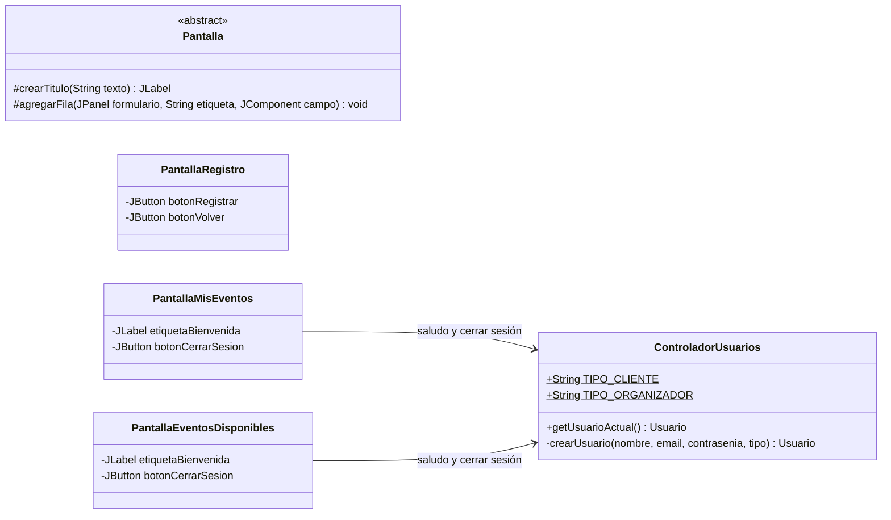

# Bitácora 2026-10-21 · Etapa E5 — Usuarios

> **Cómo responder:** editá este archivo en GitHub, en la rama `desarrollo` (botón ✏️). Completá las respuestas a las decisiones, los pedidos y la aprobación al final. Tiene que estar respondido **antes de las 23:30**: a las 00:00 Claude lee este archivo.

> ℹ️ **Hoy se revisan la E4 y la E5 juntas**, como pidió AgustinSimonenco ayer. Si se aprueba esta bitácora, a la noche se mergean las dos a `main`.

## Resumen

Ya se puede **usar el programa por primera vez**. Al abrirlo aparece el login. Desde ahí la persona se registra como cliente u organizador (CU01), inicia sesión (CU02) y entra a la pantalla de inicio de su rol, que es su "menú". También puede cerrar sesión. Los usuarios se guardan en `datos.dat`, así que siguen estando al volver a abrir el programa. Compila con `javac --release 8` sin errores.

## Estado de aprobaciones anteriores

- **Bitácora del 20/10 (E4): `NO`**, con el comentario "Aun no tuvimos tiempo de revisarlo, de todas formas, sigue con la E5, y siguiente revisaremos E4 y E5 juntas." (AgustinSimonenco).
  - No se pidieron correcciones, así que no hubo nada que corregir antes de la etapa.
  - **No se mergeó a `main`.** `main` sigue con la E3 (el merge del 19/10, hecho el 20/10 por D-007). La E4 y la E5 están solo en `desarrollo`.
- **Bitácoras del 17/10, 18/10 y 19/10:** aprobadas y mergeadas.
- **Días sin respuesta:** ninguno. El 20/10 tuvo respuesta, aunque fue `NO`.
- **Decisiones aplicadas:** no había decisiones abiertas. La D-007 ya se aplicó el 20/10 y la D-006, por defecto, el mismo día.
- **Pedidos del equipo aplicados:** no hubo pedidos.

## Qué se hizo y por qué

### Controlador: `src/controlador/ControladorUsuarios.java` (nuevo)

Es el primero de los cinco controladores del p7. Hereda de `Controlador`, así que ya tiene la `sesion` y la `ventana`.

| Método | Qué hace |
|---|---|
| `registrar(nombre, email, contrasenia, tipo)` | CU01. Crea el usuario con `crearUsuario`, se lo pasa a `DatosSistema.registrarUsuario` (que rechaza un email repetido), guarda, muestra "Listo, Ana. Ya podés iniciar sesión." y vuelve al login. |
| `iniciarSesion(email, contrasenia)` | CU02. Le pide a `DatosSistema.autenticar` el usuario, lo guarda en la sesión y, según `getTipo()`, muestra `MIS_EVENTOS` (organizador) o `EVENTOS_DISPONIBLES` (cliente). |
| `cerrarSesion()` | Pone el usuario actual en `null` y vuelve al login. No guarda: no cambia ningún dato. |
| `getUsuarioActual()` | Lo usan las pantallas de inicio para saludar. |
| `crearUsuario(...)` (privado) | `new Organizador(...)` o `new Cliente(...)` según lo elegido en el combo. |
| `TIPO_CLIENTE`, `TIPO_ORGANIZADOR` | Los textos del combo ("Cliente" y "Organizador"). La pantalla arma el combo con estas constantes, así lo que llega al controlador siempre coincide con lo que compara. |

Los dos métodos principales tienen la misma forma que el ejemplo del p7: `try` → modelo → guardar → mostrar; `catch (SistemaException e)` → `mostrarError`. **No hay ninguna regla en el controlador**: los datos vacíos y el `@` los controla el constructor de `Usuario`, y el email repetido y la contraseña, `DatosSistema`.

### Vista (`src/vista/`)

| Archivo | Qué es |
|---|---|
| `Pantalla.java` (cambió) | Se agregaron dos métodos protegidos que usan todas las pantallas: `crearTitulo(texto)` (el título grande de arriba) y `agregarFila(formulario, etiqueta, campo)` (una fila "Email: [campo]"). Así no se repite el mismo código en cada formulario. |
| `PantallaLogin.java` (nuevo) | Email, contraseña, *Ingresar* y *Registrarse*. Apretar **Enter** en la contraseña también ingresa (el `JPasswordField` avisa a la pantalla igual que un botón). `actualizar()` vacía los campos, así al cerrar sesión no queda la contraseña escrita. |
| `PantallaRegistro.java` (nuevo) | Nombre, email, contraseña, combo de tipo, *Registrar* y *Volver*. `actualizar()` vacía todo y deja elegido "Cliente". |
| `PantallaMisEventos.java` (nuevo) | Inicio del organizador. **Por ahora solo** dice "Hola, Ana. Entraste como organizador." y tiene *Cerrar sesión*. La tabla de eventos y los demás botones se agregan en la E6 a E8. |
| `PantallaEventosDisponibles.java` (nuevo) | Inicio del cliente, igual que la anterior. La tabla de eventos, el carrito y *Mis compras* se agregan en la E8 y la E9. |

Todas implementan `ActionListener` y en `actionPerformed` preguntan `e.getSource() == botonX`, como dice el p7. Para acomodar los componentes se usan tres *layouts* de Swing:

- `BorderLayout` para la pantalla: título arriba (`NORTH`), formulario al medio (`CENTER`) y botones abajo (`SOUTH`).
- `GridLayout(0, 2)` para el formulario: dos columnas, etiqueta y campo. El `0` quiere decir "las filas que hagan falta".
- `FlowLayout` alrededor del formulario y de los botones, para que no se estiren a todo el ancho.

### `Main.java` (cambió)

Ahora crea el `ControladorUsuarios` y las cuatro pantallas, las registra en la ventana con `agregarPantalla` y muestra el login con `ventana.mostrar(LOGIN)`. Se usa `mostrar` y no solo `setVisible` para que el login pase por `actualizar()`, como cualquier otra pantalla.

### Cómo se verificó

- `compilar.sh` compila sin errores ni advertencias.
- Se buscaron construcciones prohibidas (`->`, `::`, `var`, `Optional`, streams, `new ActionListener`): no hay ninguna.
- Claude escribió una prueba **fuera del repo** (no se subió). Usa una ventana "falsa" que imprime los mensajes en lugar de abrir diálogos. Hizo 10 verificaciones y **todas dieron bien**:
  1. Registrar un organizador vuelve al login.
  2. Registrar un cliente también.
  3. Un email repetido ("ANA@mail.com" cuando ya está "ana@mail.com") da error y se queda en el registro.
  4. Un nombre vacío da error.
  5. Un email sin `@` da error.
  6. Una contraseña incorrecta da error y se queda en el login.
  7. Un email inexistente da el mismo error.
  8. El organizador entra a *Mis eventos*.
  9. *Cerrar sesión* vuelve al login y deja la sesión vacía.
  10. Después de volver a cargar el archivo, el cliente sigue registrado y entra a *Eventos disponibles*, aunque escriba el email con mayúsculas.
- **No se abrió la ventana a mano:** de noche no hay nadie para mirarla. Ver "Cómo probarlo".

## Decisiones tomadas por Claude

- **Después de registrarse se vuelve al login**, sin entrar solo. Es lo que ya decía el p9, y así la persona prueba que su email y su contraseña funcionan.
- **Las pantallas de inicio (`PantallaMisEventos` y `PantallaEventosDisponibles`) se crearon hoy, pero mínimas** (saludo y *Cerrar sesión*). Sin ellas, el "menú según el rol" del CU02 no tenía adónde ir. Cada etapa les va agregando lo suyo.
- **Esas dos pantallas reciben también el `ControladorUsuarios`**, para *Cerrar sesión* y el saludo. El p7 solo decía `ControladorEventos` y `ControladorCarrito`. Se actualizó el p7.
- ***Registrarse* y *Volver* llaman directo a `ventana.mostrar(...)`**, sin pasar por el controlador, porque solo cambian de pantalla y no llevan datos. Hacer `controlador.irARegistro()` sería un método que no hace nada más. Se aclaró en el p7 y en el p9.
- **Enter en la contraseña = *Ingresar*.** Es lo que espera cualquiera que usa un login, y es una sola línea (`campoContrasenia.addActionListener(this)`).
- **El saludo dice el rol** ("Entraste como organizador"), para que en la demo se vea claro que el menú depende del tipo de usuario.
- **No se pide repetir la contraseña** en el registro. El CU01 no lo pide y sería un campo más que explicar. Si el equipo lo quiere, se agrega (pedirlo en "Pedidos del equipo").
- **Si falla el guardado al registrarse**, el usuario queda en memoria pero no en el archivo, y se muestra el error. Es muy raro (disco lleno) y deshacerlo complicaría el código.
- **`crearTitulo` y `agregarFila` van en `Pantalla`** y no en una clase nueva, para no sumar clases (la rúbrica premia menos clases).

## Cambios en los diagramas

Lo que cambió hoy en el **p7**:

- **p7:** lo de arriba. Además, en la tabla de pantallas, las dos de inicio ahora dicen que usan `ControladorUsuarios` y que son el menú del CU02. Hay una aclaración nueva sobre los botones que solo navegan.
- **p9:** tres notas en la parte 1: qué pasa al registrarse bien, que *Registrarse* y *Volver* navegan directo y que Enter en la contraseña ingresa. El diagrama no cambió.
- **Secuencias:**
  - **Nueva:** [`CU01-registrar-usuario.md`](../docs/diseno/secuencias/CU01-registrar-usuario.md). No es de los 5 del p8, pero CLAUDE.md pide una por cada caso de uso implementado. Está enlazada desde el p8, en "Otros diagramas".
  - **`CU02-iniciar-sesion.md`:** se agregó lo de Enter. El resto ya coincidía con el código, llamada por llamada.
- **p6:** sin cambios. El modelo ya tenía todo lo que hizo falta.
- **README y PLAN.md:** estado actualizado y casilla de E5 marcada.

## Cómo probarlo

1. Bajar la rama `desarrollo` (`git pull origin desarrollo`).
2. Compilar con `compilar.bat` (o `./compilar.sh`) y ejecutar con `ejecutar.bat` (o `./ejecutar.sh`).
3. **Registro:**
   - Tocar *Registrarse*.
   - Completar "Ana", "ana@mail.com", "123", elegir *Organizador* y tocar *Registrar*.
   - Tiene que aparecer "Listo, Ana. Ya podés iniciar sesión." y volver al login.
4. **Errores del registro:**
   - Registrarse otra vez con "ANA@mail.com": tiene que decir "Ya hay un usuario registrado con ese email."
   - Dejar el nombre vacío: "Completá el nombre, el email y la contraseña."
   - Poner un email sin `@`: "El email no es válido."
5. **Login:**
   - Entrar con "ana@mail.com" y una contraseña mal: "Email o contraseña incorrectos."
   - Con "123" (tocando *Ingresar* o apretando Enter): tiene que abrir **Mis eventos** con "Hola, Ana. Entraste como organizador."
6. Tocar *Cerrar sesión*: vuelve al login con los campos vacíos.
7. Registrar un cliente y entrar: tiene que abrir **Eventos disponibles**.
8. Cerrar el programa, abrirlo de nuevo y entrar con los mismos usuarios: tienen que seguir estando (se guardaron en `datos.dat`).
9. Si algo se ve mal (por ejemplo, campos muy chicos o mal alineados), anotarlo en "Pedidos del equipo".

## Para la defensa

**Recorrido del CU02 (iniciar sesión), de la pantalla al modelo:**

1. La persona escribe email y contraseña y toca *Ingresar*. Swing llama a `PantallaLogin.actionPerformed(e)`, porque la pantalla se registró como *listener* del botón con `addActionListener(this)`.
2. La pantalla ve que `e.getSource() == botonIngresar`. Lee los campos: `campoEmail.getText()` y `new String(campoContrasenia.getPassword())`. Llama a `controlador.iniciarSesion(email, contrasenia)`.
3. `ControladorUsuarios.iniciarSesion` llama a `sesion.getDatos().autenticar(email, contrasenia)`.
4. `DatosSistema.autenticar` busca el usuario con `buscarUsuario`, que recorre la lista y compara con `equalsIgnoreCase`. Después le pregunta al usuario encontrado `validarContrasenia`. Si no hay usuario o la contraseña no coincide, lanza `UsuarioException("Email o contraseña incorrectos.")`.
5. Si todo está bien, el controlador hace `sesion.setUsuarioActual(usuario)` y pregunta `usuario.getTipo()`. Java ejecuta el `getTipo()` de la clase real: `Organizador` devuelve `"ORGANIZADOR"` y `Cliente`, `"CLIENTE"`.
6. Según eso, llama a `ventana.mostrar(VentanaPrincipal.MIS_EVENTOS)` o a `ventana.mostrar(VentanaPrincipal.EVENTOS_DISPONIBLES)`.
7. `VentanaPrincipal.mostrar` busca la pantalla en el `HashMap`, le llama `actualizar()` (que pone "Hola, Ana") y la muestra con el `CardLayout`.

**Recorrido del CU01 (registrarse):** `PantallaRegistro.actionPerformed` → `ControladorUsuarios.registrar` → `crearUsuario` (`new Organizador` o `new Cliente`, cuyo constructor valida en `Usuario`) → `DatosSistema.registrarUsuario` (email repetido) → `Sesion.guardar()` → `PersistenciaArchivo.guardar` (escribe `datos.dat`) → `mostrarMensaje` → `mostrar(LOGIN)`. Está dibujado en `secuencias/CU01-registrar-usuario.md`.

**Preguntas que podría hacer el profesor:**

1. ¿Cómo sabe el programa a qué pantalla ir según el rol, si no usan `instanceof`? — *Por polimorfismo: `getTipo()` es abstracto en `Usuario` y cada subclase lo implementa. El controlador llama siempre al mismo método y Java ejecuta el de la clase real del objeto.*
2. ¿Por qué el controlador no valida que el email tenga `@`? — *Porque la regla es del usuario (GRASP Experto): la valida el constructor de `Usuario`. Así no se puede crear un usuario inválido desde ningún lado, y el controlador solo coordina.*
3. ¿Por qué `PantallaLogin` implementa `ActionListener`? — *Es el patrón Observer de Swing: el botón no conoce a la pantalla, solo sabe que tiene que avisar a sus listeners. La pantalla se anota con `addActionListener(this)` y, cuando la tocan, Swing llama a `actionPerformed`.*
4. ¿Por qué `getPassword()` y no `getText()` en la contraseña? — *`JPasswordField` devuelve la contraseña como arreglo de `char` (`getText` está desaconsejado para ese campo). Con `new String(...)` se convierte a `String` para pasarla al controlador.*
5. ¿Por qué "Registrarse" no pasa por el controlador? — *Porque solo cambia de pantalla, no lleva datos ni toca el modelo. El p7 dice que la pantalla no tiene reglas de negocio, y cambiar de tarjeta no es una regla.*
6. ¿Qué pasa si se registra con un email que ya existe? — *`DatosSistema.registrarUsuario` lanza `UsuarioException`. Sube hasta el `catch (SistemaException e)` del controlador, que llama a `mostrarError`. No se guarda nada y se queda en el registro.*
7. ¿Por qué el mismo mensaje para "email inexistente" y "contraseña incorrecta"? — *Para no dar pistas: si el mensaje fuera distinto, alguien podría averiguar qué emails están registrados probando en el login.*
8. ¿Para qué sirven `TIPO_CLIENTE` y `TIPO_ORGANIZADOR`? — *Son el texto del combo. La pantalla arma el combo con esas constantes y el controlador compara contra ellas. Si alguien cambia el texto, cambia en un solo lugar y no se rompe la comparación.*
9. ¿Por qué `crearTitulo` está en `Pantalla`? — *Para no repetir código (mantenibilidad): todas las pantallas lo heredan. Es protegido porque solo lo usan las subclases.*

## Decisiones pendientes

No hay decisiones pendientes nuevas. Todo lo que hubo que decidir hoy se podía revertir fácil, así que está en "Decisiones tomadas por Claude". La última usada sigue siendo la D-007.

## Pedidos del equipo

Cambios, correcciones o dudas para la próxima noche. Una línea por pedido.

-

## Aprobación

- **Aprobado:** <!-- SÍ o NO -->
- **Comentarios:**
- **Revisó:**
