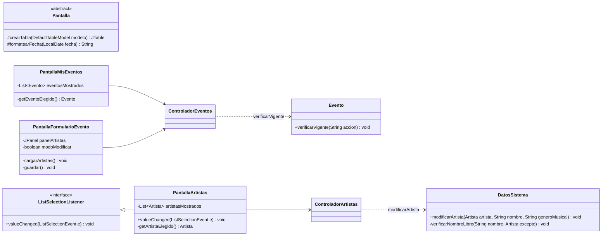

# Bitácora 2026-10-23 · Etapas E6 y E7 — Artistas y eventos

> **Cómo responder:** editá este archivo en GitHub, en la rama `desarrollo` (botón ✏️). Completá las respuestas a las decisiones, los pedidos y la aprobación al final. Tiene que estar respondido **antes de las 23:30**: a las 00:00 Claude lee este archivo.

> ⚠️ **Anoche (22/10) Claude no trabajó:** no hay bitácora del 22/10 ni commits de ese día. Por eso la E6 (que era del 22/10) quedó atrasada y **hoy se hicieron la E6 y la E7 juntas**. Como la E7 era una etapa liviana, alcanzó para las dos. El plan sigue al día.

> ℹ️ **Hoy es el parcial de Java.** Esta bitácora se puede revisar con calma: si no llegan a aprobar hoy, mañana se sigue igual con la E8.

## Resumen

El organizador ya puede **gestionar el catálogo de artistas** (CU15: alta, modificación y baja) y **crear, modificar y cancelar sus eventos** (CU03, CU04 y CU05). "Mis eventos" ahora tiene una tabla con sus eventos y los botones *Nuevo*, *Modificar*, *Cancelar evento* y *Gestionar artistas*. Compila con `javac --release 8` sin errores, y una prueba automática de 27 verificaciones dio todo bien.

## Estado de aprobaciones anteriores

- **Bitácora del 21/10 (E5): sin respuesta.** El campo `Aprobado` quedó vacío. **No se mergeó a `main`.** `main` sigue con la E3; la E4, la E5 y lo de hoy están solo en `desarrollo`.
- **Bitácora del 20/10 (E4): `NO`**, con el pedido de revisar la E4 y la E5 juntas. Sigue pendiente de revisión.
- **Días seguidos sin respuesta:** 1 (el 21/10). El 22/10 no cuenta porque no hubo bitácora. Todavía no se llega a los 3 días que limitarían el trabajo a mejoras menores.
- **Decisiones aplicadas:** no había decisiones abiertas (la última es la D-007, ya cerrada).
- **Pedidos del equipo aplicados:** no hubo pedidos.
- **Para aprobar:** si ponen `SÍ` en esta bitácora, a la noche se mergean a `main` la E4, la E5, la E6 y la E7 juntas (todo lo que está en `desarrollo`).

## Qué se hizo y por qué

### Modelo (cambios chicos)

| Archivo | Cambio | Por qué |
|---|---|---|
| `DatosSistema.java` | Nuevo `modificarArtista(artista, nombre, genero)` | Si el controlador llamaba directo a `Artista.modificar`, se podía renombrar un artista con el nombre de otro. Para controlarlo hay que recorrer el catálogo, y eso lo sabe hacer `DatosSistema` (GRASP Experto). |
| `DatosSistema.java` | Nuevo privado `verificarNombreLibre(nombre, excepto)` | La búsqueda de nombre repetido que antes estaba dentro de `agregarArtista`. Ahora la usan el alta y la modificación, sin repetir el `for`. El parámetro `excepto` es el artista que se está modificando, para que no choque consigo mismo. |
| `DatosSistema.java` | `getEventosDe` ahora llama a `actualizarEstado(hoy)` | Igual que `getEventosDisponibles`. Si no, un evento cuya fecha ya pasó seguía diciendo `ACTIVO` en la tabla del organizador. |
| `Evento.java` | `verificarVigente` pasó de privado a **público** | El controlador lo llama **antes** de abrir el formulario de modificar o de preguntar "¿Cancelar el evento?". Así un evento cancelado da el error enseguida, y no después de completar todo. |

### Controladores (nuevos)

**`ControladorArtistas`** (CU15):

| Método | Qué hace |
|---|---|
| `getArtistas()` | Lista para la tabla. |
| `altaArtista(nombre, genero)` | `new Artista(...)` (valida que no estén vacíos) → `DatosSistema.agregarArtista` (nombre repetido) → guardar → mensaje → recarga la pantalla. |
| `modificarArtista(artista, nombre, genero)` | `DatosSistema.modificarArtista` → guardar → mensaje → recarga. |
| `bajaArtista(artista)` | Pregunta "¿Dar de baja a ...?". Si sí: `DatosSistema.eliminarArtista` (no deja si está en un evento `ACTIVO` o `AGOTADO`) → guardar → mensaje → recarga. |

**`ControladorEventos`** (CU03, CU04, CU05):

| Método | Qué hace |
|---|---|
| `getMisEventos()` | Eventos del organizador que inició sesión. |
| `getArtistas()` | Para la lista de artistas del formulario. |
| `getEventoSeleccionado()` | El formulario lo pregunta para saber si crea o modifica. |
| `nuevoEvento()` | Pone `eventoSeleccionado = null` (modo crear) y abre el formulario. |
| `crearEvento(...)` | Convierte los textos → `new Evento(...)` (valida todo) → `agregarEvento` → guardar → "Evento creado." → Mis eventos. Es exactamente el diagrama del p8. |
| `elegirParaModificar(evento)` | `verificarOrganizador` y `verificarVigente("modificar")` → guarda el evento en `eventoSeleccionado` → abre el formulario. |
| `modificarEvento(...)` | Convierte los textos → `Evento.modificar(...)` (valida y controla que la capacidad no sea menor a lo vendido) → guardar → Mis eventos. |
| `cancelarEvento(evento)` | `verificarOrganizador` y `verificarVigente("cancelar")` → pregunta "¿Cancelar el evento ...?" → `Evento.cancelar()` → guardar → Mis eventos. |

Todos tienen la misma forma que los de la E5: `try` → modelo → guardar → mostrar; `catch (SistemaException e)` → `mostrarError`. **Ninguna regla está en el controlador.**

Los métodos del CU06 (`elegirParaArtistas`, `asignarArtista`, `quitarArtista`) quedan para la E8, como dice el plan.

### Vista

| Archivo | Qué es |
|---|---|
| `Pantalla.java` (cambió) | Dos ayudas nuevas: `crearTabla(modelo)` arma una tabla de solo lectura donde se elige una fila por vez, y `formatearFecha(fecha)` muestra la fecha como `dd/mm/aaaa`. Las van a usar también las pantallas del cliente. |
| `PantallaMisEventos.java` (cambió) | Ahora tiene la **tabla** (nombre, fecha, lugar, capacidad, disponibles, precio, estado) y los botones *Nuevo*, *Modificar*, *Cancelar evento*, *Gestionar artistas* y *Cerrar sesión*. Recibe el `ControladorEventos` además del `ControladorUsuarios`. |
| `PantallaFormularioEvento.java` (nueva) | **Un solo formulario para crear y modificar.** En `actualizar()` le pregunta al controlador `getEventoSeleccionado()`: si es `null`, título "Nuevo evento", campos vacíos y lista de artistas; si no, título "Modificar evento", campos llenos y **sin** lista (los artistas se cambian en el CU06). Tiene *Guardar*, *Nuevo artista* (CU03, 2a) y *Volver*. |
| `PantallaArtistas.java` (nueva) | Tabla con el catálogo, campos nombre y género, y *Alta*, *Modificar*, *Baja*, *Volver*. Al elegir una fila, el nombre y el género se copian a los campos. |
| `Main.java` (cambió) | Crea los dos controladores nuevos y registra las dos pantallas nuevas. |

**Cómo se sabe qué evento eligió la persona:** cada pantalla con tabla guarda la lista que mostró (`eventosMostrados`, `artistasMostrados`) en el mismo orden que las filas. Entonces `eventosMostrados.get(tabla.getSelectedRow())` es el evento de esa fila. Si no hay fila elegida, `getSelectedRow()` da `-1` y la pantalla avisa "Elegí un evento de la tabla.".

**Cómo se arma una tabla:** se crea un `DefaultTableModel` con los nombres de las columnas. En `actualizar()` se borran las filas (`setRowCount(0)`) y se agrega una fila por objeto con `addRow(new Object[] {...})`.

### Cómo se verificó

- `compilar.sh` compila sin errores ni advertencias.
- Se buscaron construcciones prohibidas (`->`, `::`, `var`, `Optional`, streams, `new ActionListener`): no hay ninguna.
- Claude escribió una prueba **fuera del repo** (no se subió) con una ventana "falsa" que guarda los mensajes en lugar de abrir diálogos. Hizo **27 verificaciones y todas dieron bien**. Entre otras:
  - Alta de artista; alta repetida ("SODA stereo" cuando ya está "Soda Stereo") da error; alta con nombre vacío da error.
  - Modificar un artista con el nombre de otro da error; modificar solo el género (mismo nombre) funciona.
  - Crear evento con capacidad "mil", con fecha 31/02/2027, con fecha pasada y sin artistas: los cuatro dan el error correcto y no se crea nada.
  - Crear evento bien, con precio "1500,50" (con coma): queda `ACTIVO` con precio 1500.5.
  - Dar de baja un artista que está en un evento activo da error; elegir "No" en la confirmación no borra; con "Sí" borra.
  - Modificar con capacidad 0 da error; modificar bien cambia los datos; bajar la capacidad a 3 cuando hay 5 vendidas da error.
  - Cancelar con "No" no cambia nada; con "Sí" queda `CANCELADO`; cancelar otra vez da error; *Modificar* un evento cancelado da error y **no abre el formulario**.
  - Un artista que solo está en un evento cancelado sí se puede dar de baja.
  - Otro organizador no ve los eventos de Ana.
  - Después de volver a cargar `datos.dat`, el evento sigue cancelado y con el nombre nuevo.
- Además se abrieron las tres pantallas en una ventana real y se sacó una imagen de cada una: la tabla, el formulario y el catálogo se ven bien acomodados.

## Decisiones tomadas por Claude

- **Hoy se hicieron la E6 y la E7 juntas**, porque la E6 se atrasó un día (anoche no hubo corrida) y la E7 era liviana. Así no se arrastra el atraso a la E8.
- **`DatosSistema.modificarArtista` (método nuevo en el p6)** para que no haya dos artistas con el mismo nombre también al modificar. Era la opción con menos código: el `for` ya existía.
- **`Evento.verificarVigente` público:** mismo criterio que `Compra.verificarCancelable` en el CU14: avisar antes de pedir datos o confirmación.
- **Al elegir una fila en Artistas, los datos pasan a los campos.** Para eso `PantallaArtistas` implementa también `ListSelectionListener` (otra interfaz de Swing, mismo patrón Observer). Sin esto, para modificar había que reescribir el nombre y el género de memoria.
- **La baja de artista pide confirmación**, porque borra y no se puede deshacer. La alta y la modificación no preguntan.
- **Después de alta, modificación o baja se queda en Artistas** con la tabla recargada, para poder seguir cargando artistas.
- ***Gestionar artistas*, *Nuevo artista* y los *Volver* van directo a `ventana.mostrar(...)`**, igual que *Registrarse* en la E5: solo cambian de pantalla. *Nuevo* sí pasa por el controlador porque tiene que dejar el formulario en modo crear.
- **En la tabla de eventos se muestran "Disponibles"** (capacidad menos vendidas) y el precio como "$ 1500,50". El estado se muestra tal cual el enum (`ACTIVO`, `CANCELADO`, …).
- **Al modificar, el precio aparece como "1500.5"** (con punto), porque así lo escribe Java. Se puede guardar igual: el controlador acepta punto o coma.
- **El botón *Artistas del evento* (CU06) todavía no está** en "Mis eventos". Se agrega en la E8, con su pantalla.
- **Para listar eventos se actualiza el estado de cada uno** (`getEventosDe` llama a `actualizarEstado`), así un evento vencido se ve `FINALIZADO` también para el organizador.

## Cambios en los diagramas

Lo que cambió hoy en el **p6** y el **p7**:

- **p6:** `modificarArtista` y `verificarNombreLibre` en `DatosSistema`; `verificarVigente` ahora público; nueva fila en la tabla de reglas (nombre de artista repetido); sección nueva "Cambios hechos al programar artistas y eventos (23/10)".
- **p7:** atributos y métodos reales de `PantallaMisEventos`, `PantallaFormularioEvento` y `PantallaArtistas`; `ListSelectionListener`; ayudas nuevas de `Pantalla`; explicación de las tablas; descripción de `ControladorEventos` y `ControladorArtistas`; trazabilidad de CU04, CU05 y CU15 actualizada.
- **p9:** el diagrama no cambió. Se agregaron notas: evento cancelado al tocar *Modificar* o *Cancelar evento*, qué pasa después de alta/modificación/baja de artista y qué botones navegan directo.
- **Secuencias:**
  - **Nuevas:** [`CU04-modificar-evento.md`](../docs/diseno/secuencias/CU04-modificar-evento.md), [`CU05-cancelar-evento.md`](../docs/diseno/secuencias/CU05-cancelar-evento.md) y [`CU15-gestionar-artistas.md`](../docs/diseno/secuencias/CU15-gestionar-artistas.md). Enlazadas desde el p8, en "Otros diagramas".
  - **`CU03-crear-evento.md`** (del p8): se comparó llamada por llamada con `crearEvento` y coincide; no hubo que cambiarlo.
- **README y PLAN.md:** estado actualizado y casillas de E6 y E7 marcadas.

## Cómo probarlo

1. Bajar la rama `desarrollo` (`git pull origin desarrollo`).
2. Compilar con `compilar.bat` (o `./compilar.sh`) y ejecutar con `ejecutar.bat` (o `./ejecutar.sh`).
3. Entrar con un organizador (si no hay, registrarse como en la E5).
4. **Artistas (CU15):**
   - Tocar *Gestionar artistas*. Escribir "Soda Stereo" y "Rock" y tocar *Alta*: aparece en la tabla.
   - Dar de alta otra vez "soda stereo": tiene que decir "Ya existe un artista llamado soda stereo."
   - Tocar una fila: el nombre y el género pasan a los campos. Cambiar el género y tocar *Modificar*.
   - Agregar un segundo artista y darlo de baja con *Baja* → *Sí*.
   - Tocar *Modificar* sin elegir fila: "Elegí un artista de la tabla."
5. **Crear evento (CU03):** *Volver* → *Nuevo*. Completar nombre, fecha (por ejemplo 15/12/2026), lugar, capacidad 100, precio 1500,50, elegir un artista y *Guardar*. Tiene que aparecer en la tabla como `ACTIVO`.
   - Probar errores: capacidad "mil", fecha "31/02/2027", fecha pasada o ningún artista elegido.
6. **Modificar (CU04):** elegir el evento → *Modificar*. El formulario viene lleno y sin lista de artistas. Cambiar el lugar y *Guardar*.
7. **Cancelar (CU05):** elegir el evento → *Cancelar evento* → *Sí*. La tabla dice `CANCELADO`. Probar *Modificar* sobre ese evento: tiene que dar error sin abrir el formulario.
8. **Baja con evento:** crear otro evento con un artista y tratar de dar de baja a ese artista: tiene que decir que está en el evento.
9. Cerrar y volver a abrir el programa: todo tiene que seguir igual.
10. Si algo se ve mal (columnas, tamaños, textos), anotarlo en "Pedidos del equipo".

## Para la defensa

**Recorrido del CU03 (crear evento), de la pantalla al archivo:**

1. En "Mis eventos" se toca *Nuevo*. `PantallaMisEventos.actionPerformed` llama a `controlador.nuevoEvento()`, que pone `eventoSeleccionado = null` y hace `ventana.mostrar(FORMULARIO_EVENTO)`.
2. `VentanaPrincipal.mostrar` llama a `PantallaFormularioEvento.actualizar()`. Como `getEventoSeleccionado()` es `null`, la pantalla queda en modo crear: campos vacíos y la lista con los artistas del catálogo.
3. La persona completa los datos, elige artistas (Ctrl + clic) y toca *Guardar*. `actionPerformed` llama al método privado `guardar()`, que como no está en modo modificar llama a `controlador.crearEvento(...)` con los textos y `listaArtistas.getSelectedValuesList()`.
4. `ControladorEventos.crearEvento` convierte la fecha, la capacidad y el precio con los métodos heredados de `Controlador`. Si "mil" no es un número, `convertirEntero` lanza `DatosInvalidosException` y se va directo al `catch`.
5. Pide a `DatosSistema` un id nuevo y hace `new Evento(...)`. El constructor valida todo (nombre y lugar, fecha futura, capacidad > 0, precio ≥ 0, al menos un artista). Si algo falla, el objeto no llega a existir.
6. `DatosSistema.agregarEvento(evento)` → `sesion.guardar()` → `PersistenciaArchivo.guardar` escribe `datos.dat`.
7. `mostrarMensaje("Evento creado.")` y `mostrar(MIS_EVENTOS)`: la tabla se recarga con `getMisEventos()` y aparece el evento nuevo.

**Recorrido del CU04 (modificar):** fila elegida → `elegirParaModificar(evento)` → `verificarOrganizador` y `verificarVigente("modificar")` → `eventoSeleccionado = evento` → el formulario, en `actualizar()`, ve que no es `null` y llena los campos → *Guardar* → `modificarEvento(...)` → `Evento.modificar(...)` → guardar. Dibujado en `secuencias/CU04-modificar-evento.md`.

**Recorrido del CU05 (cancelar):** fila elegida → `cancelarEvento(evento)` → `verificarOrganizador` y `verificarVigente("cancelar")` → `ventana.confirmar(...)` → `Evento.cancelar()` → guardar. Dibujado en `secuencias/CU05-cancelar-evento.md`.

**Recorrido del CU15 (artistas):** *Alta* → `altaArtista` → `new Artista` (no vacío) → `DatosSistema.agregarArtista` → `verificarNombreLibre` → guardar. Dibujado en `secuencias/CU15-gestionar-artistas.md`.

**Preguntas que podría hacer el profesor:**

1. ¿Cómo sabe el formulario si tiene que crear o modificar? — *Le pregunta al controlador `getEventoSeleccionado()`. Si es `null`, se llegó con *Nuevo* y crea; si hay un evento, se llegó con *Modificar*. El controlador guarda ese evento entre las dos pantallas.*
2. ¿Por qué un solo formulario para crear y modificar? — *Para no repetir código (mantenibilidad) y tener una clase menos. Los campos son los mismos; solo cambia el título, si se muestra la lista de artistas y qué método del controlador se llama.*
3. ¿Dónde se valida que la fecha sea futura? — *En `Evento.validarDatos`, que lo usan el constructor y `modificar`. El controlador solo convierte el texto a `LocalDate`; si el texto no es una fecha, lanza `DatosInvalidosException`.*
4. ¿Por qué `verificarVigente` se llama en el controlador si `modificar` y `cancelar` ya lo llaman? — *Para avisar antes de abrir el formulario o de preguntar "¿seguro?". La llamada de adentro de `Evento` es la que protege la regla siempre; la del controlador es para que la persona no complete algo para nada.*
5. ¿Cómo sabe la pantalla qué evento es la fila elegida? — *Guarda la lista que mostró (`eventosMostrados`) en el mismo orden que las filas. `getSelectedRow()` da el número de fila, y con ese número se hace `get` en la lista.*
6. ¿Por qué no se puede renombrar un artista con el nombre de otro, y quién lo controla? — *`DatosSistema.modificarArtista`, porque es la clase que tiene la lista de todos los artistas (Experto). Usa `verificarNombreLibre`, el mismo método que el alta, pasándole el artista que se modifica para que no choque consigo mismo.*
7. ¿Por qué no se puede dar de baja un artista que está en un evento? — *Porque el evento quedaría con un artista que ya no existe en el catálogo. Lo controla `DatosSistema.eliminarArtista` recorriendo los eventos `ACTIVO` o `AGOTADO`. Si el evento está cancelado o finalizado, sí se puede.*
8. ¿Qué pasa con las compras de un evento que se cancela? — *No se cancelan solas (lo dice el p3). El evento ya no se puede comprar, y cada cliente puede cancelar su compra con el CU14.*
9. ¿Qué es `ListSelectionListener`? — *Una interfaz de Swing, como `ActionListener`. La tabla avisa a la pantalla cada vez que cambia la fila elegida llamando a `valueChanged`. La usamos para copiar el nombre y el género a los campos. Es el mismo patrón Observer.*
10. ¿Por qué la tabla no se puede editar haciendo doble clic? — *Porque `crearTabla` le saca el editor (`setDefaultEditor(Object.class, null)`). Los datos solo se cambian con los botones, que pasan por el controlador y el modelo, donde están las validaciones.*

## Decisiones pendientes

No hay decisiones pendientes nuevas. Todo lo de hoy se puede revertir fácil, así que está en "Decisiones tomadas por Claude". La última usada sigue siendo la D-007.

## Pedidos del equipo

Cambios, correcciones o dudas para la próxima noche. Una línea por pedido.

-

## Aprobación

- **Aprobado:** <!-- SÍ o NO -->
- **Comentarios:**
- **Revisó:**
