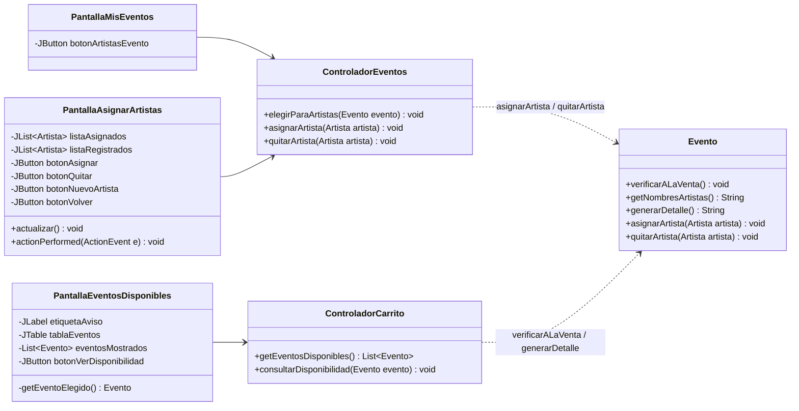

# Bitácora 2026-10-24 · Etapa E8 — Asignación de artistas y consulta de eventos

> **Cómo responder:** editá este archivo en GitHub, en la rama `desarrollo` (botón ✏️). Completá las respuestas a las decisiones, los pedidos y la aprobación al final. Tiene que estar respondido **antes de las 23:30**: a las 00:00 Claude lee este archivo.

> ⚠️ **Van 2 bitácoras seguidas sin respuesta** (21/10 y 23/10). Si esta también queda sin respuesta, mañana se llega a 3 y, según CLAUDE.md, la etapa de mañana (E9, carrito) se limita a **mejoras menores y revisión de consistencia**. Eso atrasaría el plan justo antes del Seguimiento II (27/10). Alcanza con poner `SÍ` o `NO` en "Aprobación".

## Resumen

El organizador ya puede **asignar y quitar artistas de un evento** (CU06) desde el botón nuevo *Artistas del evento*. El cliente, al entrar, ve la **tabla de eventos disponibles** (CU07) y puede **ver la disponibilidad** de uno (CU08). Compila con `javac --release 8` sin errores y una prueba automática de 25 verificaciones dio todo bien.

## Estado de aprobaciones anteriores

- **Bitácora del 23/10 (E6 y E7): sin respuesta.** El campo `Aprobado` quedó vacío. **No se mergeó a `main`.**
- **Bitácora del 21/10 (E5): sin respuesta.**
- **Bitácora del 20/10 (E4): `NO`**, con el pedido de revisar la E4 y la E5 juntas. Sigue pendiente de esa revisión.
- **`main` sigue con la E3.** La E4, E5, E6, E7 y lo de hoy (E8) están solo en `desarrollo`.
- **Días seguidos sin respuesta:** 2 (21/10 y 23/10; el 22/10 no hubo bitácora y no cuenta). Ver el aviso de arriba.
- **Decisiones aplicadas:** no había decisiones abiertas (la última era la D-007, ya cerrada).
- **Pedidos del equipo aplicados:** no hubo pedidos.
- **Para aprobar:** si ponen `SÍ` en esta bitácora, a la noche se mergea a `main` todo lo que está en `desarrollo` (E4 a E8).

## Qué se hizo y por qué

### Modelo (`Evento.java`)

| Cambio | Por qué |
|---|---|
| Nuevo `verificarALaVenta()` | El CU08 pide un mensaje distinto para un evento cancelado (2a: "fue cancelado y no tiene entradas a la venta") y para uno que ya pasó (2b: "ya se realizó"). Antes ese control estaba dentro de `verificarDisponibilidad` con un solo mensaje. Ahora `verificarDisponibilidad` llama a `verificarALaVenta`, así el control está escrito una sola vez. |
| Nuevo `getNombresArtistas()` | Devuelve "Soda Stereo, Charly García". Lo usan la tabla del cliente y el detalle. Lo hace `Evento` porque tiene la lista de artistas (Experto). Se hizo con un `for` y concatenación, sin streams. |
| Nuevo `generarDetalle()` | Arma el texto del CU08 (nombre, fecha, lugar, artistas, precio, disponibles). Si quedan 0 entradas dice "0 (AGOTADO)" (3a). Es la misma idea que `Comprobante.generarTexto()`. |
| `asignarArtista` y `quitarArtista` llaman a `verificarVigente` | Precondición del CU06: el evento no está cancelado. Antes el modelo dejaba cambiar los artistas de un evento cancelado. Ahora pueden lanzar también `EventoException`. |

### Controladores

**`ControladorEventos`** (CU06, métodos nuevos):

| Método | Qué hace |
|---|---|
| `elegirParaArtistas(evento)` | `verificarOrganizador` y `verificarVigente("cambiar los artistas de")` → guarda el evento en `eventoSeleccionado` → abre `PantallaAsignarArtistas`. Es igual a `elegirParaModificar`. |
| `asignarArtista(artista)` | `eventoSeleccionado.asignarArtista(artista)` (no deja repetidos, 3a) → guardar → mensaje → recarga la pantalla. |
| `quitarArtista(artista)` | `eventoSeleccionado.quitarArtista(artista)` (no deja quitar el último, 3c) → guardar → mensaje → recarga la pantalla. |

**`ControladorCarrito`** (nuevo; en la E9 se le agregan los métodos del carrito):

| Método | Qué hace |
|---|---|
| `getEventosDisponibles()` | CU07: devuelve `DatosSistema.getEventosDisponibles(hoy)` (solo los `ACTIVO`, con el estado actualizado). |
| `consultarDisponibilidad(evento)` | CU08: `actualizarEstado(hoy)` → `verificarALaVenta()` → `mostrarTexto("Disponibilidad", evento.generarDetalle())`. Si falla, muestra el error y recarga la tabla para que el evento desaparezca. |

Todos tienen la misma forma de siempre: `try` → modelo → guardar (si cambia algo) → mostrar; `catch (SistemaException e)` → `mostrarError`.

### Vista

| Archivo | Qué es |
|---|---|
| `PantallaAsignarArtistas.java` (nueva) | Dos listas lado a lado: **Artistas del evento** con el botón *Quitar del evento*, y **Artistas registrados** (todo el catálogo) con *Asignar al evento*. Abajo *Nuevo artista* (CU06, 3b: lleva a `PantallaArtistas`) y *Volver*. El título dice "Artistas de *nombre del evento*". |
| `PantallaMisEventos.java` (cambió) | Botón nuevo *Artistas del evento*, entre *Cancelar evento* y *Gestionar artistas*. Necesita una fila elegida, igual que *Modificar*. |
| `PantallaEventosDisponibles.java` (cambió) | Ya no es solo un saludo: tiene la **tabla** (nombre, fecha, lugar, artistas, precio, disponibles), un **aviso** debajo del saludo ("Por ahora no hay eventos disponibles." si la tabla está vacía, CU07 2a) y el botón *Ver disponibilidad*. Recibe el `ControladorCarrito`. |
| `Main.java` (cambió) | Crea el `ControladorCarrito` y registra `PantallaAsignarArtistas`. |

**Cómo se sabe qué artista se eligió:** en una `JList<Artista>`, `getSelectedValue()` devuelve directamente el objeto `Artista` (no hace falta una lista aparte como en las tablas). Si no hay ninguno elegido, devuelve `null` y la pantalla avisa.

### Cómo se verificó

- `compilar.sh` compila sin errores ni advertencias.
- Se buscaron construcciones prohibidas (`->`, `::`, `var`, `Optional`, streams, `new ActionListener`): no hay ninguna.
- Claude escribió una prueba **fuera del repo** (no se subió) con una ventana "falsa" que guarda los mensajes en lugar de abrir diálogos. **25 verificaciones, todas bien.** Entre otras:
  - CU06: elegir un evento propio abre la pantalla; asignar un artista que ya está da "ya está en el evento"; asignar otro funciona; quitar uno que no está da error; quitar uno de dos funciona; quitar el último da "El evento tiene que tener al menos un artista."; un evento de otro organizador da error; un evento cancelado da "No se puede cambiar los artistas de un evento cancelado." y no abre la pantalla; llamar directo a `Evento.asignarArtista` sobre un cancelado lanza `EventoException`.
  - CU07: solo aparecen los eventos `ACTIVO` (no los cancelados, agotados ni pasados); con el sistema vacío aparece el aviso.
  - CU08: el detalle muestra fecha, lugar, artistas, precio "$1500,50" y disponibles; un evento agotado dice "0 (AGOTADO)"; uno cancelado da el error del 2a y recarga la tabla; uno cuya fecha ya pasó queda `FINALIZADO` y da el error del 2b.
  - `verificarDisponibilidad` (lo usa el carrito) sigue funcionando igual: cancelado da `EventoException` y sin lugar da `SinDisponibilidadException`.
  - Después de volver a cargar `datos.dat`, los artistas del evento siguen como quedaron.
- Además se dibujaron las tres pantallas en una imagen (Mis eventos con el botón nuevo, Artistas del evento y Eventos disponibles): se ven bien acomodadas.

## Decisiones tomadas por Claude

- **En el CU06 se elige un artista por vez.** El caso de uso dice "uno o más", pero así cada error (3a, 3c) habla de un solo artista y el código es más simple. Para asignar varios se toca *Asignar al evento* varias veces. Coincide con la firma `asignarArtista(Artista)` que ya estaba en el p7.
- **La lista de registrados muestra todo el catálogo**, también los que ya están en el evento. Si se elige uno de esos, el modelo avisa que ya está: así se ve el flujo 3a tal cual lo describe el caso de uso.
- **Después de asignar o quitar se muestra un mensaje corto** ("X se agregó al evento.") y se queda en la misma pantalla, igual que en la gestión de artistas.
- **`Evento.asignarArtista` y `quitarArtista` controlan que el evento esté vigente**, además del controlador. La del controlador evita abrir la pantalla para nada; la del modelo asegura la regla siempre.
- **CU07, "no hay eventos" se avisa con una etiqueta y no con un diálogo**, porque un diálogo saltaría cada vez que el cliente entra o vuelve a la pantalla.
- **CU08 muestra el detalle en un diálogo** (`mostrarTexto`, el mismo del comprobante) y no en una pantalla nueva: una clase menos.
- **El texto del detalle lo arma `Evento.generarDetalle()`**, en el modelo, igual que el comprobante. Así el controlador no tiene que formatear fechas ni calcular disponibles.
- **Si al consultar el evento resulta cancelado o pasado, se recarga la tabla** para que desaparezca. Es el único controlador que llama a `mostrar` dentro del `catch`; tiene un comentario que lo explica.
- **`ControladorCarrito` se creó hoy** con solo los dos métodos de consulta, porque el p7 ya asigna CU07 y CU08 a ese controlador. En la E9 se le agregan los del carrito.
- **La columna "Artistas" de la tabla del cliente puede quedar cortada** con "..." si hay muchos artistas. El detalle de *Ver disponibilidad* los muestra completos.

## Cambios en los diagramas

Lo que cambió hoy en el **p6** y el **p7**:

- **p6:** `verificarALaVenta`, `getNombresArtistas` y `generarDetalle` en `Evento`; tabla de reglas actualizada (evento cancelado no cambia artistas; nueva fila del CU08); sección nueva "Cambios hechos al programar la asignación y la consulta (24/10)".
- **p7:** atributos reales de `PantallaAsignarArtistas` y `PantallaEventosDisponibles`; botón nuevo de `PantallaMisEventos`; explicación de las listas; descripción del CU06 en `ControladorEventos` y de `ControladorCarrito`; trazabilidad de CU06, CU07 y CU08 actualizada; nota de lo que falta para la E9.
- **p9:** el diagrama no cambió (las flechas del CU06 y del CU08 ya estaban). Se agregaron notas: *Artistas del evento* con un evento cancelado, qué pasa después de asignar o quitar, el aviso de "no hay eventos" y qué pasa si el evento consultado ya no está a la venta.
- **Secuencias nuevas:** [`CU06-asignar-artistas.md`](../docs/diseno/secuencias/CU06-asignar-artistas.md), [`CU07-consultar-eventos-disponibles.md`](../docs/diseno/secuencias/CU07-consultar-eventos-disponibles.md) y [`CU08-consultar-disponibilidad.md`](../docs/diseno/secuencias/CU08-consultar-disponibilidad.md). Enlazadas desde el p8, en "Otros diagramas".
- **`CU09-agregar-entradas-al-carrito.md`** (del p8): se revisó. Sigue siendo correcto, porque `verificarDisponibilidad` lanza las mismas excepciones que antes; solo cambió el texto del mensaje para un evento cancelado.
- **README y PLAN.md:** estado actualizado y casilla de la E8 marcada.

## Cómo probarlo

1. Bajar la rama `desarrollo` (`git pull origin desarrollo`).
2. Compilar con `compilar.bat` (o `./compilar.sh`) y ejecutar con `ejecutar.bat` (o `./ejecutar.sh`).
3. Entrar con un organizador. Si no hay artistas ni eventos, crear dos o tres artistas y un evento con uno solo (como en la bitácora del 23/10).
4. **Asignar artistas (CU06):**
   - Elegir el evento → *Artistas del evento*. A la izquierda tiene que estar su artista; a la derecha, todo el catálogo.
   - Elegir a la derecha el mismo artista que ya tiene y tocar *Asignar al evento*: "... ya está en el evento."
   - Elegir otro y *Asignar al evento*: aparece a la izquierda.
   - Elegir a la izquierda uno de los dos y *Quitar del evento*: desaparece. Tratar de quitar el que queda: "El evento tiene que tener al menos un artista."
   - Tocar *Asignar al evento* sin elegir nada: "Elegí un artista de la lista de registrados."
   - *Nuevo artista* lleva al catálogo; *Volver* vuelve a Mis eventos.
   - Cancelar un evento y tocar *Artistas del evento* sobre él: tiene que dar error sin abrir la pantalla.
5. *Cerrar sesión* y registrarse o entrar como **cliente**.
6. **Eventos disponibles (CU07):** tiene que aparecer la tabla con los eventos activos y sus artistas. Los cancelados no aparecen. (Con un sistema sin eventos activos aparece "Por ahora no hay eventos disponibles.")
7. **Disponibilidad (CU08):** elegir una fila → *Ver disponibilidad*. Aparece un diálogo con fecha, lugar, artistas, precio y entradas disponibles. Sin fila elegida: "Elegí un evento de la tabla."
8. Cerrar y volver a abrir el programa: los artistas de cada evento tienen que seguir como quedaron.
9. Si algo se ve mal (tamaños, textos), anotarlo en "Pedidos del equipo".

## Para la defensa

**Recorrido del CU06 (asignar un artista), de la pantalla al archivo:**

1. En "Mis eventos" se elige una fila y se toca *Artistas del evento*. `PantallaMisEventos.actionPerformed` busca el evento con `getEventoElegido()` y llama a `controlador.elegirParaArtistas(evento)`.
2. `ControladorEventos.elegirParaArtistas` llama a `evento.verificarOrganizador(...)` y `evento.verificarVigente("cambiar los artistas de")`. Si el evento está cancelado, salta la `EventoException` al `catch` y se muestra el error. Si no, guarda `eventoSeleccionado = evento` y hace `ventana.mostrar(ASIGNAR_ARTISTAS)`.
3. `VentanaPrincipal.mostrar` llama a `PantallaAsignarArtistas.actualizar()`, que le pide al controlador `getEventoSeleccionado()` y llena las dos listas: `evento.getArtistas()` y `controlador.getArtistas()`.
4. Se elige un artista a la derecha y se toca *Asignar al evento*. `actionPerformed` toma `listaRegistrados.getSelectedValue()` y llama a `controlador.asignarArtista(artista)`.
5. `ControladorEventos.asignarArtista` llama a `eventoSeleccionado.asignarArtista(artista)`. `Evento` vuelve a controlar que esté vigente y que el artista no esté ya (`tieneArtista`); si ya está, lanza `ArtistaException` (3a). Si no, lo agrega a su lista.
6. `sesion.guardar()` → `PersistenciaArchivo.guardar` escribe `datos.dat`. Después `mostrarMensaje(...)` y `mostrar(ASIGNAR_ARTISTAS)`, que vuelve a llamar a `actualizar()` y las listas muestran el cambio.

**Recorrido del CU07:** login de cliente → `ControladorUsuarios.iniciarSesion` → `mostrar(EVENTOS_DISPONIBLES)` → `PantallaEventosDisponibles.actualizar()` → `ControladorCarrito.getEventosDisponibles()` → `DatosSistema.getEventosDisponibles(hoy)`, que a cada evento le hace `actualizarEstado(hoy)` y se queda con los que `estaActivo()`. Dibujado en `secuencias/CU07-consultar-eventos-disponibles.md`.

**Recorrido del CU08:** fila elegida → *Ver disponibilidad* → `ControladorCarrito.consultarDisponibilidad(evento)` → `evento.actualizarEstado(hoy)` → `evento.verificarALaVenta()` → `evento.generarDetalle()` → `ventana.mostrarTexto(...)`. Dibujado en `secuencias/CU08-consultar-disponibilidad.md`.

**Preguntas que podría hacer el profesor:**

1. ¿Quién controla que un artista no se asigne dos veces? — *`Evento.asignarArtista`, con `tieneArtista`. Es el experto porque la lista de artistas del evento está en `Evento`. El controlador solo captura la `ArtistaException` y muestra el mensaje.*
2. ¿Por qué un evento no puede quedarse sin artistas? — *Porque en el diagrama de clases la relación `Evento`–`Artista` es `1..*` y así se decidió en la D-002. `Evento.quitarArtista` lanza `ArtistaException` si es el último.*
3. ¿Cómo sabe `PantallaAsignarArtistas` de qué evento son los artistas? — *Se lo pregunta al controlador con `getEventoSeleccionado()`. El controlador lo guardó en `elegirParaArtistas`. Es el mismo atributo que usa el formulario para modificar.*
4. ¿Por qué se controla dos veces que el evento no esté cancelado? — *La del controlador es para no abrir la pantalla en vano. La de adentro de `Evento` protege la regla aunque alguien llame directo al modelo. Es el mismo criterio que en el CU04.*
5. ¿Qué diferencia hay entre `verificarALaVenta` y `verificarDisponibilidad`? — *`verificarALaVenta` solo mira el estado (cancelado o finalizado). `verificarDisponibilidad(cantidad)` primero llama a `verificarALaVenta` y después mira si alcanzan las entradas. El CU08 usa la primera; el carrito (CU09) usa la segunda. Así el control del estado está escrito una sola vez.*
6. ¿Por qué se llama a `actualizarEstado` antes de consultar? — *El estado no cambia solo con el tiempo: un evento que ayer estaba `ACTIVO` hoy puede haber pasado. `actualizarEstado(hoy)` lo pasa a `FINALIZADO` si la fecha ya pasó.*
7. ¿Dónde se calculan las entradas disponibles? — *En `Evento.getEntradasDisponibles()`: capacidad menos vendidas. Lo usan la tabla, el detalle y `verificarDisponibilidad`.*
8. ¿Por qué el detalle lo arma el modelo y no la pantalla? — *Porque lo muestra el controlador con `mostrarTexto`, igual que el comprobante (`Comprobante.generarTexto`). Así el controlador no formatea nada y el texto lo arma quien tiene los datos.*
9. ¿Qué pasa en el CU07 si no hay eventos? — *La tabla queda vacía y la etiqueta de aviso dice "Por ahora no hay eventos disponibles." (2a). Lo decide la pantalla mirando si la lista vino vacía; eso es mostrar, no una regla de negocio.*
10. ¿Por qué `ControladorCarrito` tiene métodos de consulta de eventos? — *Porque el p7 tiene un controlador por módulo, y la consulta del cliente es la entrada a la compra: CU09 incluye CU08. En la E9 el mismo controlador agrega las entradas al carrito.*

## Decisiones pendientes

### D-008 · ¿Mostrar al cliente los eventos agotados?

- **Contexto:** el CU07 dice "eventos activos **con entradas disponibles**", así que hoy la tabla del cliente muestra solo los `ACTIVO`. Un evento `AGOTADO` desaparece de la lista. Por eso el flujo **3a del CU08** ("no quedan entradas → se muestra como AGOTADO") nunca se ve desde la pantalla, aunque el código ya lo tiene preparado (`generarDetalle` escribe "0 (AGOTADO)").
- **Opciones:**
  - (a) Dejarlo como está: solo eventos `ACTIVO`. Es lo que dice el CU07 al pie de la letra.
  - (b) Mostrar también los `AGOTADO`, con 0 en "Disponibles". Así el cliente entiende por qué no puede comprar y el 3a del CU08 se puede mostrar en la defensa. Cambia una línea en `DatosSistema.getEventosDisponibles` y la descripción del CU07 (que pasaría a decir "eventos activos o agotados").
- **Recomendación de Claude:** (b), porque hace visible un flujo alternativo que hoy no se puede ver, y el carrito igual rechaza un agotado con `SinDisponibilidadException`.
- **Si no hay respuesta:** se aplica (a), es decir, queda como está (es lo que dice el caso de uso hoy).
- **Respuesta del equipo:**
- **Respondió:**

## Pedidos del equipo

Cambios, correcciones o dudas para la próxima noche. Una línea por pedido.

-

## Aprobación

- **Aprobado:** <!-- SÍ o NO -->
- **Comentarios:**
- **Revisó:**
