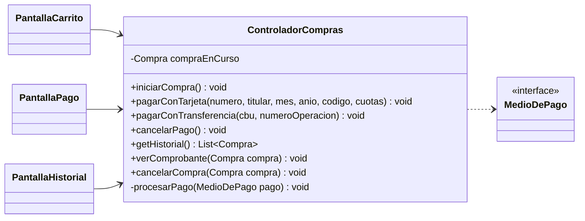

# Bitácora 2026-11-06 · Etapas E9 a E16 — Proyecto terminado

> ℹ️ **Esta bitácora no salió de la corrida nocturna.** Agustín pidió por chat terminar todo el proyecto de punta a punta. Dijo que el trabajo ya estaba aprobado y dio libertad para todas las decisiones. Por eso se hicieron juntas todas las etapas que faltaban y se mergeó a `main`.

## Resumen

El programa está **terminado**: los 15 casos de uso funcionan desde la interfaz. Se agregaron el carrito, la compra, los dos medios de pago, el comprobante, el historial y la cancelación de compras. También hay datos de ejemplo para la demo, 62 tests JUnit, manual de uso, guía de defensa y los diagramas al día.

## Estado de aprobaciones anteriores

- **Las bitácoras del 21/10, 23/10 y 24/10 quedaron con el campo `Aprobado` vacío.** La aprobación llegó por chat el 06/11: *"Ya aprobamos todo el trabajo"*.
- **Merge a `main`:** se hizo después de esta bitácora, con `git merge --no-ff`. Lleva a `main` desde la E4 hasta la E16. **El código de hoy (E9 a E16) el equipo todavía no lo revisó:** la aprobación fue anterior a que existiera. Si algo no convence, se revierte con un commit nuevo.
- **Decisiones aplicadas:** D-008 (ver abajo).
- **Pedidos del equipo:** la corrección del profesor sobre el orden de los diagramas de secuencia ya se había aplicado el 02/11.
- **No hubo corridas nocturnas desde el 25/10.** Por eso la E9 a la E16 se acumularon.

## Qué se hizo y por qué

### E9 a E12: compra completa

| Archivo | Qué es |
|---|---|
| `ControladorCarrito` (cambió) | Suma `getCarrito`, `agregarAlCarrito`, `cambiarCantidad` y `quitarItem` (CU09). |
| `ControladorCompras` (nuevo) | `iniciarCompra` (CU10), `pagarConTarjeta` y `pagarConTransferencia` (CU11), `cancelarPago`, `getHistorial` (CU13), `verComprobante` (CU12) y `cancelarCompra` (CU14). Los dos pagos terminan en el mismo método privado `procesarPago`, que recibe un `MedioDePago`. |
| `PantallaCarrito` (nueva) | Ítems, total, *Cambiar cantidad*, *Quitar*, *Confirmar compra* y *Seguir comprando*. |
| `PantallaPago` (nueva) | Monto, opción de tarjeta o transferencia y el formulario de la opción elegida. |
| `PantallaHistorial` (nueva) | Tabla de compras, *Ver comprobante*, *Cancelar compra* y *Volver*. |
| `PantallaEventosDisponibles` (cambió) | Suma cantidad, *Agregar al carrito*, *Carrito* y *Mis compras*. |
| `Comprobante.generarTexto` (cambió) | Ahora tiene todo lo que pide el CU12: email, lugar, cantidad, precio, subtotal y códigos, agrupados por evento. |
| `Compra.getNombresEventos` (nuevo) | Nombres de los eventos para la tabla del historial, con "(CANCELADO)" si corresponde. |

### E13: tests

64 tests JUnit en `test/`, que se ejecutan con `probar.bat`. Cubren `Evento`, `Carrito`, `Compra`, los pagos, `DatosSistema`, la persistencia y los datos de ejemplo. Se usa `try` / `fail` / `catch` y no `assertThrows`, porque `assertThrows` necesita una lambda y las reglas del proyecto no las permiten.

### E14: robustez y datos de ejemplo

Al revisar qué podía romperse aparecieron tres problemas reales, ya corregidos y con su test cuando corresponde:

| Problema | Qué pasaba | Arreglo |
|---|---|---|
| Cantidad enorme en el carrito | Con dos cantidades enormes, la suma se desbordaba, daba negativa y **pasaba la verificación**. | `Carrito.agregarItem` suma en un `long`, y `Evento.verificarDisponibilidad` recibe un `long`. |
| Año de vencimiento enorme | `YearMonth.of` lanzaba una excepción que nadie capturaba. | `PagoTarjeta.validarVencimiento` controla el rango. |
| Precio "NaN" o "Infinity" | `Double.parseDouble` los acepta, y `NaN` pasaba la validación de precio negativo. | `Controlador.convertirDecimal` los rechaza. |

Además, un agente independiente auditó el código y los documentos, y encontró errores que los tests no habían visto. Se corrigieron estos:

| Problema | Qué pasaba | Arreglo |
|---|---|---|
| Reintegro de un evento cancelado | Al llegar la fecha, el cliente ya no podía cancelar la compra, aunque el evento nunca se hizo. Contradecía la D-003. | `Compra.verificarCancelable` no aplica el límite de fecha a un evento cancelado. |
| Fallo al guardar después de pagar | El cliente no veía el comprobante de una compra ya pagada. | El comprobante se muestra en un `finally`. |
| Fallo al guardar después de cancelar | La tabla seguía diciendo `CONFIRMADA`. | El historial se recarga antes de guardar. |
| Requisito de JDK | Los documentos decían JDK 8, pero `--release` no existe en ese `javac`. | Manual y README dicen JDK 9 o más nuevo. |
| Casos de uso distintos del programa | CU10, CU11, CU12, CU13 y CU14 no decían lo mismo que el código. | Se actualizó el texto de los CU; el comprobante ahora muestra la fecha de la compra. En el CU10, los alternativos pasaron a 2a (evento sin lugar) y 4a (no acepta el resumen). |

**Limitaciones conocidas que quedaron sin arreglar**, porque no se pueden dar en la demo o son menores:

- Con el programa abierto pasada la medianoche, un evento que acaba de vencer se puede agregar al carrito hasta que se vuelva a listar.
- `Compra.confirmar` no deshace nada si falla a mitad de camino. Desde la interfaz no se llega, porque el carrito se verifica antes y una sola persona usa el programa por vez.
- Si la computadora se corta justo mientras se guarda, `datos.dat` puede quedar dañado.
- Al agregar más entradas de un evento que ya está en el carrito, el error dice cuántas quedan en total, sin descontar las del carrito.
- Quedan cuatro métodos muy parecidos para obtener la fila elegida, uno por pantalla, y el formato de fecha está en tres clases.

`DatosDeEjemplo` carga usuarios, artistas, eventos y compras la primera vez que se abre el programa. Las fechas se calculan desde hoy, así los eventos siempre son futuros. `ejecutar-demo.bat` borra `datos.dat` y abre el programa con esos datos.

### E15 y E16: documentación

- `docs/manual-de-uso.md`: cómo usar el programa, datos de prueba y **guion de 5 minutos para la demo**.
- `docs/guia-de-defensa.md`: trazabilidad de los 15 casos de uso, patrones y preguntas.
- `generar-javadoc.bat`: genera el Javadoc en `javadoc/`, que no se sube a git porque se puede regenerar.
- README y PLAN.md actualizados.

### Cómo se verificó

- Compila con `javac --release 8` sin errores, y no hay construcciones prohibidas.
- **64 tests JUnit, todos bien**, con `probar.sh` y `probar.bat`.
- **Recorrido automático por la interfaz real** (fuera del repo): 50 verificaciones, todas bien, tocando los botones reales de las diez pantallas con Juan, María y Ana, sin ninguna excepción inesperada. Solo los diálogos se reemplazaron por una versión que guarda el texto. Cubre, entre otras cosas, pago rechazado y reintento, cancelar el pago, evento cancelado con entradas en el carrito (4a), cancelar compra, carrito guardado entre sesiones y persistencia al recargar.
- Se abrió el `Main` real con y sin `datos.dat`, y se dibujaron las pantallas en imágenes para revisar cómo se ven.
- **No se probó a mano** con mouse y teclado de una persona. Los diálogos reales (`JOptionPane`) no se ejercitaron en el recorrido automático. Conviene hacer el guion del manual una vez antes de presentar.

## Decisiones tomadas por Claude

- **D-008, opción (b):** el cliente también ve los eventos agotados, con "AGOTADO" en la tabla. Se cambió la descripción del CU07. Era la recomendada, y permite mostrar el flujo 3a del CU08.
- **Merge a `main` con la aprobación dada por chat**, aunque el campo de la bitácora estaba vacío.
- **`Evento.estaVigente` reemplaza a `estaActivo`:** la comparación estaba repetida en tres lugares.
- **Una compra por fila en el historial**, no una entrada por fila. Los códigos de las entradas están en el comprobante.
- **`DatosDeEjemplo` va en el paquete `persistencia`**, porque tiene que ver con los datos iniciales. Es una clase más, pero no cambia el diseño.
- **`ejecutar-demo` borra `datos.dat`.** Se avisa en el manual.
- **El Javadoc generado no se sube a git**, porque son muchos archivos que se pueden regenerar. Si la entrega lo pide, se genera con `generar-javadoc.bat`.
- **El CBU tiene que tener 22 dígitos:** el CU11 dice "CBU/alias", pero el alias no se implementó. Es un detalle del pago simulado.
- **La cantidad de entradas por compra no tiene un tope propio:** el único límite es la capacidad del evento.
- **Material de presentación:** no se armaron diapositivas. El pedido fue mostrar el software, y para eso está el guion del manual. Quedó sin marcar en el PLAN.

## Cambios en los diagramas

- **p6:** `estaVigente`, `getNombresEventos`, `estaVacio`, `agregarDetalle`, y sección "Cambios hechos al terminar el programa (06/11)".
- **p7:** atributos reales de `PantallaCarrito`, `PantallaPago`, `PantallaHistorial` y `PantallaEventosDisponibles`; `formatearPrecio`; descripción de `ControladorCarrito` y de `Main`.
- **p8:** enlaces a las secuencias nuevas. Los 15 casos de uso tienen diagrama.
- **p9:** el diagrama no cambió; notas sobre agotados, filas sin elegir y historial vacío.
- **Secuencias:** nueva `CU13-consultar-historial.md`. Actualizadas `CU07`, `CU08`, `CU09` y `CU10`, donde `mostrar(EVENTOS_DISPONIBLES)` ahora va antes de guardar.
- **Casos de uso:** CU07 actualizado por la D-008.

## Cómo probarlo

1. Bajar la rama `main` o `desarrollo`, que quedan iguales.
2. `compilar.bat`, y después `ejecutar-demo.bat`.
3. Seguir el guion de `docs/manual-de-uso.md`.
4. `probar.bat` tiene que decir 64 tests bien.

## Para la defensa

Todo está en `docs/guia-de-defensa.md`.

**Recorrido del pago, el más largo:** `PantallaPago.pagar()` → `ControladorCompras.pagarConTarjeta` convierte el mes, el año y las cuotas → `new PagoTarjeta` valida el formato → `procesarPago(pago)` → `Compra.registrarPago` agrega el pago y llama a `procesar()` → `Pago.procesar` llama a `autorizar()` de la subclase (Template Method) → `Compra.confirmar` ocupa los lugares y crea las entradas → `Cliente.agregarCompra` → `Compra.generarComprobante` → `carrito.vaciar()` → se vuelve a eventos → `sesion.guardar()` → se muestra el comprobante.

**Preguntas que podría hacer el profesor:**

1. ¿Por qué `procesarPago` recibe un `MedioDePago`? — *Para que sea el mismo código con tarjeta y con transferencia. Es el patrón Strategy.*
2. ¿Qué pasa si se rechaza el pago? — *`Pago.procesar` lanza `PagoException`, que sube hasta el `catch` de `pagarConTarjeta`. Lo que sigue en `procesarPago` no se ejecuta, y la compra sigue en curso para reintentar.*
3. ¿Dónde está la compra mientras se paga? — *En `ControladorCompras.compraEnCurso`. Todavía no es del cliente: si se cancela el pago, se descarta.*
4. ¿Cómo se liberan los lugares al cancelar? — *`Compra.cancelar` recorre las entradas: anula cada una y llama a `Evento.liberarLugares(1)`. Si el evento estaba agotado, vuelve a activo.*

## Decisiones pendientes

No hay decisiones pendientes. La última usada sigue siendo la D-008.

## Pedidos del equipo

Cambios, correcciones o dudas. Una línea por pedido.

-

## Aprobación

- **Aprobado:** SÍ, por chat (Agustín, 06/11)
- **Comentarios:** la aprobación se dio antes de escribir la E9 a la E16; ver "Estado de aprobaciones anteriores".
- **Revisó:**
