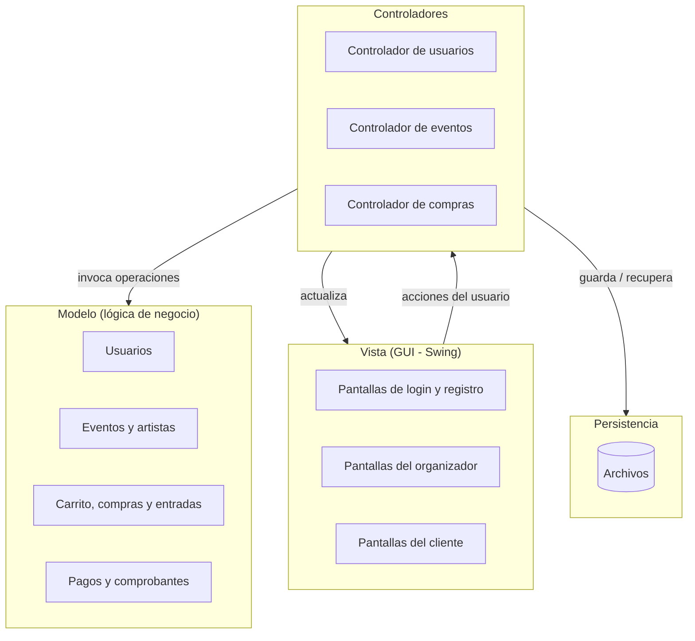

# p2. Descripción de alto nivel del sistema

## ¿Qué es?

El Sistema de Gestión de Eventos Musicales es una **aplicación de escritorio en Java con interfaz gráfica** que conecta a dos tipos de usuarios:

- **Organizadores**, que publican recitales, les asignan artistas y los administran.
- **Clientes**, que buscan recitales, compran entradas a través de un carrito, las pagan y consultan sus compras.

Toda la información (usuarios, eventos, artistas, compras, pagos) se guarda en archivos, de modo que se conserva al cerrar y volver a abrir la aplicación.

## Módulos principales

| Módulo | Responsabilidad | Casos de uso |
|---|---|---|
| **Usuarios** | Registro, inicio de sesión y control de acceso según el rol. | CU01, CU02 |
| **Eventos y artistas** | Alta, modificación y cancelación de eventos; gestión de artistas y su asignación a eventos; control de capacidad. | CU03 – CU06, CU15 |
| **Ventas** | Consulta de eventos y disponibilidad, carrito, confirmación y cancelación de compras, historial. | CU07 – CU10, CU13, CU14 |
| **Pagos** | Procesamiento (simulado) de pagos con distintos medios: tarjeta y transferencia. | CU11 |
| **Comprobantes** | Emisión del comprobante de cada compra confirmada. | CU12 |
| **Persistencia** | Guardar y recuperar los datos del sistema desde archivos. | (soporte de todos) |

## Arquitectura general

El sistema sigue el patrón **MVC (Modelo – Vista – Controlador)**, con una capa de persistencia separada:

- **Vista:** muestra la información y captura las acciones del usuario. No contiene lógica de negocio.
- **Controladores:** reciben las acciones de la vista, coordinan cada caso de uso y devuelven el resultado a la vista.
- **Modelo:** contiene las reglas del negocio (por ejemplo, que no se vendan más entradas que la capacidad del evento).
- **Persistencia:** aísla el guardado en archivos del resto del sistema, para poder cambiar el mecanismo de almacenamiento sin modificar el modelo.

Los errores (capacidad agotada, pago rechazado, datos inválidos, etc.) se representan con una **jerarquía de excepciones propia**: el modelo las lanza y los controladores las capturan para mostrar un mensaje claro en la vista.

## Flujo típico de uso

1. Un **organizador** inicia sesión, crea un recital (nombre, fecha, lugar, capacidad y precio) y le asigna artistas.
2. Un **cliente** inicia sesión, consulta los eventos disponibles y agrega entradas al carrito.
3. El cliente confirma la compra y paga con tarjeta o transferencia.
4. Si el pago se aprueba, el sistema genera las entradas y el comprobante, y descuenta la disponibilidad del evento.
5. El cliente puede ver luego su historial de compras o cancelar una compra antes de la fecha del evento.

## Tecnologías

- **Lenguaje:** Java 8 o superior, programación orientada a objetos.
- **Interfaz gráfica:** Swing (incluida en el JDK).
- **Persistencia:** archivos, usando solo la biblioteca estándar de Java.
- **Documentación:** UML (diagramas en Mermaid), Javadoc.
- **Pruebas:** JUnit.
