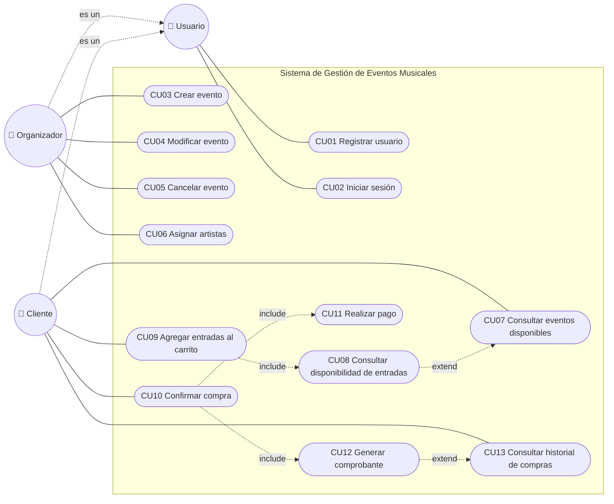

# Casos de uso

## Diagrama de casos de uso

**Relaciones entre casos de uso**

- Organizador y Cliente heredan de Usuario, por eso ambos pueden registrarse e iniciar sesión.
- **CU08 extiende CU07:** desde el listado de eventos el cliente *puede* (opcionalmente) consultar la disponibilidad detallada de uno.
- **CU09 incluye CU08:** antes de agregar entradas al carrito siempre se verifica que haya disponibilidad.
- **CU10 incluye CU11 y CU12:** confirmar una compra siempre implica pagar y, si el pago se aprueba, generar el comprobante.
- **CU12 extiende CU13:** desde el historial el cliente *puede* volver a ver o descargar el comprobante de una compra.

## Resumen

| ID | Caso de uso | Actor |
|---|---|---|
| CU01 | Registrar usuario | Usuario |
| CU02 | Iniciar sesión | Usuario |
| CU03 | Crear evento | Organizador |
| CU04 | Modificar evento | Organizador |
| CU05 | Cancelar evento | Organizador |
| CU06 | Asignar artistas a un evento | Organizador |
| CU07 | Consultar eventos disponibles | Cliente |
| CU08 | Consultar disponibilidad de entradas | Cliente |
| CU09 | Agregar entradas al carrito | Cliente |
| CU10 | Confirmar compra | Cliente |
| CU11 | Realizar pago | Cliente |
| CU12 | Generar comprobante | Cliente (lo dispara el sistema) |
| CU13 | Consultar historial de compras | Cliente |

## Descripción

### CU01 — Registrar usuario
- **Actor:** Usuario
- **Descripción:** Permite registrar un nuevo usuario en el sistema.
- **Flujo principal:**
  1. El usuario ingresa nombre, email, contraseña y tipo (cliente u organizador).
  2. El sistema valida que el email no esté registrado.
  3. El sistema crea el usuario.
- **Alternativo:** 2a. El email ya existe → el sistema informa el error.

### CU02 — Iniciar sesión
- **Actor:** Usuario
- **Descripción:** Permite acceder al sistema con credenciales registradas.
- **Flujo principal:**
  1. El usuario ingresa email y contraseña.
  2. El sistema valida las credenciales.
  3. El sistema muestra el menú según el tipo de usuario.
- **Alternativo:** 2a. Credenciales incorrectas → el sistema informa el error.

### CU03 — Crear evento
- **Actor:** Organizador
- **Descripción:** Registra un nuevo evento indicando nombre, fecha, lugar, capacidad y precio de entrada.
- **Precondición:** El organizador inició sesión.
- **Flujo principal:**
  1. El organizador ingresa los datos del evento.
  2. El sistema valida los datos.
  3. El sistema crea el evento en estado ACTIVO.
- **Alternativo:** 2a. Datos inválidos → el sistema informa el error.

### CU04 — Modificar evento
- **Actor:** Organizador
- **Descripción:** Actualiza la información de un evento existente.
- **Precondición:** El evento existe, fue creado por ese organizador y no está cancelado.
- **Flujo principal:**
  1. El organizador selecciona un evento.
  2. Modifica los datos deseados.
  3. El sistema valida y guarda los cambios.

### CU05 — Cancelar evento
- **Actor:** Organizador
- **Descripción:** Marca un evento como cancelado para impedir nuevas ventas.
- **Precondición:** El evento existe y fue creado por ese organizador.
- **Flujo principal:**
  1. El organizador selecciona un evento.
  2. Confirma la cancelación.
  3. El sistema cambia el estado del evento a CANCELADO.

### CU06 — Asignar artistas a un evento
- **Actor:** Organizador
- **Descripción:** Asocia uno o más artistas a un evento.
- **Flujo principal:**
  1. El organizador selecciona un evento.
  2. Selecciona o registra uno o más artistas.
  3. El sistema asocia los artistas al evento.
- **Alternativo:** 2a. El artista ya está asignado → el sistema lo informa.

### CU07 — Consultar eventos disponibles
- **Actor:** Cliente
- **Descripción:** Muestra los eventos activos con entradas disponibles.
- **Flujo principal:**
  1. El cliente solicita el listado.
  2. El sistema muestra los eventos activos con nombre, fecha, lugar, artistas, precio y entradas disponibles.
- **Alternativo:** 2a. No hay eventos activos → el sistema informa que no hay eventos disponibles.

### CU08 — Consultar disponibilidad de entradas
- **Actor:** Cliente
- **Descripción:** Permite conocer la cantidad de entradas disponibles para un evento determinado.
- **Precondición:** El cliente inició sesión y el evento existe.
- **Flujo principal:**
  1. El cliente selecciona un evento.
  2. El sistema verifica el estado del evento.
  3. El sistema calcula las entradas disponibles.
  4. El sistema muestra nombre, fecha, lugar, artistas, precio por entrada y cantidad disponible.
- **Alternativos:**
  - 2a. El evento está CANCELADO → el sistema informa que el evento fue cancelado y no tiene entradas a la venta.
  - 2b. El evento ya se realizó (FINALIZADO) → el sistema informa que el evento ya no está disponible.
  - 3a. No quedan entradas → el sistema muestra el evento como AGOTADO.

### CU09 — Agregar entradas al carrito
- **Actor:** Cliente
- **Descripción:** Permite seleccionar entradas para un evento y agregarlas al carrito de compra.
- **Precondición:** El cliente inició sesión.
- **Postcondición:** El carrito del cliente contiene el ítem (evento + cantidad) con su subtotal.
- **Flujo principal:**
  1. El cliente selecciona un evento.
  2. El cliente indica la cantidad de entradas que quiere.
  3. Se consulta la disponibilidad de entradas.
  4. El sistema agrega el ítem al carrito y calcula el subtotal.
  5. El sistema muestra el carrito actualizado con el total acumulado.
- **Alternativos:**
  - 2a. La cantidad ingresada es 0 o negativa → el sistema informa el error y vuelve a pedirla.
  - 5a. El cliente quiere quitar un ítem o cambiar una cantidad → el sistema actualiza el carrito y recalcula el total.

### CU10 — Confirmar compra
- **Actor:** Cliente
- **Descripción:** Permite confirmar las entradas del carrito y generar una operación de compra.
- **Precondición:** El cliente inició sesión y su carrito tiene al menos un ítem.
- **Flujo principal:**
  1. El cliente solicita confirmar la compra.
  2. El sistema muestra el resumen: eventos, cantidades, subtotales y total.
  3. El cliente acepta el resumen.
  4. Se ejecuta Realizar Pago.
  6. El sistema registra la compra y genera una entrada por cada unidad comprada, asociada al cliente y al evento.
  7. Se genera el comprobante.
  8. El carrito se vacía. 
- **Alternativos:**
  - 1a. El carrito está vacío → el sistema informa que no hay entradas para comprar.
  - 3a. El cliente no acepta el resumen → se realizan modificaciones.
  - 4a. El pago es rechazado → no se registra la compra ni se generan entradas; el carrito se conserva para reintentar.

### CU11 — Realizar pago
- **Actor:** Cliente
- **Descripción:** Concreta el pago de una compra mediante distintos medios (tarjeta o transferencia).
- **Precondición:** Se está confirmando una compra y se conoce el monto total.
- **Flujo principal:**
  1. El sistema muestra el monto a pagar y los medios de pago disponibles.
  2. El cliente elige el medio de pago.
  3. El cliente ingresa los datos correspondientes:
     - **Tarjeta:** número, titular, vencimiento, código de seguridad y cantidad de cuotas.
     - **Transferencia:** CBU/alias de origen y número de comprobante.
  4. El sistema valida el formato de los datos.
  5. El sistema procesa el pago.
  6. El sistema registra el pago como APROBADO e informa el resultado.
- **Alternativos:**
  - 4a. Datos con formato inválido (por ejemplo, tarjeta vencida o con dígitos de menos) → el sistema informa el error y vuelve a pedirlos.
  - 5a. El pago falla → el sistema lo registra como RECHAZADO, informa el motivo y permite reintentar con otro medio o cancelar.
  - 2a. El cliente cancela el pago → se vuelve a CU10 sin registrar la compra.

### CU12 — Generar comprobante
- **Actor:** Cliente (lo dispara automáticamente el sistema al aprobarse el pago)
- **Descripción:** Permite emitir un comprobante asociado a una compra confirmada.
- **Precondición:** Existe una compra con pago APROBADO.
- **Flujo principal:**
  1. El sistema genera un número de comprobante único.
  2. El sistema arma el comprobante con:
     - número de comprobante y fecha/hora de la compra,
     - datos del cliente (nombre y email),
     - detalle por evento: nombre, fecha, lugar, cantidad, precio unitario y subtotal,
     - código de cada entrada,
     - total pagado y medio de pago (en tarjeta, solo los últimos 4 dígitos).
  3. El sistema muestra el comprobante al cliente.
  4. El sistema guarda el comprobante asociado a la compra.
- **Alternativos:**
  - 1a. La compra no tiene un pago aprobado → el sistema no genera el comprobante e informa el error.

### CU13 — Consultar historial de compras
- **Actor:** Cliente
- **Descripción:** Muestra todas las entradas adquiridas anteriormente.
- **Flujo principal:**
  1. El cliente solicita su historial.
  2. El sistema muestra las entradas con evento, fecha de compra, precio y estado del pago.
- **Alternativo:** 2a. El cliente no tiene compras → el sistema informa que el historial está vacío.
