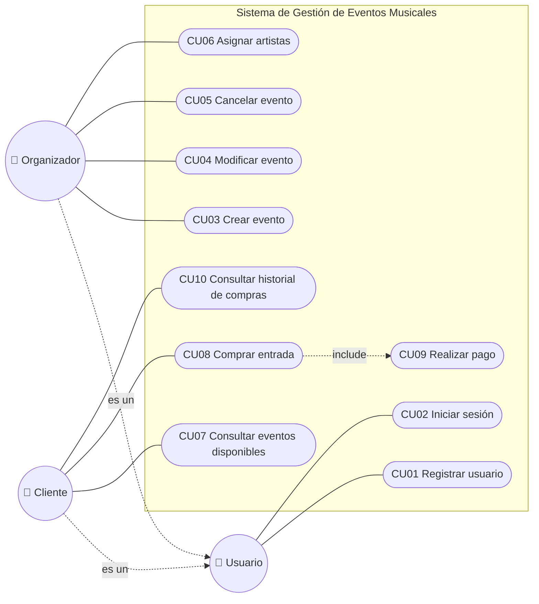

# Casos de uso

## Diagrama de casos de uso

> Organizador y Cliente heredan de Usuario, por eso ambos pueden registrarse e iniciar sesión.
> Comprar entrada **incluye** Realizar pago: no hay compra sin pago.

## Resumen

| ID | Caso de uso | Actor |
|---|---|---|
| CU01 | Registrar usuario | Usuario |
| CU02 | Iniciar sesión | Usuario |
| CU03 | Crear evento | Organizador |
| CU04 | Modificar evento | Organizador |
| CU05 | Cancelar evento | Organizador |
| CU06 | Asignar artistas a un evento | Organizador |
| CU07 | Consultar eventos disponibles | Cliente |
| CU08 | Comprar entrada | Cliente |
| CU09 | Realizar pago | Cliente |
| CU10 | Consultar historial de compras | Cliente |

## Descripción

### CU01 — Registrar usuario
- **Actor:** Usuario
- **Descripción:** Permite registrar un nuevo usuario en el sistema.
- **Flujo principal:**
  1. El usuario ingresa nombre, email, contraseña y tipo (cliente u organizador).
  2. El sistema valida que el email no esté registrado.
  3. El sistema crea el usuario.
- **Alternativo:** 2a. El email ya existe → el sistema informa el error.

### CU02 — Iniciar sesión
- **Actor:** Usuario
- **Descripción:** Permite acceder al sistema con credenciales registradas.
- **Flujo principal:**
  1. El usuario ingresa email y contraseña.
  2. El sistema valida las credenciales.
  3. El sistema muestra el menú según el tipo de usuario.
- **Alternativo:** 2a. Credenciales incorrectas → el sistema informa el error.

### CU03 — Crear evento
- **Actor:** Organizador
- **Descripción:** Registra un nuevo evento indicando nombre, fecha, lugar, capacidad y precio de entrada.
- **Precondición:** El organizador inició sesión.
- **Flujo principal:**
  1. El organizador ingresa los datos del evento.
  2. El sistema valida los datos (fecha futura, capacidad > 0, precio > 0).
  3. El sistema crea el evento en estado ACTIVO.
- **Alternativo:** 2a. Datos inválidos → el sistema informa el error.

### CU04 — Modificar evento
- **Actor:** Organizador
- **Descripción:** Actualiza la información de un evento existente.
- **Precondición:** El evento existe, fue creado por ese organizador y no está cancelado.
- **Flujo principal:**
  1. El organizador selecciona un evento.
  2. Modifica los datos deseados.
  3. El sistema valida y guarda los cambios.

### CU05 — Cancelar evento
- **Actor:** Organizador
- **Descripción:** Marca un evento como cancelado para impedir nuevas ventas.
- **Precondición:** El evento existe y fue creado por ese organizador.
- **Flujo principal:**
  1. El organizador selecciona un evento.
  2. Confirma la cancelación.
  3. El sistema cambia el estado del evento a CANCELADO.

### CU06 — Asignar artistas a un evento
- **Actor:** Organizador
- **Descripción:** Asocia uno o más artistas a un evento.
- **Flujo principal:**
  1. El organizador selecciona un evento.
  2. Selecciona o registra uno o más artistas.
  3. El sistema asocia los artistas al evento.
- **Alternativo:** 2a. El artista ya está asignado → el sistema lo informa.

### CU07 — Consultar eventos disponibles
- **Actor:** Cliente
- **Descripción:** Muestra los eventos activos con entradas disponibles.
- **Flujo principal:**
  1. El cliente solicita el listado.
  2. El sistema muestra los eventos activos con nombre, fecha, lugar, artistas, precio y entradas disponibles.

### CU08 — Comprar entrada
- **Actor:** Cliente
- **Descripción:** Permite adquirir entradas para un evento seleccionado.
- **Precondición:** El cliente inició sesión.
- **Flujo principal:**
  1. El cliente selecciona un evento y la cantidad de entradas.
  2. El sistema verifica que el evento esté activo y haya capacidad.
  3. El sistema calcula el total.
  4. Se ejecuta **CU09 — Realizar pago**.
  5. El sistema genera las entradas y las asocia al cliente.
- **Alternativos:**
  - 2a. No hay capacidad suficiente o el evento está cancelado → el sistema informa el error.
  - 4a. El pago es rechazado → no se generan las entradas.

### CU09 — Realizar pago
- **Actor:** Cliente
- **Descripción:** Concreta el pago mediante distintos medios (tarjeta o transferencia).
- **Flujo principal:**
  1. El cliente elige el medio de pago.
  2. Ingresa los datos correspondientes.
  3. El sistema procesa el pago y lo registra como APROBADO.
- **Alternativo:** 3a. El pago falla → se registra como RECHAZADO.

### CU10 — Consultar historial de compras
- **Actor:** Cliente
- **Descripción:** Muestra todas las entradas adquiridas anteriormente.
- **Flujo principal:**
  1. El cliente solicita su historial.
  2. El sistema muestra las entradas con evento, fecha de compra, precio y estado del pago.
