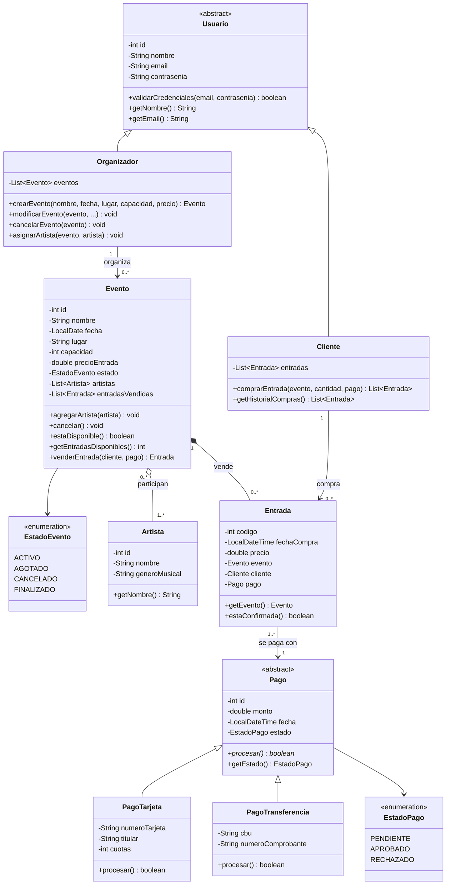

# Diagrama de clases inicial

Versión INICIAL de las clases principales de la propuesta: Usuario, Cliente, Organizador, Evento, Artista, Entrada, Pago, PagoTarjeta y PagoTransferencia.

Para esta versión, se hace uso de los casos de uso: CU01, CU02, CU03, CU04 y CU05.

Relaciones básicas:

## Decisiones de diseño

- **Usuario** es abstracta: nunca se instancia un "usuario" genérico, siempre es Cliente u Organizador. Los dos heredan el registro y el inicio de sesión.
- **Pago** es abstracta y `procesar()` es abstracto: cada medio de pago lo implementa a su manera (**polimorfismo**). Agregar un medio nuevo (por ejemplo MercadoPago) no obliga a cambiar el resto del sistema.
- **Evento – Artista** es una **agregación**: el artista existe aunque se borre el evento, y un artista puede tocar en varios eventos.
- **Evento – Entrada** es una **composición**: la entrada no tiene sentido sin su evento.
- **Un pago puede cubrir varias entradas** (compra de 3 entradas = 1 pago).
- Se usan **enums** para los estados en lugar de Strings, así se evitan valores inválidos.
- **Evento** es experto en su capacidad (GRASP *Experto*): sabe cuántas entradas quedan y si puede vender, por eso `venderEntrada()` y `estaDisponible()` están ahí.

## Para revisar más adelante

- Agregar una clase controladora (por ejemplo `SistemaEventos`) que guarde las listas de usuarios, eventos y artistas y coordine los casos de uso (GRASP *Controlador*).
- Evaluar una clase `Compra` que agrupe varias entradas con un solo pago, si el historial se complica.
- Si se agregan sectores (VIP, campo, general), crear una clase `Sector` con su propia capacidad y precio.
