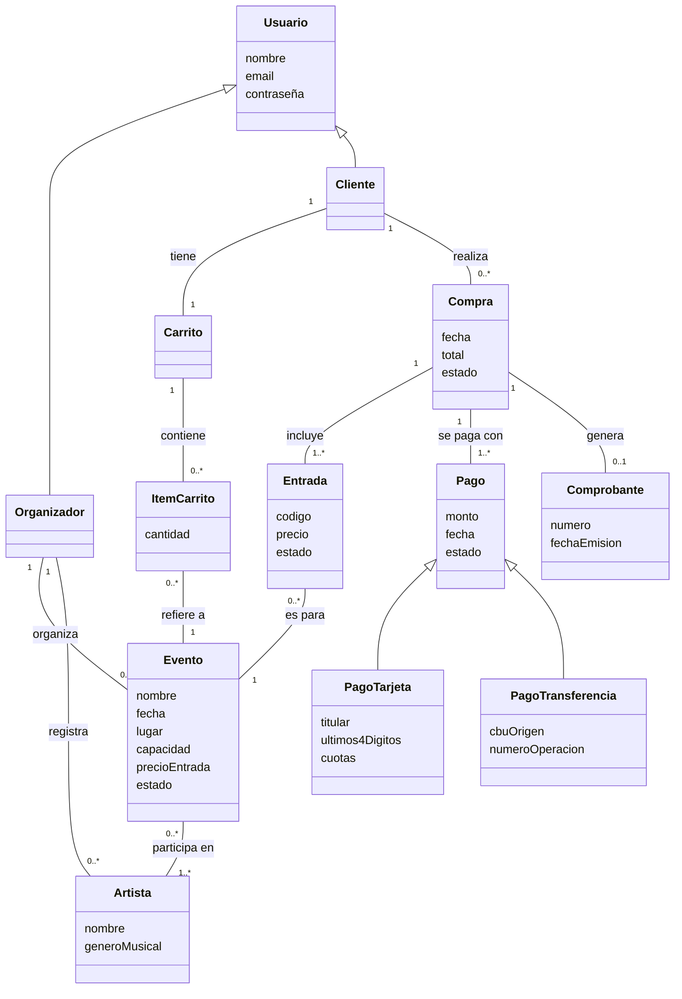

# p5. Diagrama conceptual

## Diagrama

## Descripción de los conceptos

| Concepto | Qué representa |
|---|---|
| **Usuario** | Persona registrada en el sistema. Puede ser Organizador o Cliente. |
| **Evento** | Recital con fecha, lugar, capacidad máxima y precio por entrada. Su estado puede ser activo, agotado, cancelado o finalizado. |
| **Carrito** | Selección temporal de entradas que el cliente todavía no compró. |
| **ItemCarrito** | Una línea del carrito: un evento y la cantidad de entradas elegidas. |
| **Compra** | Operación confirmada por un cliente. Agrupa las entradas compradas en un mismo momento. Puede estar confirmada o cancelada. |
| **Entrada** | Derecho de acceso a un evento, con un código único. Puede estar válida o anulada. |
| **Pago** | Registro del pago de una compra. Puede ser con tarjeta o por transferencia, y estar aprobado o rechazado. |
