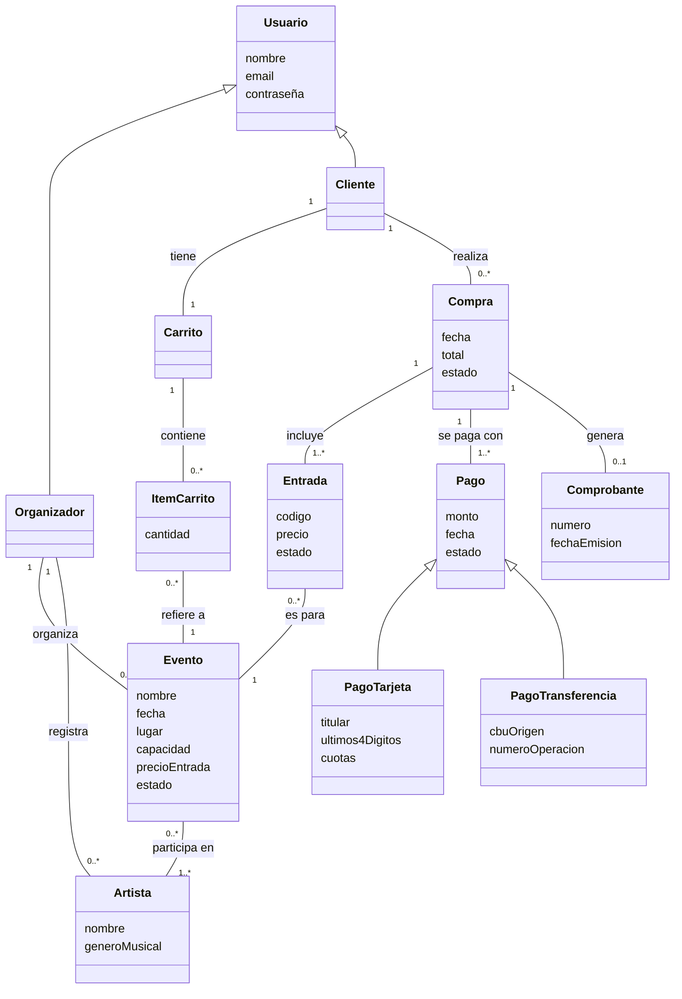

# p5. Diagrama conceptual

El diagrama conceptual (modelo de dominio) muestra **los conceptos del problema y cómo se relacionan**, sin entrar en cómo se van a programar. Por eso no incluye métodos, tipos de datos, visibilidad, pantallas ni controladores: esos detalles aparecen recién en el diagrama de clases del modelo (p6) y en el de vista y controlador (p7).

Los conceptos se obtuvieron a partir de los sustantivos de los [casos de uso](../analisis/casos-de-uso.md) y de los [requerimientos](../analisis/p3-requerimientos-funcionales.md).

## Diagrama

## Descripción de los conceptos

| Concepto | Qué representa |
|---|---|
| **Usuario** | Persona registrada en el sistema. Puede ser Organizador o Cliente. |
| **Organizador** | Usuario que crea y administra eventos y registra artistas. |
| **Cliente** | Usuario que compra entradas. |
| **Evento** | Recital con fecha, lugar, capacidad máxima y precio por entrada. Su estado puede ser activo, agotado, cancelado o finalizado. |
| **Artista** | Músico o banda que participa en uno o más eventos. |
| **Carrito** | Selección temporal de entradas que el cliente todavía no compró. |
| **ItemCarrito** | Una línea del carrito: un evento y la cantidad de entradas elegidas. |
| **Compra** | Operación confirmada por un cliente. Agrupa las entradas compradas en un mismo momento. Puede estar confirmada o cancelada. |
| **Entrada** | Derecho de acceso a un evento, con un código único. Puede estar válida o anulada. |
| **Pago** | Registro del pago de una compra. Puede ser con tarjeta o por transferencia, y estar aprobado o rechazado. |
| **Comprobante** | Constancia emitida cuando una compra se paga correctamente. |

## Decisiones tomadas

- **Carrito separado de Compra:** el carrito es una selección provisoria que se puede modificar; la compra es definitiva. Así lo pide el flujo de CU09 y CU10.
- **Compra agrupa entradas:** en una sola compra se pueden adquirir varias entradas, incluso de distintos eventos, con un único pago y un único comprobante.
- **Compra – Pago es 1 a 1..\*:** si un pago es rechazado y el cliente reintenta con otro medio, todos los intentos quedan registrados; solo uno puede estar aprobado.
- **Compra – Comprobante es 1 a 0..1:** el comprobante existe solo si la compra se pagó correctamente.
- **ItemCarrito y Entrada se relacionan con Evento**, no con el carrito o la compra directamente, porque necesitan saber el precio y la capacidad del evento.
- **Solo se guardan los últimos 4 dígitos de la tarjeta** en el concepto PagoTarjeta, en línea con RNF07.
