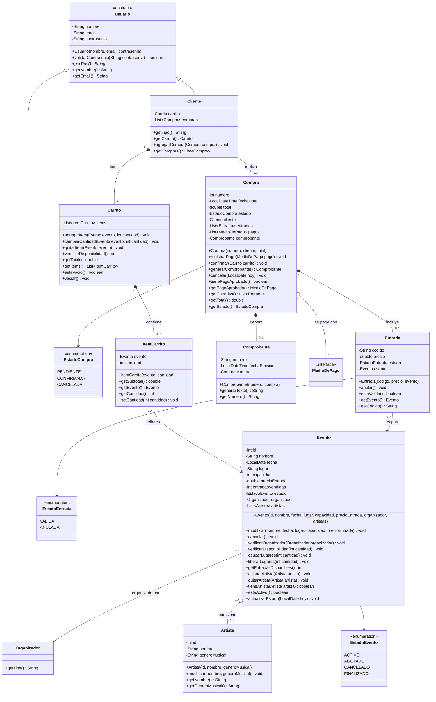
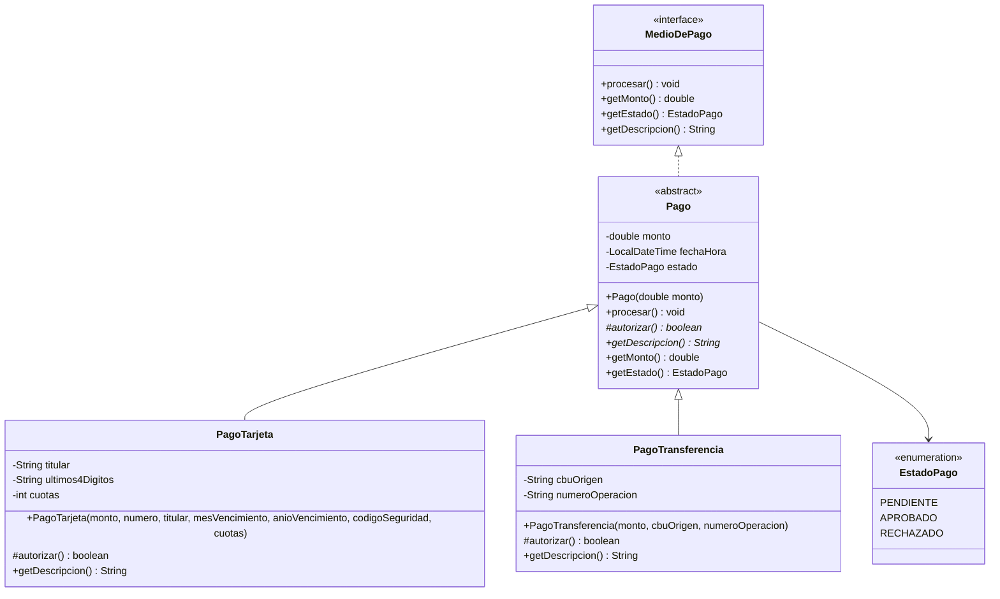
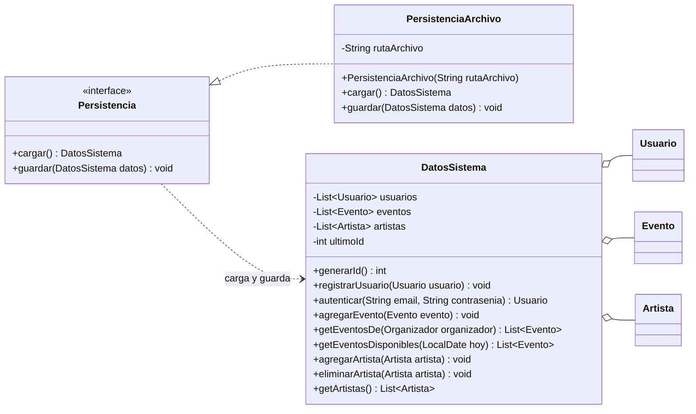
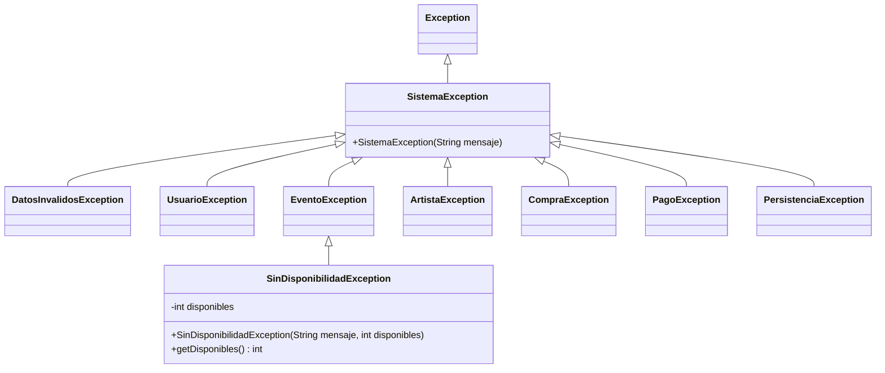

# p6. Diagrama de clases del modelo

Se agregan los detalles de diseño: atributos con tipo, métodos.

## 1. Usuarios, eventos y compras

### Flujo esperado: 

1. El cliente agrega ítems al Carrito. 
2. Al confirmar (CU10), el carrito vuelve a verificar la disponibilidad de todos sus ítems.
3. Se crea una compra en estado pendiente con el total del carrito.
4. registrarPago guarda el intento y lo procesa (CU11). Si se rechaza, el intento queda registrado y el cliente puede reintentar con otro medio.
5. Con el pago aprobado, confirmarCarrito ocupa los lugares en cada evento, crea una Entrada y pasa compra a CONFIRMADA.
6. generarComprobante crea el comprobante (CU12). Después el carrito se vacía.
7. Si el cliente cancela el pago, la compra pendiente se descarta.

## 2. Pagos

### Descripción y decisiones

- **MediodePaho** es la interfaz que usa el resto del sistema. Compra guarda una lista de MedioDePago y nunca pregunta si es tarjeta o transferencia: solo llama a procesar().
- **Pago** es la clase abstracta que implementa la interfaz y tiene lo común (monto, fecha y estado). Su método procesar() es el **método base**: siempre hace los mismos pasos (llama a autorizar(), pone el estado y, si se rechazó, lanza excepción). Lo único que cambia entre medios es autorizar(), que cada subclase implementa.
- Se usa una interfaz para hacer el programa extensible. Ejemplo: Si mañana se agrega MercadoPago, se puede escribir una clase que implemente MedioDePago directamente, aunque no se parezca a Pago. Compra y los controladores no cambian, porque dependen de la interfaz.

## 3. Persistencia

### Descripción

- **DatosSistema** agrupa todo lo que se guarda: usuarios, eventos y artistas. Las compras no van en una lista aparte, porque cada Cliente ya tiene las suyas. 
solo guarda las listas y hace las búsquedas que necesitan recorrerlas todas (por ejemplo, ver si un email ya existe). 
- **Persistencia** es la interfaz que usan los controladores para cargar y guardar. No saben lo interno.
- **PersistenciaArchivo** es la implementación que guarda todo en **un archivo** usando solo la biblioteca estándar. Si el archivo no existe (primera ejecución), cargar() devuelve un DatosSistema vacío.
- **Cuándo se guarda:** el controlador llama a guardar después de cada operación que cambia datos (registrar, crear evento, comprar, cancelar…). Así, si se cierra la aplicación, no se pierde nada.

## 4. Jerarquía de excepciones

### Descripción

| Excepción | Cuándo se lanza |
|---|---|
| **SistemaException** | Base de todas. Nunca se lanza sola. Permite que una pantalla capture cualquier error de negocio con un único `catch`. |
| **DatosInvalidosException** | Un dato ingresado tiene mal formato: campo vacío, número negativo, fecha pasada, tarjeta con dígitos de menos. |
| **UsuarioException** | Email ya registrado o credenciales incorrectas. |
| **EventoException** | El evento está cancelado o finalizado, o el usuario no es su organizador. |
| **SinDisponibilidadException** | No quedan entradas suficientes. Guarda cuántas quedan, para que la pantalla le diga al cliente "quedan 3" (CU09, alternativo 3a). |
| **ArtistaException** | Artista ya asignado o existente, intento de quitar el último artista de un evento, o baja de un artista que está en un evento activo. |
| **CompraException** | Carrito vacío, compra ya cancelada, evento ya realizado, o comprobante sin pago aprobado. |
| **PagoException** | El pago fue rechazado. |
| **PersistenciaException** | No se pudo leer o escribir el archivo. Envuelve la `IOException` original. |

- Son **excepciones verificadas** (heredan de `Exception`, no de `RuntimeException`): el compilador obliga a los controladores a capturarlas, así ninguna llega sin control a la pantalla.
- El **modelo lanza** las excepciones, el **controlador las captura** y le pasa el mensaje a la **pantalla**, que lo muestra con un `JOptionPane`.

## Patrones y principios usados

| Patrón | Dónde | Para qué |
|---|---|---|
| **Herencia y polimorfismo** | `Usuario` → `Cliente`, `Organizador` | Registro e inicio de sesión se escriben una sola vez; `getTipo()` decide el menú sin preguntar por la clase. |
| **Strategy** | `MedioDePago` usado por `Compra` | `Compra` funciona con cualquier medio de pago; el medio se elige en tiempo de ejecución. |
| **Template Method** | `Pago.procesar()` con `autorizar()` abstracto | Los pasos del pago no se repiten en cada subclase (sin código duplicado). |
| **Interfaz de persistencia** (parecido a DAO) | `Persistencia` / `PersistenciaArchivo` | Se puede cambiar cómo se guarda sin tocar el modelo ni los controladores. |
| **GRASP Experto en información** | `Evento.getEntradasDisponibles()`, `Carrito.getTotal()`, `ItemCarrito.getSubtotal()` | Cada cálculo lo hace la clase que tiene los datos. |
| **GRASP Creador** | `Compra` crea `Entrada` y `Comprobante`; `Carrito` crea `ItemCarrito` | Crea el objeto quien lo contiene. |
| **GRASP Bajo acoplamiento** | `Compra` depende de `MedioDePago`, no de las subclases | Agregar un medio no obliga a cambiar `Compra`. |
| **Jerarquía de excepciones propia** | `SistemaException` y subclases | Errores de negocio clasificados (RNF07). |

