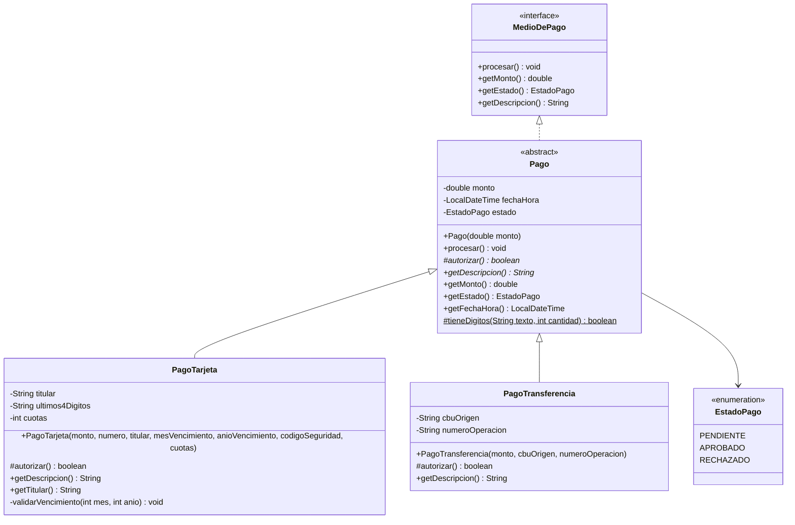
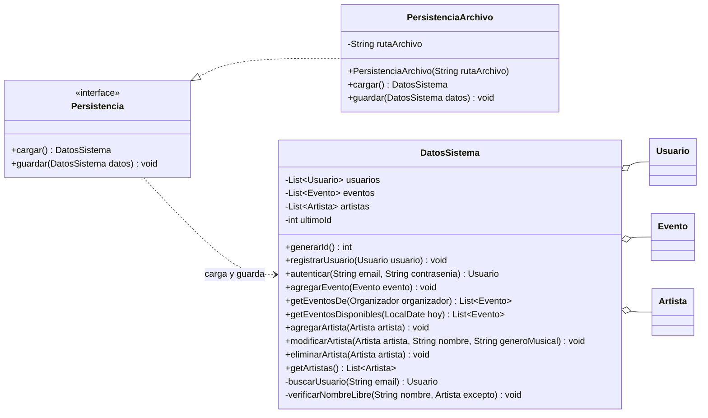
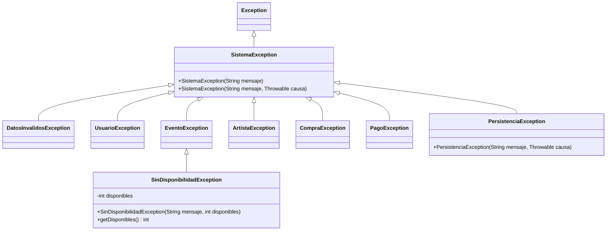

# p6. Diagrama de clases del modelo

Este diagrama muestra las clases del **modelo**: las que tienen las reglas del negocio. No incluye pantallas ni controladores, que van en el p7.

Es consistente con el [diagrama conceptual (p5)](p5-diagrama-conceptual.md): cada concepto del p5 tiene su clase acá. Lo que se agrega son los detalles de diseño: atributos con tipo, métodos, la interfaz `MedioDePago`, la persistencia y las excepciones.

Para que se pueda leer, el modelo se divide en cuatro partes:

1. [Usuarios, eventos y compras](#1-usuarios-eventos-y-compras)
2. [Pagos](#2-pagos)
3. [Persistencia](#3-persistencia)
4. [Jerarquía de excepciones](#4-jerarquía-de-excepciones)

Paquetes de Java: `modelo` (partes 1 y 2), `persistencia` (parte 3, salvo `DatosSistema`, que va en `modelo`) y `excepciones` (parte 4).

## 1. Usuarios, eventos y compras

```mermaid
classDiagram
    direction TB

    class Usuario {
        <<abstract>>
        -String nombre
        -String email
        -String contrasenia
        +Usuario(nombre, email, contrasenia)
        +validarContrasenia(String contrasenia) boolean
        +getTipo()* String
        +getNombre() String
        +getEmail() String
        -estaVacio(String texto) boolean
    }

    class Cliente {
        -Carrito carrito
        -List~Compra~ compras
        +getTipo() String
        +getCarrito() Carrito
        +agregarCompra(Compra compra) void
        +getCompras() List~Compra~
    }

    class Organizador {
        +getTipo() String
    }

    class Evento {
        -int id
        -String nombre
        -LocalDate fecha
        -String lugar
        -int capacidad
        -double precioEntrada
        -int entradasVendidas
        -EstadoEvento estado
        -Organizador organizador
        -List~Artista~ artistas
        +Evento(id, nombre, fecha, lugar, capacidad, precioEntrada, organizador, artistas)
        +modificar(nombre, fecha, lugar, capacidad, precioEntrada) void
        +cancelar() void
        +verificarOrganizador(Organizador organizador) void
        +verificarDisponibilidad(int cantidad) void
        +verificarALaVenta() void
        +ocuparLugares(int cantidad) void
        +liberarLugares(int cantidad) void
        +getEntradasDisponibles() int
        +asignarArtista(Artista artista) void
        +quitarArtista(Artista artista) void
        +tieneArtista(Artista artista) boolean
        +getNombresArtistas() String
        +generarDetalle() String
        +estaActivo() boolean
        +actualizarEstado(LocalDate hoy) void
        +getId() int
        +getNombre() String
        +getFecha() LocalDate
        +getLugar() String
        +getCapacidad() int
        +getPrecioEntrada() double
        +getEstado() EstadoEvento
        +getOrganizador() Organizador
        +getArtistas() List~Artista~
        -validarDatos(nombre, fecha, lugar, capacidad, precioEntrada) void
        -guardarDatos(nombre, fecha, lugar, capacidad, precioEntrada) void
        +verificarVigente(String accion) void
        -actualizarCupo() void
    }

    class EstadoEvento {
        <<enumeration>>
        ACTIVO
        AGOTADO
        CANCELADO
        FINALIZADO
    }

    class Artista {
        -int id
        -String nombre
        -String generoMusical
        +Artista(id, nombre, generoMusical)
        +modificar(nombre, generoMusical) void
        +getId() int
        +getNombre() String
        +getGeneroMusical() String
        +toString() String
        -validar(nombre, generoMusical) void
    }

    class Carrito {
        -List~ItemCarrito~ items
        +agregarItem(Evento evento, int cantidad) void
        +cambiarCantidad(Evento evento, int cantidad) void
        +quitarItem(Evento evento) void
        -buscarItem(Evento evento) ItemCarrito
        -buscarItemExistente(Evento evento) ItemCarrito
        -validarCantidad(int cantidad) void
        +verificarDisponibilidad() void
        +getTotal() double
        +getItems() List~ItemCarrito~
        +estaVacio() boolean
        +vaciar() void
    }

    class ItemCarrito {
        -Evento evento
        -int cantidad
        +ItemCarrito(evento, cantidad)
        +getSubtotal() double
        +getEvento() Evento
        +getCantidad() int
        +setCantidad(int cantidad) void
    }

    class Compra {
        -int numero
        -LocalDateTime fechaHora
        -double total
        -EstadoCompra estado
        -Cliente cliente
        -List~Entrada~ entradas
        -List~MedioDePago~ pagos
        -Comprobante comprobante
        +Compra(numero, cliente, total)
        +registrarPago(MedioDePago pago) void
        +confirmar(Carrito carrito) void
        +generarComprobante() Comprobante
        +verificarCancelable(LocalDate hoy) void
        +cancelar(LocalDate hoy) void
        +tienePagoAprobado() boolean
        +getPagoAprobado() MedioDePago
        +getNumero() int
        +getFechaHora() LocalDateTime
        +getCliente() Cliente
        +getEntradas() List~Entrada~
        +getTotal() double
        +getEstado() EstadoCompra
        -crearEntradas(ItemCarrito item) void
    }

    class EstadoCompra {
        <<enumeration>>
        PENDIENTE
        CONFIRMADA
        CANCELADA
    }

    class Entrada {
        -String codigo
        -double precio
        -EstadoEntrada estado
        -Evento evento
        +Entrada(codigo, precio, evento)
        +anular() void
        +estaValida() boolean
        +getEvento() Evento
        +getCodigo() String
        +getPrecio() double
    }

    class EstadoEntrada {
        <<enumeration>>
        VALIDA
        ANULADA
    }

    class Comprobante {
        -String numero
        -LocalDateTime fechaEmision
        -Compra compra
        +Comprobante(numero, compra)
        +generarTexto() String
        +getNumero() String
    }

    class MedioDePago {
        <<interface>>
    }

    Usuario <|-- Cliente
    Usuario <|-- Organizador

    Evento "0..*" --> "1" Organizador : organizado por
    Evento "0..*" o-- "1..*" Artista : participan
    Evento --> EstadoEvento

    Cliente "1" *-- "1" Carrito : tiene
    Carrito "1" *-- "0..*" ItemCarrito : contiene
    ItemCarrito "0..*" --> "1" Evento : refiere a

    Cliente "1" -- "0..*" Compra : realiza
    Compra "1" *-- "0..*" Entrada : incluye
    Entrada "0..*" --> "1" Evento : es para
    Compra "1" o-- "0..*" MedioDePago : se paga con
    Compra "1" *-- "0..1" Comprobante : genera
    Compra --> EstadoCompra
    Entrada --> EstadoEntrada
```

### Descripción de las clases

| Clase | Responsabilidad |
|---|---|
| **Usuario** | Clase abstracta con lo común a todo usuario: nombre, email, contraseña y la validación de la contraseña. `getTipo()` es abstracto: cada subclase dice qué tipo de usuario es (`Cliente` devuelve `"CLIENTE"` y `Organizador`, `"ORGANIZADOR"`), y con eso el controlador decide qué menú mostrar. |
| **Cliente** | Usuario que compra. Tiene **un** carrito y la lista de sus compras (su historial). |
| **Organizador** | Usuario que crea eventos y gestiona artistas. No tiene atributos propios: cada evento guarda quién lo organiza. |
| **Evento** | Recital. Sabe cuántas entradas le quedan, controla que no se venda más que la capacidad, y maneja sus artistas y su estado. |
| **Artista** | Músico o banda. Catálogo compartido por todos los organizadores. |
| **Carrito** | Selección provisoria del cliente. Calcula el total y verifica la disponibilidad de todos sus ítems. Si se agrega un evento que ya está en el carrito, se suma la cantidad en el mismo ítem (lo busca con el método privado `buscarItem`) y se verifica la disponibilidad de la suma. |
| **ItemCarrito** | Una línea del carrito: un evento y una cantidad. Calcula su subtotal. |
| **Compra** | Operación del cliente. Registra los intentos de pago, crea las entradas cuando se confirma, genera el comprobante y se puede cancelar. `generarComprobante()` crea el comprobante la primera vez y las siguientes devuelve el mismo (así sirve también para "Ver comprobante" desde el historial). |
| **Entrada** | Derecho de acceso a un evento. Tiene un código único (número de compra + número de entrada, por ejemplo `15-3`) y se puede anular. |
| **Comprobante** | Constancia de una compra pagada. Su número sale del número de compra (por ejemplo `C-15`), así es único sin otro contador. Arma el texto que se muestra al cliente. |
| **Enums de estado** | `EstadoEvento`, `EstadoCompra` y `EstadoEntrada` (y `EstadoPago`, en la parte 2). Se usan enums y no `String` para que sea imposible poner un estado inválido. |

### Reglas importantes y dónde están

| Regla | Clase y método | Excepción |
|---|---|---|
| No puede haber dos usuarios con el mismo email | `DatosSistema.registrarUsuario` | `UsuarioException` |
| Email y contraseña tienen que coincidir | `DatosSistema.autenticar` | `UsuarioException` |
| Nombre y lugar no vacíos, fecha futura, capacidad > 0, precio ≥ 0 | constructor de `Evento` y `Evento.modificar` | `DatosInvalidosException` |
| Un evento se crea con al menos un artista (D-002) | constructor de `Evento` | `DatosInvalidosException` |
| No se puede bajar la capacidad por debajo de lo ya vendido | `Evento.modificar` | `EventoException` |
| Un evento cancelado o finalizado no se modifica, no se vuelve a cancelar y no se le cambian los artistas | `Evento.verificarVigente` (lo llaman `modificar`, `cancelar`, `asignarArtista` y `quitarArtista`, y también `ControladorEventos` antes de abrir el formulario, la pantalla de artistas del evento o de pedir confirmación) | `EventoException` |
| Solo el organizador del evento lo puede modificar, cancelar o cambiarle artistas | `Evento.verificarOrganizador` | `EventoException` |
| No se venden entradas de un evento cancelado, finalizado o sin lugar | `Evento.verificarDisponibilidad` (usa `verificarALaVenta`) | `EventoException` / `SinDisponibilidadException` |
| Al consultar la disponibilidad, un evento cancelado o finalizado se informa como tal (CU08, 2a y 2b) | `Evento.verificarALaVenta` | `EventoException` |
| Un artista no se asigna dos veces; un evento conserva al menos un artista | `Evento.asignarArtista` / `Evento.quitarArtista` | `ArtistaException` |
| No se da de baja un artista asignado a un evento activo | `DatosSistema.eliminarArtista` | `ArtistaException` |
| No hay dos artistas con el mismo nombre (ni al crear ni al modificar) | `DatosSistema.agregarArtista` / `DatosSistema.modificarArtista` | `ArtistaException` |
| La cantidad pedida tiene que ser mayor a 0 | `Carrito.agregarItem` / `Carrito.cambiarCantidad` | `DatosInvalidosException` |
| No se confirma un carrito vacío | `Carrito.verificarDisponibilidad` | `CompraException` |
| La compra se confirma solo con un pago aprobado | `Compra.confirmar` | `CompraException` |
| El comprobante se genera solo si hay pago aprobado | `Compra.generarComprobante` | `CompraException` |
| No se cancela una compra ya cancelada, ni si alguno de sus eventos es hoy o ya pasó (RF15: "antes de la fecha del evento") | `Compra.verificarCancelable` (la llama también `Compra.cancelar`) | `CompraException` |

### Cómo funciona una compra, paso a paso

1. El cliente agrega ítems al `Carrito`. Cada vez se llama a `Evento.verificarDisponibilidad` (CU09 incluye CU08).
2. Al confirmar (CU10), el carrito vuelve a verificar la disponibilidad de **todos** sus ítems, porque algo pudo cambiar desde que se agregaron (por ejemplo, el organizador canceló el evento).
3. Se crea una `Compra` en estado `PENDIENTE` con el total del carrito.
4. `Compra.registrarPago(medio)` guarda el intento y lo procesa (CU11). Si se rechaza, el intento queda registrado y el cliente puede reintentar con otro medio.
5. Con el pago aprobado, `Compra.confirmar(carrito)` ocupa los lugares en cada evento, crea una `Entrada` por unidad y pasa la compra a `CONFIRMADA`. Recién ahí el controlador la agrega al cliente con `Cliente.agregarCompra`.
6. `Compra.generarComprobante()` crea el `Comprobante` (CU12). Después el carrito se vacía.
7. Si el cliente cancela el pago, la compra `PENDIENTE` se descarta: nunca se agregó a la lista del cliente, así que no queda guardada.

## 2. Pagos

### Descripción

- **`MedioDePago`** es la interfaz que usa el resto del sistema. `Compra` guarda una lista de `MedioDePago` y nunca pregunta si es tarjeta o transferencia: solo llama a `procesar()`.
- **`Pago`** es la clase abstracta que implementa la interfaz y tiene lo común (monto, fecha y estado). Su método `procesar()` es el **método plantilla**: siempre hace los mismos pasos (llama a `autorizar()`, pone el estado en `APROBADO` o `RECHAZADO` y, si se rechazó, lanza `PagoException`). Lo único que cambia entre medios es `autorizar()`, que cada subclase implementa.
- **`PagoTarjeta`** valida los datos en el constructor (16 dígitos, vencimiento no pasado, código de 3 dígitos, cuotas 1, 3, 6 o 12) y **solo guarda los últimos 4 dígitos**. El número completo y el código de seguridad no se guardan nunca.
- **`PagoTransferencia`** valida que el CBU tenga 22 dígitos y que el número de operación no esté vacío.
- **El pago es simulado** (ver p1). Para poder mostrar el caso de rechazo en la demo, `autorizar()` rechaza las tarjetas terminadas en `0000` y las transferencias cuyo número de operación termina en `000`.

**¿Para qué sirve la interfaz si ya está la clase abstracta?** Para la extensibilidad. Si mañana se agrega MercadoPago, se puede escribir una clase que implemente `MedioDePago` directamente, aunque no se parezca a `Pago`. `Compra` y los controladores no cambian, porque dependen de la interfaz.

## 3. Persistencia

### Descripción

- **`DatosSistema`** (paquete `modelo`) agrupa todo lo que se guarda: usuarios, eventos y artistas. Las compras no van en una lista aparte, porque cada `Cliente` ya tiene las suyas. También genera los números de id (un solo contador para todo, así nunca se repiten).
  - **No es una God class:** solo guarda las listas y hace las búsquedas que necesitan recorrerlas todas (por ejemplo, ver si un email ya existe). Las reglas de cada objeto están en su propia clase (`Evento`, `Carrito`, `Compra`).
- **`Persistencia`** es la interfaz que usan los controladores para cargar y guardar. No saben si los datos van a un archivo, a una base de datos o a otro lado.
- **`PersistenciaArchivo`** es la implementación que guarda todo en **un archivo** usando solo la biblioteca estándar. Si el archivo no existe (primera ejecución), `cargar()` devuelve un `DatosSistema` vacío.
  - **Formato (D-001, aprobado el 17/10): serialización de Java.** `guardar()` escribe el `DatosSistema` entero con `ObjectOutputStream` y `cargar()` lo lee con `ObjectInputStream`. Por eso todas las clases del modelo que se guardan implementan `java.io.Serializable` (se omite en los diagramas para no llenarlos de flechas). La ventaja es que las referencias entre objetos se conservan solas: una `Entrada` sigue apuntando al mismo `Evento` después de cargar.
- **Cuándo se guarda:** el controlador llama a `guardar` después de cada operación que cambia datos (registrar, crear evento, comprar, cancelar…). Así, si se cierra la aplicación, no se pierde nada.

## 4. Jerarquía de excepciones

### Descripción

| Excepción | Cuándo se lanza |
|---|---|
| **SistemaException** | Base de todas. Nunca se lanza sola. Permite que una pantalla capture cualquier error de negocio con un único `catch`. |
| **DatosInvalidosException** | Un dato ingresado tiene mal formato: campo vacío, número negativo, fecha pasada, tarjeta con dígitos de menos. |
| **UsuarioException** | Email ya registrado o credenciales incorrectas. |
| **EventoException** | El evento está cancelado o finalizado, o el usuario no es su organizador. |
| **SinDisponibilidadException** | No quedan entradas suficientes. Guarda cuántas quedan, para que la pantalla le diga al cliente "quedan 3" (CU09, alternativo 3a). |
| **ArtistaException** | Artista ya asignado o existente, intento de quitar el último artista de un evento, o baja de un artista que está en un evento activo. |
| **CompraException** | Carrito vacío, compra ya cancelada, evento ya realizado, o comprobante sin pago aprobado. |
| **PagoException** | El pago fue rechazado. |
| **PersistenciaException** | No se pudo leer o escribir el archivo. Envuelve la `IOException` original. |

- Son **excepciones verificadas** (heredan de `Exception`, no de `RuntimeException`): el compilador obliga a los controladores a capturarlas, así ninguna llega sin control a la pantalla.
- El **modelo lanza** las excepciones, el **controlador las captura** y le pasa el mensaje a la **pantalla**, que lo muestra con un `JOptionPane`.

## Patrones y principios usados

| Patrón | Dónde | Para qué |
|---|---|---|
| **Herencia y polimorfismo** | `Usuario` → `Cliente`, `Organizador` | Registro e inicio de sesión se escriben una sola vez; `getTipo()` decide el menú sin preguntar por la clase. |
| **Strategy** | `MedioDePago` usado por `Compra` | `Compra` funciona con cualquier medio de pago; el medio se elige en tiempo de ejecución. |
| **Template Method** | `Pago.procesar()` con `autorizar()` abstracto | Los pasos del pago no se repiten en cada subclase (sin código duplicado). |
| **Interfaz de persistencia** (parecido a DAO) | `Persistencia` / `PersistenciaArchivo` | Se puede cambiar cómo se guarda sin tocar el modelo ni los controladores. |
| **GRASP Experto en información** | `Evento.getEntradasDisponibles()`, `Carrito.getTotal()`, `ItemCarrito.getSubtotal()` | Cada cálculo lo hace la clase que tiene los datos. |
| **GRASP Creador** | `Compra` crea `Entrada` y `Comprobante`; `Carrito` crea `ItemCarrito` | Crea el objeto quien lo contiene. |
| **GRASP Bajo acoplamiento** | `Compra` depende de `MedioDePago`, no de las subclases | Agregar un medio no obliga a cambiar `Compra`. |
| **Jerarquía de excepciones propia** | `SistemaException` y subclases | Errores de negocio clasificados (RNF07). |

## Diferencias con el p5 y por qué

El p6 sigue al p5. Las diferencias son de detalle y se reflejaron en el p5 en la revisión de consistencia de la etapa E3 (19/10):

- **`Compra` – `Entrada` y `Compra` – `MedioDePago` son `0..*`** (en el p5 eran `1..*`; se corrigió el 19/10): mientras la compra está `PENDIENTE` todavía no tiene entradas ni pagos. Una compra `CONFIRMADA` siempre tiene al menos una entrada y un pago aprobado.
- **`Organizador` – `Artista` (registra) no se navega en el código:** los artistas son un catálogo compartido entre organizadores y ningún caso de uso necesita saber quién cargó cada artista. En el p5 se deja, porque como concepto es cierto que el organizador los registra.
- **`Organizador` – `Evento`:** la flecha va de `Evento` a `Organizador` (cada evento sabe quién lo organiza). Para listar los eventos de un organizador se usa `DatosSistema.getEventosDe`.
- **`Evento` – `Artista` es `1..*`, igual que en el p5:** un evento se crea con al menos un artista (D-002, aprobado el 17/10: CU03 pide elegir los artistas al crear el evento).

## Cambios hechos al dibujar los diagramas de secuencia (19/10)

Al dibujar el [p8](p8-diagramas-de-secuencia.md) aparecieron métodos que el p6 no mostraba. Se agregaron para que todo sea consistente:

- **`Compra.verificarCancelable(hoy)`:** CU14 pide verificar si se puede cancelar **antes** de pedir confirmación al cliente.
- **Getters de `Evento`** (`getNombre`, `getFecha`, `getLugar`, `getPrecioEntrada`, `getEstado`, `getArtistas`) y de **`Compra`** (`getNumero`, `getFechaHora`, `getCliente`): los usan las pantallas para armar las tablas, el comprobante y los códigos de las entradas.
- **`Carrito.buscarItem(evento)`** (privado): evita repetir la búsqueda en `agregarItem`, `cambiarCantidad` y `quitarItem`.

## Cambios hechos al programar el esqueleto (20/10)

Al escribir el código de la etapa E4 se agregaron al diagrama los métodos que el código necesitó, para que p6 y código coincidan:

- **Getters nuevos:** `Evento.getId`, `getCapacidad` (para llenar el formulario de CU04) y `getOrganizador` (lo usa `DatosSistema.getEventosDe`); `Artista.getId`; `Entrada.getPrecio` y `Pago.getFechaHora` (para el comprobante); `PagoTarjeta.getTitular`.
- **`Artista.toString()`** devuelve el nombre: es lo que muestra una `JList<Artista>` en las pantallas.
- **`Pago.tieneDigitos(texto, cantidad)`** (protegido y estático): lo usan `PagoTarjeta` y `PagoTransferencia` para validar el número de tarjeta, el código y el CBU sin repetir el mismo `for`.
- **Métodos privados** para no repetir código: `Evento.validarDatos`, `guardarDatos`, `verificarVigente` y `actualizarCupo`; `Carrito.buscarItemExistente` y `validarCantidad`; `Compra.crearEntradas`; `DatosSistema.buscarUsuario`; `Usuario.estaVacio`; `Artista.validar`; `PagoTarjeta.validarVencimiento`.
- **`SistemaException` y `PersistenciaException`** tienen un constructor con la excepción original (`causa`), para que `PersistenciaArchivo` envuelva la `IOException` sin perderla.
- **El monto de un pago puede ser 0** (un evento puede ser gratis, porque el precio puede ser 0). Lo que no puede ser es negativo.

## Cambios hechos al programar artistas y eventos (23/10, etapas E6 y E7)

- **`DatosSistema.modificarArtista(artista, nombre, genero)`** (nuevo): antes, `ControladorArtistas` iba a llamar directo a `Artista.modificar`, pero así se podía renombrar un artista con el nombre de otro. Como para controlarlo hay que recorrer todo el catálogo, lo hace `DatosSistema` (GRASP Experto) y después llama a `Artista.modificar`.
- **`DatosSistema.verificarNombreLibre`** (privado): la búsqueda de nombre repetido que antes estaba dentro de `agregarArtista`. Ahora la usan `agregarArtista` y `modificarArtista`, así no se repite el `for`.
- **`Evento.verificarVigente` pasó de privado a público:** el controlador lo llama **antes** de abrir el formulario de modificación (CU04) y antes de preguntar "¿Cancelar el evento?" (CU05). Así no se completa un formulario ni se confirma algo que después va a fallar. Es la misma idea que `Compra.verificarCancelable` en el CU14.
- **`DatosSistema.getEventosDe`** ahora actualiza el estado de cada evento (`actualizarEstado(hoy)`) antes de devolverlos, igual que `getEventosDisponibles`. Así el organizador ve como `FINALIZADO` un evento cuya fecha ya pasó. La firma no cambió.

## Cambios hechos al programar la asignación y la consulta (24/10, etapa E8)

- **`Evento.verificarALaVenta()`** (nuevo, público): controla que el evento no esté cancelado ni finalizado, con un mensaje distinto para cada caso, como pide el CU08 (2a: "fue cancelado y no tiene entradas a la venta"; 2b: "ya se realizó"). Antes ese control estaba escrito dentro de `verificarDisponibilidad`; ahora `verificarDisponibilidad` lo llama, así no se repite. Un evento `AGOTADO` pasa el control, porque sigue a la venta aunque no le queden lugares.
- **`Evento.getNombresArtistas()`** (nuevo): devuelve los nombres de los artistas separados por coma. Lo usan la tabla del cliente (CU07) y el detalle (CU08). Está en `Evento` porque es quien tiene la lista de artistas (GRASP Experto).
- **`Evento.generarDetalle()`** (nuevo): arma el texto del CU08, paso 4 (nombre, fecha, lugar, artistas, precio y entradas disponibles). Si no quedan entradas, dice "0 (AGOTADO)" (3a). Es la misma idea que `Comprobante.generarTexto()`.
- **`Evento.asignarArtista` y `quitarArtista` ahora llaman a `verificarVigente`:** la precondición del CU06 dice que el evento no está cancelado. Por eso, además de `ArtistaException`, pueden lanzar `EventoException`. La firma en el diagrama no cambia (las excepciones no se dibujan en los métodos).
