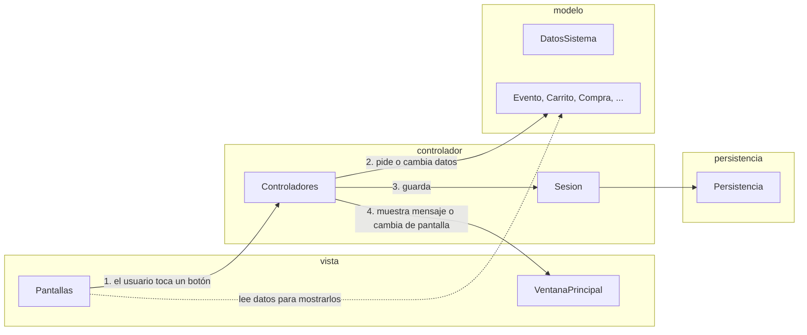

# p7. Diagrama de clases de la vista y el controlador

## 1. Visión general (MVC)



**Cómo se reparte el trabajo en cada acción del usuario:**

1. La **pantalla** recibe el clic (implementa `ActionListener`) y llama a **un** método del controlador, pasándole lo que el usuario escribió, tal cual, como `String`.
2. El **controlador** convierte los textos (números, fechas), busca los objetos del modelo y les pide que hagan la operación. Nunca decide una regla de negocio: eso lo hace el modelo.
3. Si todo salió bien, el controlador guarda los datos (`Sesion.guardar()`) y le dice a la `VentanaPrincipal` qué mostrar.
4. Si el modelo lanzó una `SistemaException`, el controlador la captura y le pide a la ventana que muestre el mensaje (`mostrarError`). La pantalla nunca ve una excepción.

## 2. Vista

```mermaid
classDiagram
    direction TB

    class JFrame
    class JPanel
    class ActionListener {
        <<interface>>
        +actionPerformed(ActionEvent e) void
    }

    class VentanaPrincipal {
        -CardLayout tarjetas
        -JPanel contenedor
        -Map~String, Pantalla~ pantallas
        +agregarPantalla(String nombre, Pantalla pantalla) void
        +mostrar(String nombre) void
        +mostrarMensaje(String mensaje) void
        +mostrarError(String mensaje) void
        +mostrarTexto(String titulo, String texto) void
        +confirmar(String pregunta) boolean
    }

    class Pantalla {
        <<abstract>>
        #VentanaPrincipal ventana
        +Pantalla(VentanaPrincipal ventana)
        +actualizar()* void
    }

    class PantallaLogin {
        -JTextField campoEmail
        -JPasswordField campoContrasenia
        -JButton botonIngresar
        -JButton botonRegistrarse
        +actualizar() void
        +actionPerformed(ActionEvent e) void
    }
    class PantallaRegistro {
        -JTextField campoNombre
        -JTextField campoEmail
        -JPasswordField campoContrasenia
        -JComboBox~String~ comboTipo
        +actualizar() void
        +actionPerformed(ActionEvent e) void
    }
    class PantallaMisEventos {
        -JTable tablaEventos
        -List~Evento~ eventosMostrados
        +actualizar() void
        +actionPerformed(ActionEvent e) void
    }
    class PantallaFormularioEvento {
        -JTextField campoNombre
        -JTextField campoFecha
        -JTextField campoLugar
        -JTextField campoCapacidad
        -JTextField campoPrecio
        -JList~Artista~ listaArtistas
        -boolean modoModificar
        +actualizar() void
        +actionPerformed(ActionEvent e) void
    }
    class PantallaAsignarArtistas {
        -JList~Artista~ listaAsignados
        -JList~Artista~ listaRegistrados
        +actualizar() void
        +actionPerformed(ActionEvent e) void
    }
    class PantallaArtistas {
        -JTable tablaArtistas
        -JTextField campoNombre
        -JTextField campoGenero
        +actualizar() void
        +actionPerformed(ActionEvent e) void
    }
    class PantallaEventosDisponibles {
        -JTable tablaEventos
        -JTextField campoCantidad
        -List~Evento~ eventosMostrados
        +actualizar() void
        +actionPerformed(ActionEvent e) void
    }
    class PantallaCarrito {
        -JTable tablaItems
        -JTextField campoCantidad
        -JLabel etiquetaTotal
        +actualizar() void
        +actionPerformed(ActionEvent e) void
    }
    class PantallaPago {
        -JLabel etiquetaMonto
        -JRadioButton opcionTarjeta
        -JRadioButton opcionTransferencia
        -JTextField campoNumeroTarjeta
        -JTextField campoTitular
        -JTextField campoMesVencimiento
        -JTextField campoAnioVencimiento
        -JPasswordField campoCodigo
        -JComboBox~String~ comboCuotas
        -JTextField campoCbu
        -JTextField campoOperacion
        +actualizar() void
        +actionPerformed(ActionEvent e) void
    }
    class PantallaHistorial {
        -JTable tablaCompras
        -List~Compra~ comprasMostradas
        +actualizar() void
        +actionPerformed(ActionEvent e) void
    }

    JFrame <|-- VentanaPrincipal
    JPanel <|-- Pantalla
    VentanaPrincipal "1" *-- "1..*" Pantalla : muestra de a una
    Pantalla --> VentanaPrincipal

    Pantalla <|-- PantallaLogin
    Pantalla <|-- PantallaRegistro
    Pantalla <|-- PantallaMisEventos
    Pantalla <|-- PantallaFormularioEvento
    Pantalla <|-- PantallaAsignarArtistas
    Pantalla <|-- PantallaArtistas
    Pantalla <|-- PantallaEventosDisponibles
    Pantalla <|-- PantallaCarrito
    Pantalla <|-- PantallaPago
    Pantalla <|-- PantallaHistorial

    ActionListener <|.. PantallaLogin
    ActionListener <|.. PantallaRegistro
    ActionListener <|.. PantallaMisEventos
    ActionListener <|.. PantallaFormularioEvento
    ActionListener <|.. PantallaAsignarArtistas
    ActionListener <|.. PantallaArtistas
    ActionListener <|.. PantallaEventosDisponibles
    ActionListener <|.. PantallaCarrito
    ActionListener <|.. PantallaPago
    ActionListener <|.. PantallaHistorial
```



### Pantallas y qué controlador usa cada una

Para no llenar el diagrama de flechas, la relación pantalla → controlador va en esta tabla. Cada pantalla recibe su controlador en el constructor y lo guarda en un atributo `controlador`.

| Pantalla | Para qué sirve | Controlador | Casos de uso |
|---|---|---|---|
| **PantallaLogin** | Email y contraseña. Es la primera pantalla. | `ControladorUsuarios` | CU02 |
| **PantallaRegistro** | Alta de usuario, eligiendo cliente u organizador. | `ControladorUsuarios` | CU01 |
| **PantallaMisEventos** | Inicio del organizador: tabla con sus eventos y botones *Nuevo*, *Modificar*, *Cancelar evento*, *Artistas del evento*, *Gestionar artistas* y *Cerrar sesión*. | `ControladorEventos` | CU04 (elegir), CU05 |
| **PantallaFormularioEvento** | Crear o modificar un evento. Al crear, se eligen los artistas (D-002); si falta uno, el botón *Nuevo artista* lleva a `PantallaArtistas`. | `ControladorEventos` | CU03, CU04 |
| **PantallaAsignarArtistas** | Artistas asignados y registrados del evento elegido. | `ControladorEventos` | CU06 |
| **PantallaArtistas** | Catálogo de artistas: alta, modificación y baja. | `ControladorArtistas` | CU15 |
| **PantallaEventosDisponibles** | Inicio del cliente: eventos activos, *Ver disponibilidad*, cantidad y *Agregar al carrito*. Botones *Carrito*, *Mis compras* y *Cerrar sesión*. | `ControladorCarrito` | CU07, CU08, CU09 |
| **PantallaCarrito** | Ítems, total, cambiar cantidad, quitar y *Confirmar compra*. | `ControladorCarrito` y `ControladorCompras` | CU09 (5a), CU10 |
| **PantallaPago** | Monto, medio de pago y sus datos. *Pagar* y *Cancelar pago*. | `ControladorCompras` | CU11 |
| **PantallaHistorial** | Compras del cliente con *Ver comprobante* y *Cancelar compra*. | `ControladorCompras` | CU13, CU12, CU14 |

### Descripción

- **`VentanaPrincipal`** es la **única ventana** (`JFrame`) del programa. Usa un `CardLayout`: todas las pantallas están cargadas como "tarjetas" y se muestra una por vez con `mostrar(nombre)`. Así no se abren y cierran ventanas, y la navegación queda en un solo lugar.
  - Antes de mostrar una pantalla llama a su `actualizar()`, para que recargue los datos (por ejemplo, la tabla de eventos después de crear uno).
  - Tiene los métodos para hablar con el usuario usando `JOptionPane`: `mostrarMensaje`, `mostrarError`, `confirmar` (sí/no) y `mostrarTexto` (el comprobante, en un área de texto). Así ningún controlador usa Swing directamente.
- **`Pantalla`** es la clase abstracta de todas las pantallas (`JPanel`). Tiene la referencia a la ventana y obliga a cada pantalla a implementar `actualizar()`. Gracias a esto, `VentanaPrincipal.mostrar` funciona igual con cualquier pantalla (**polimorfismo**).
- **Cada pantalla implementa `ActionListener`** (regla del proyecto: nada de lambdas ni clases anónimas). En `actionPerformed` se pregunta qué botón se tocó (`e.getSource() == botonX`) y se llama a **un** método del controlador. No hay ninguna regla de negocio en las pantallas.
- **Las pantallas leen el modelo para mostrarlo:** por ejemplo, `PantallaMisEventos` le pide al controlador la lista de eventos y arma la tabla con `getNombre()`, `getFecha()`, etc. Nunca llaman a un método que cambie el modelo: eso pasa siempre por el controlador.
- **No hay pantalla de comprobante ni de menú:** el comprobante se muestra con `mostrarTexto` (un diálogo) y el "menú según el rol" es directamente la pantalla de inicio de cada rol (`PantallaMisEventos` o `PantallaEventosDisponibles`). Son menos clases para la misma funcionalidad.

## 3. Controladores

```mermaid
classDiagram
    direction TB

    class Sesion {
        -DatosSistema datos
        -Persistencia persistencia
        -Usuario usuarioActual
        +Sesion(Persistencia persistencia)
        +getDatos() DatosSistema
        +getUsuarioActual() Usuario
        +setUsuarioActual(Usuario usuario) void
        +getCliente() Cliente
        +getOrganizador() Organizador
        +guardar() void
    }

    class Controlador {
        <<abstract>>
        #Sesion sesion
        #VentanaPrincipal ventana
        +Controlador(Sesion sesion, VentanaPrincipal ventana)
        #convertirEntero(String texto, String campo) int
        #convertirDecimal(String texto, String campo) double
        #convertirFecha(String texto) LocalDate
    }

    class ControladorUsuarios {
        +registrar(nombre, email, contrasenia, tipo) void
        +iniciarSesion(email, contrasenia) void
        +cerrarSesion() void
    }

    class ControladorEventos {
        -Evento eventoSeleccionado
        +getMisEventos() List~Evento~
        +getArtistas() List~Artista~
        +getEventoSeleccionado() Evento
        +nuevoEvento() void
        +elegirParaModificar(Evento evento) void
        +crearEvento(nombre, fecha, lugar, capacidad, precio, artistas) void
        +modificarEvento(nombre, fecha, lugar, capacidad, precio) void
        +cancelarEvento(Evento evento) void
        +elegirParaArtistas(Evento evento) void
        +asignarArtista(Artista artista) void
        +quitarArtista(Artista artista) void
    }

    class ControladorArtistas {
        +getArtistas() List~Artista~
        +altaArtista(nombre, genero) void
        +modificarArtista(Artista artista, nombre, genero) void
        +bajaArtista(Artista artista) void
    }

    class ControladorCarrito {
        +getEventosDisponibles() List~Evento~
        +consultarDisponibilidad(Evento evento) void
        +agregarAlCarrito(Evento evento, String cantidad) void
        +cambiarCantidad(Evento evento, String cantidad) void
        +quitarItem(Evento evento) void
        +getCarrito() Carrito
    }

    class ControladorCompras {
        -Compra compraEnCurso
        +iniciarCompra() void
        +getMontoAPagar() double
        +pagarConTarjeta(numero, titular, mes, anio, codigo, cuotas) void
        +pagarConTransferencia(cbu, numeroOperacion) void
        +cancelarPago() void
        +getHistorial() List~Compra~
        +verComprobante(Compra compra) void
        +cancelarCompra(Compra compra) void
    }

    class VentanaPrincipal
    class Persistencia {
        <<interface>>
    }
    class DatosSistema
    class Usuario
    class Evento
    class Artista
    class Carrito
    class Compra
    class MedioDePago {
        <<interface>>
    }
    class SistemaException

    Controlador <|-- ControladorUsuarios
    Controlador <|-- ControladorEventos
    Controlador <|-- ControladorArtistas
    Controlador <|-- ControladorCarrito
    Controlador <|-- ControladorCompras

    Controlador --> Sesion
    Controlador --> VentanaPrincipal
    Sesion --> DatosSistema
    Sesion --> Persistencia
    Sesion --> Usuario : usuario actual

    ControladorEventos --> Evento : seleccionado
    ControladorEventos ..> Artista
    ControladorArtistas ..> Artista
    ControladorCarrito ..> Carrito
    ControladorCarrito ..> Evento
    ControladorCompras --> Compra : en curso
    ControladorCompras ..> MedioDePago : crea PagoTarjeta o PagoTransferencia
    Controlador ..> SistemaException : captura
```



### Descripción

- **`Sesion`** guarda el estado de la aplicación mientras está abierta: los datos cargados (`DatosSistema`), la persistencia y el usuario que inició sesión. Todos los controladores comparten **el mismo** objeto `Sesion`, así cuando `ControladorUsuarios` guarda el usuario, los demás ya lo ven.
  - `guardar()` llama a `persistencia.guardar(datos)`. Es el único lugar desde donde se guarda.
  - `getCliente()` y `getOrganizador()` devuelven el usuario actual convertido al tipo correcto (un *cast*). Es seguro porque a las pantallas del cliente solo se llega si el usuario es cliente, y lo mismo con el organizador (ver p9).
- **`Controlador`** es la clase abstracta de los cinco controladores. Tiene lo que todos usan, para no repetir código:
  - las referencias a la `Sesion` y a la `VentanaPrincipal`;
  - los métodos que convierten el texto de un campo en número o fecha (`convertirEntero`, `convertirDecimal`, `convertirFecha`). Si el texto no es válido, lanzan `DatosInvalidosException` con un mensaje que nombra el campo ("La capacidad tiene que ser un número"). La fecha se escribe `dd/mm/aaaa`.
- **Un controlador por módulo** del p2 (usuarios, eventos, artistas, carrito, compras). Cada uno coordina sus casos de uso y no sabe nada de los otros. Así ninguno se vuelve una *God class*.
- **Forma de cada método público** (todos iguales, para que se puedan explicar con un solo ejemplo):

  ```java
  public void agregarAlCarrito(Evento evento, String textoCantidad) {
      try {
          int cantidad = convertirEntero(textoCantidad, "La cantidad");
          sesion.getCliente().getCarrito().agregarItem(evento, cantidad);
          sesion.guardar();
          ventana.mostrar(VentanaPrincipal.CARRITO);
      } catch (SistemaException e) {
          // El modelo avisó que algo no se puede hacer: se muestra el motivo
          ventana.mostrarError(e.getMessage());
      }
  }
  ```

- **Estado entre pantallas:** cuando un caso de uso pasa por más de una pantalla, el controlador recuerda el objeto en uso:
  - `ControladorEventos.eventoSeleccionado`: el evento que se va a modificar o al que se le asignan artistas. Si es `null`, el formulario está en modo "crear".
  - `ControladorCompras.compraEnCurso`: la `Compra` `PENDIENTE` que se crea al confirmar el carrito (CU10) y se paga en `PantallaPago` (CU11). Si se rechaza el pago, la compra sigue en curso y se puede reintentar; si se cancela el pago, se descarta (`null`) y se vuelve al carrito.
- **`Main`** (paquete raíz) crea, en este orden: `PersistenciaArchivo`, `Sesion` (que carga los datos), `VentanaPrincipal`, los cinco controladores y las diez pantallas; registra las pantallas en la ventana y muestra `PantallaLogin`.

## 4. Trazabilidad: caso de uso → pantalla → controlador → modelo

Esta tabla es la que hay que usar en la defensa: para cada caso de uso dice por dónde entra y qué clase del modelo tiene la regla.

| CU | Pantalla y botón | Método del controlador | Modelo |
|---|---|---|---|
| CU01 | `PantallaRegistro` · *Registrar* | `ControladorUsuarios.registrar` | `new Cliente` / `new Organizador`, `DatosSistema.registrarUsuario` |
| CU02 | `PantallaLogin` · *Ingresar* | `ControladorUsuarios.iniciarSesion` | `DatosSistema.autenticar`, `Usuario.getTipo` |
| CU03 | `PantallaFormularioEvento` · *Guardar* (modo crear) | `ControladorEventos.crearEvento` | `new Evento(...)`, `DatosSistema.agregarEvento` |
| CU04 | `PantallaMisEventos` · *Modificar* → `PantallaFormularioEvento` · *Guardar* | `elegirParaModificar`, `modificarEvento` | `Evento.verificarOrganizador`, `Evento.modificar` |
| CU05 | `PantallaMisEventos` · *Cancelar evento* | `ControladorEventos.cancelarEvento` | `Evento.verificarOrganizador`, `Evento.cancelar` |
| CU06 | `PantallaAsignarArtistas` · *Asignar* / *Quitar* | `asignarArtista`, `quitarArtista` | `Evento.asignarArtista`, `Evento.quitarArtista` |
| CU07 | `PantallaEventosDisponibles` (al abrirse) | `ControladorCarrito.getEventosDisponibles` | `DatosSistema.getEventosDisponibles` |
| CU08 | `PantallaEventosDisponibles` · *Ver disponibilidad* | `ControladorCarrito.consultarDisponibilidad` | `Evento.actualizarEstado`, `Evento.getEntradasDisponibles` |
| CU09 | `PantallaEventosDisponibles` · *Agregar al carrito*; `PantallaCarrito` · *Cambiar cantidad* / *Quitar* | `agregarAlCarrito`, `cambiarCantidad`, `quitarItem` | `Carrito.agregarItem` → `Evento.verificarDisponibilidad` |
| CU10 | `PantallaCarrito` · *Confirmar compra* | `ControladorCompras.iniciarCompra` | `Carrito.verificarDisponibilidad`, `new Compra` |
| CU11 | `PantallaPago` · *Pagar* | `pagarConTarjeta` / `pagarConTransferencia` | `new PagoTarjeta` / `new PagoTransferencia`, `Compra.registrarPago`, `Compra.confirmar` |
| CU12 | automático después de pagar; `PantallaHistorial` · *Ver comprobante* | `pagarCon...`, `verComprobante` | `Compra.generarComprobante`, `Comprobante.generarTexto` |
| CU13 | `PantallaHistorial` (al abrirse) | `ControladorCompras.getHistorial` | `Cliente.getCompras` |
| CU14 | `PantallaHistorial` · *Cancelar compra* | `ControladorCompras.cancelarCompra` | `Compra.cancelar` → `Entrada.anular`, `Evento.liberarLugares` |
| CU15 | `PantallaArtistas` · *Alta* / *Modificar* / *Baja* | `altaArtista`, `modificarArtista`, `bajaArtista` | `new Artista`, `Artista.modificar`, `DatosSistema.eliminarArtista` |

## Patrones y principios usados

| Patrón | Dónde | Para qué |
|---|---|---|
| **MVC** | paquetes `vista`, `controlador`, `modelo` | Separar lo que se ve, la coordinación y las reglas. Se puede cambiar una pantalla sin tocar el modelo. |
| **GRASP Controlador** | `ControladorUsuarios`, `ControladorEventos`, … | Cada evento de la GUI lo recibe un controlador del caso de uso, no la pantalla ni el modelo. |
| **Observer** (el de Swing) | pantallas que implementan `ActionListener` | El botón avisa a la pantalla cuando lo tocan, sin conocerla. |
| **Herencia y polimorfismo** | `Pantalla` (con `actualizar()` abstracto) y `Controlador` | `VentanaPrincipal` trata a todas las pantallas igual; las conversiones de texto se escriben una sola vez. |
| **Alta cohesión / sin God class** | un controlador por módulo | Ningún controlador tiene más de unos 12 métodos públicos ni conoce los casos de uso de otro. |
| **Bajo acoplamiento** | `Sesion` depende de la interfaz `Persistencia`; los controladores dependen de `MedioDePago` | Cambiar cómo se guarda o agregar un medio de pago no obliga a tocar los controladores. |

## Relación con otros diagramas

- **p6:** los controladores solo llaman métodos que ya están en el p6. No hace falta ningún método nuevo en el modelo.
- **p2:** el p2 mostraba tres controladores de ejemplo; acá son cinco, uno por módulo. El p2 se actualizó para que coincida.
- **p9:** cada pantalla de este diagrama es un estado del diagrama de navegación.
