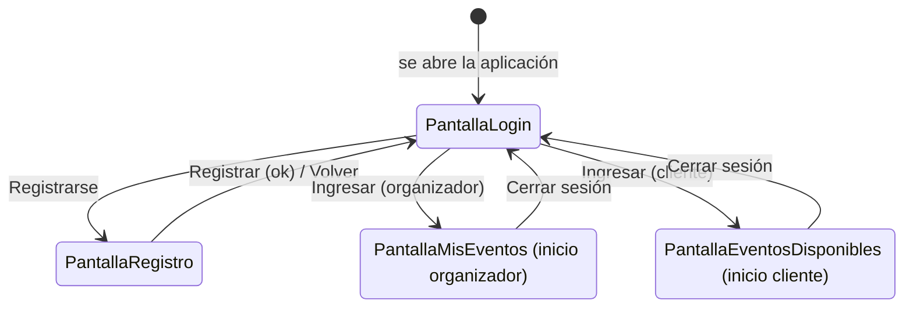
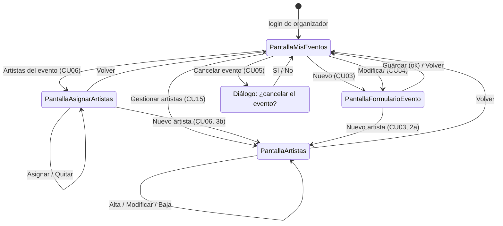
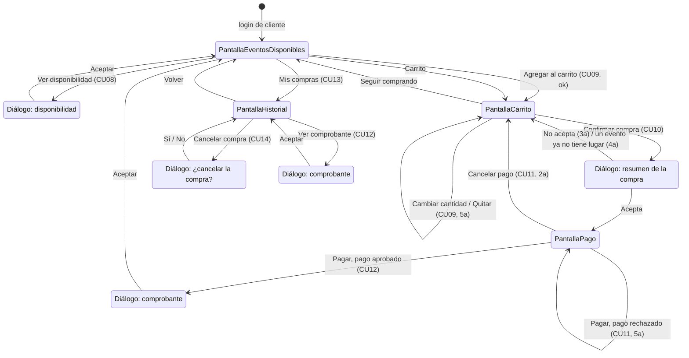

# p9. Diagrama de navegación de la GUI

Este diagrama muestra **por qué pantallas pasa el usuario** y qué botón lo lleva de una a otra. Cada estado es una pantalla del [p7](p7-diagrama-vista-controlador.md). Los diálogos (`JOptionPane`) se dibujan como notas o como estados con el prefijo *Diálogo*, porque no son pantallas: se abren encima y, al cerrarse, se queda en la misma pantalla.

Toda la aplicación es **una sola ventana** (`VentanaPrincipal`) que cambia de pantalla con `mostrar(nombre)`.

## 1. Inicio y elección del rol

- **CU02 – menú según el rol:** `ControladorUsuarios.iniciarSesion` le pregunta al usuario `getTipo()`. Si es organizador, muestra `PantallaMisEventos`; si es cliente, `PantallaEventosDisponibles`. Un cliente **no tiene ningún botón** que lo lleve a una pantalla del organizador, y al revés. Por eso los *casts* de `Sesion.getCliente()` y `getOrganizador()` son seguros.
- **Cerrar sesión** pone `usuarioActual` en `null` y vuelve al login.
- Si el login o el registro fallan (email repetido, contraseña incorrecta), se muestra un diálogo de error y **se queda en la misma pantalla**.
- **Registro exitoso:** se muestra el diálogo "Listo, *nombre*. Ya podés iniciar sesión." y se vuelve al login con los campos vacíos. No se entra directo: así la persona prueba su email y contraseña (CU01 → CU02).
- *Registrarse* y *Volver* solo cambian de pantalla, por eso la pantalla llama directo a `ventana.mostrar(...)` sin pasar por el controlador (ver p7, parte 2).
- En el login, apretar **Enter** en el campo de la contraseña es lo mismo que tocar *Ingresar*.

## 2. Organizador

- **El mismo formulario sirve para crear y modificar.** Si se llega con *Nuevo*, los campos están vacíos y se ve la lista de artistas para elegir (D-002). Si se llega con *Modificar*, los campos vienen con los datos del evento y la lista de artistas no se muestra, porque los artistas se cambian en `PantallaAsignarArtistas` (CU06).
- **Volver desde `PantallaArtistas`** siempre lleva a `PantallaMisEventos`, aunque se haya llegado desde el formulario o desde la asignación. Es más simple de programar y de explicar; al volver, el organizador entra de nuevo al evento y ya ve el artista nuevo (ver "Decisiones tomadas" en la bitácora del 18/10).
- **Sin evento elegido:** *Modificar*, *Cancelar evento* y *Artistas del evento* necesitan una fila elegida en la tabla. Si no hay ninguna, la pantalla muestra un aviso y no navega.

## 3. Cliente

- **Agregar al carrito con error** (cantidad 0, sin lugar): se muestra el error (por ejemplo "quedan 3 entradas") y **se queda en `PantallaEventosDisponibles`** para corregir la cantidad (CU09, 2a y 3a).
- **Confirmar compra (CU10):** `ControladorCompras.iniciarCompra` primero verifica el carrito. Si un evento fue cancelado o ya no tiene lugar, muestra el error y se queda en el carrito sin cobrar (4a). Si está todo bien, muestra el resumen con `confirmar(...)`; si el cliente acepta, se crea la compra `PENDIENTE` y se pasa a `PantallaPago`.
- **Pago rechazado (CU11, 5a):** se muestra el motivo y se queda en `PantallaPago`, con la misma compra en curso. El cliente puede reintentar con otro medio o tocar *Cancelar pago*.
- **Pago aprobado:** se confirma la compra, se genera el comprobante, se vacía el carrito y se muestra el comprobante en un diálogo. Al aceptar, el cliente vuelve al inicio.
- **Cancelar compra (CU14):** antes de mostrar el diálogo de confirmación, el controlador verifica que se pueda cancelar. Si la compra ya estaba cancelada o el evento es hoy o ya pasó, se muestra el error y se queda en `PantallaHistorial`, sin preguntar nada (ver [secuencia de CU14](secuencias/CU14-cancelar-compra.md)).
- **El comprobante aparece dos veces en el diagrama** solo porque se llega desde dos lugares (después de pagar y desde el historial). Es el mismo diálogo: `VentanaPrincipal.mostrarTexto`.

## Resumen de pantallas

| Pantalla | Rol | Se llega desde | Casos de uso |
|---|---|---|---|
| PantallaLogin | todos | inicio, *Cerrar sesión*, registro | CU02 |
| PantallaRegistro | todos | login | CU01 |
| PantallaMisEventos | organizador | login, *Volver* | CU04, CU05 |
| PantallaFormularioEvento | organizador | mis eventos | CU03, CU04 |
| PantallaAsignarArtistas | organizador | mis eventos | CU06 |
| PantallaArtistas | organizador | mis eventos, formulario, asignación | CU15 |
| PantallaEventosDisponibles | cliente | login, carrito, comprobante, historial | CU07, CU08, CU09 |
| PantallaCarrito | cliente | eventos disponibles, pago cancelado | CU09, CU10 |
| PantallaPago | cliente | resumen aceptado | CU11 |
| PantallaHistorial | cliente | eventos disponibles | CU12, CU13, CU14 |

Los 15 casos de uso tienen al menos una pantalla o diálogo por donde se entra.
