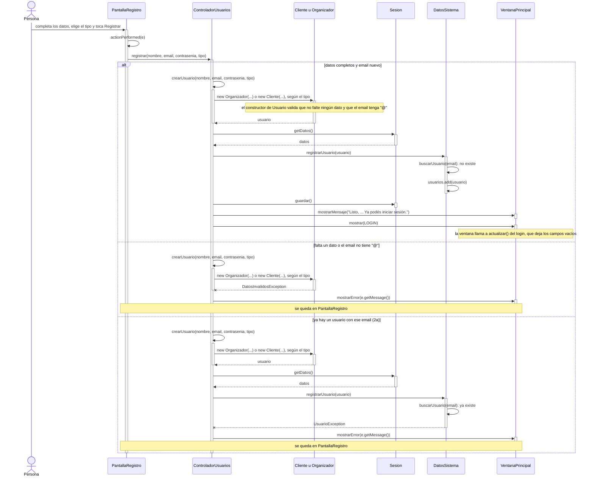

# CU01 — Registrar usuario · Diagrama de secuencia

[← Volver al p8](../p8-diagramas-de-secuencia.md) · Caso de uso: [CU01](../../analisis/casos-de-uso.md#cu01--registrar-usuario)

> Este caso de uso **no es uno de los 5 del p8** (D-005). El diagrama está igual, porque CLAUDE.md pide uno por cada caso de uso implementado, para la defensa.

La persona completa nombre, email, contraseña y tipo (cliente u organizador) en `PantallaRegistro` y toca *Registrar*. Si los datos están bien y el email no existe, se guarda el usuario y se vuelve al login; si no, ve un error y se queda en el registro.

## Diagrama

## Paso a paso

1. **`PantallaRegistro.actionPerformed`** ve que se tocó `botonRegistrar`. Lee los tres campos de texto y el tipo elegido en el combo (`comboTipo.getSelectedItem()`). Llama a `controlador.registrar(...)` con todo tal cual, como `String`.
2. **`ControladorUsuarios.crearUsuario`** (privado) crea un `Organizador` o un `Cliente` según el tipo. El combo se armó con las constantes `TIPO_CLIENTE` y `TIPO_ORGANIZADOR` del mismo controlador, así el texto siempre coincide.
3. **El constructor de `Usuario`** (que llaman los dos con `super(...)`) valida que el nombre, el email y la contraseña no estén vacíos y que el email tenga `@`. Si algo falla, lanza `DatosInvalidosException` y el objeto **no se llega a crear**. El `Cliente` además nace con su carrito vacío.
4. **`DatosSistema.registrarUsuario`** busca si ya hay un usuario con ese email, sin importar mayúsculas. Si lo hay, lanza `UsuarioException` (flujo 2a). Si no, lo agrega a la lista.
5. **El controlador guarda** (`sesion.guardar()`), avisa con un mensaje y vuelve al login.
6. **Cualquier error** (datos incompletos, email repetido o un problema al guardar el archivo) se captura con el único `catch (SistemaException e)` del controlador, que muestra el motivo.

## Elementos, patrones y decisiones

| Elemento | Qué muestra |
|---|---|
| **Herencia** (`Cliente` y `Organizador` heredan de `Usuario`) | La validación de los datos está escrita una sola vez, en `Usuario`. |
| **GRASP Creador** | El controlador crea el usuario porque tiene los datos para inicializarlo (los que escribió la persona). |
| **GRASP Experto** | `DatosSistema` controla el email repetido porque es el que tiene la lista de usuarios. |
| **Jerarquía de excepciones** | `DatosInvalidosException` y `UsuarioException` heredan de `SistemaException`: un solo `catch` las atrapa a las dos. |

- **No se entra automáticamente después de registrarse.** Se vuelve al login para que la persona pruebe su email y contraseña. Es lo que ya decía el p9.
- **El email se compara sin importar mayúsculas**, así "Ana@mail.com" y "ana@mail.com" no pueden ser dos usuarios distintos.
- **Si falla el guardado**, el usuario queda en memoria hasta que se cierre el programa, pero no en el archivo. Es un caso muy raro (disco lleno, archivo sin permisos) y el mensaje de error lo avisa.
