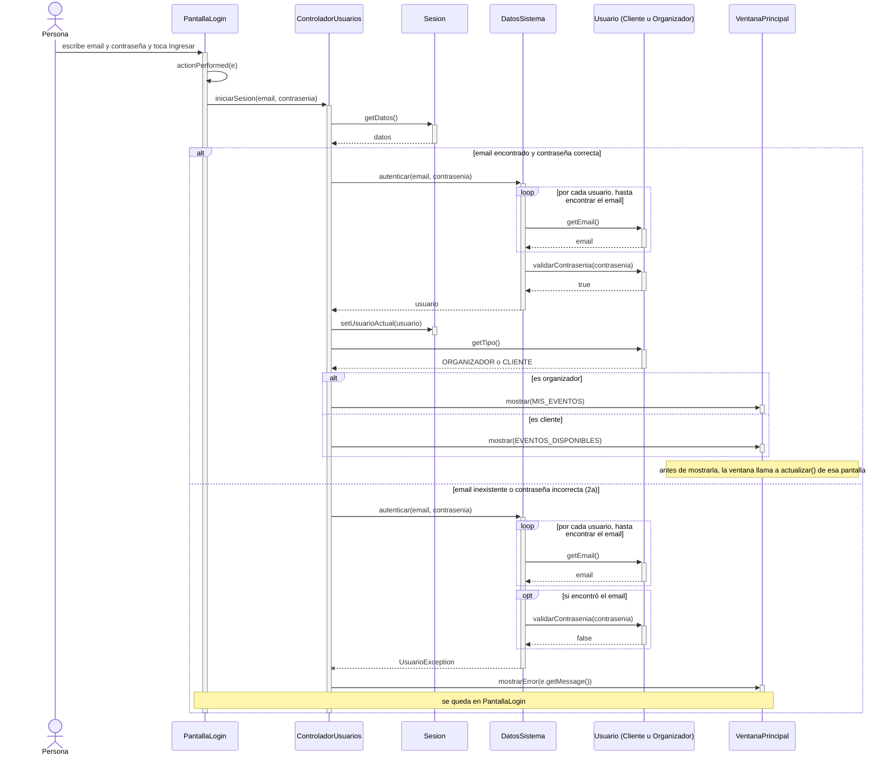

# CU02 — Iniciar sesión · Diagrama de secuencia

[← Volver al p8](../p8-diagramas-de-secuencia.md) · Caso de uso: [CU02](../../analisis/casos-de-uso.md#cu02--iniciar-sesión)

El usuario escribe email y contraseña en `PantallaLogin` y toca *Ingresar*. Si los datos son correctos, entra a la pantalla de inicio de su rol; si no, ve un error y se queda en el login.

## Diagrama

Si no se encuentra ningún usuario con ese email, `autenticar` no llama a `validarContrasenia`: lanza la excepción directamente.

## Paso a paso

1. **`PantallaLogin.actionPerformed`** ve que se tocó `botonIngresar`. Lee `campoEmail.getText()` y la contraseña (`new String(campoContrasenia.getPassword())`, porque un `JPasswordField` devuelve un arreglo de `char`). Llama a `controlador.iniciarSesion(email, contrasenia)`. Lo mismo pasa si se aprieta Enter en el campo de la contraseña (`e.getSource() == campoContrasenia`).
2. **`ControladorUsuarios.iniciarSesion`** le pide a la `Sesion` los datos cargados y llama a `DatosSistema.autenticar`.
3. **`DatosSistema.autenticar`** recorre la lista de usuarios buscando el email. Si lo encuentra, le pregunta a **ese** usuario si la contraseña es la suya (`validarContrasenia`). La contraseña se compara adentro de `Usuario`, que es el que la tiene (GRASP Experto).
4. **Si todo está bien**, devuelve el usuario. El controlador lo guarda en la sesión (`setUsuarioActual`) y le pregunta `getTipo()`.
5. **`getTipo()` es abstracto en `Usuario`.** Java ejecuta el de la clase real del objeto: `Organizador.getTipo()` devuelve `"ORGANIZADOR"` y `Cliente.getTipo()` devuelve `"CLIENTE"`. El controlador nunca pregunta "¿de qué clase es?" (sin `instanceof`).
6. Según el tipo, el controlador le pide a la ventana `mostrar(MIS_EVENTOS)` o `mostrar(EVENTOS_DISPONIBLES)`. La ventana llama a `actualizar()` de esa pantalla, que carga la tabla.
7. **Si falla** (2a), `autenticar` lanza `UsuarioException("Email o contraseña incorrectos")`. El controlador la captura con su `catch (SistemaException e)` y muestra el mensaje.

No se llama a `Sesion.guardar()`: iniciar sesión no cambia ningún dato que haya que guardar.

## Elementos, patrones y decisiones

| Elemento | Qué muestra |
|---|---|
| **Polimorfismo** (`Usuario.getTipo()`) | Una sola llamada, dos comportamientos según la clase real del objeto. |
| **GRASP Experto** | `DatosSistema` busca porque tiene la lista; `Usuario` valida porque tiene la contraseña. |
| **GRASP Controlador** | `ControladorUsuarios` recibe el evento de la GUI y coordina; no tiene reglas propias. |
| **Jerarquía de excepciones** | `UsuarioException` hereda de `SistemaException`: el controlador la captura sin conocerla en particular. |

- **El mismo mensaje para "email inexistente" y "contraseña incorrecta".** Así nadie puede averiguar qué emails están registrados probando en el login.
- **`getTipo()` devuelve un `String`** y no un enum, porque solo se usa para elegir la pantalla y es más fácil de explicar.
