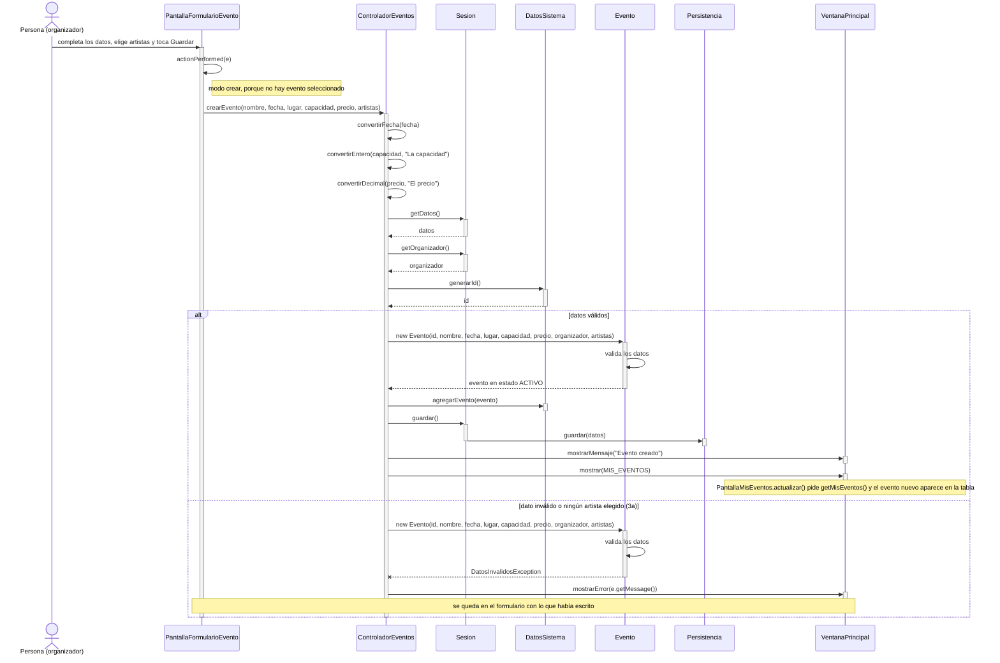

# CU03 — Crear evento · Diagrama de secuencia

[← Volver al p8](../p8-diagramas-de-secuencia.md) · Caso de uso: [CU03](../../analisis/casos-de-uso.md#cu03--crear-evento)

El organizador completa el formulario (nombre, fecha, lugar, capacidad, precio), elige uno o más artistas de la lista y toca *Guardar*. El evento se crea en estado `ACTIVO` y aparece en "Mis eventos".

## Diagrama

Si un texto no se puede convertir (por ejemplo, la capacidad dice "mil"), `convertirEntero` lanza `DatosInvalidosException` ahí mismo, antes de crear nada, y se va directo al mismo `catch`.

## Paso a paso

1. **`PantallaFormularioEvento.actionPerformed`** ve que se tocó *Guardar*. Como está en modo crear (`modoModificar` es `false`), llama a `crearEvento` con los textos de los campos y la lista de artistas elegidos (`listaArtistas.getSelectedValuesList()`).
2. **`ControladorEventos.crearEvento`** convierte los textos con los métodos heredados de `Controlador`. La fecha se escribe `dd/mm/aaaa`.
3. Le pide a la sesión los datos y el organizador que inició sesión, y a `DatosSistema` un id nuevo.
4. **`new Evento(...)`**: el constructor valida todo (nombre y lugar no vacíos, fecha futura, capacidad mayor a 0, precio no negativo, al menos un artista). Si algo está mal, lanza `DatosInvalidosException` con un mensaje claro y el objeto no llega a existir.
5. **Si se creó**, el controlador lo agrega con `DatosSistema.agregarEvento`, guarda (`Sesion.guardar()` → `Persistencia.guardar(datos)`), avisa "Evento creado" y vuelve a "Mis eventos".
6. **Si no** (3a), el controlador captura la excepción y muestra el mensaje. El organizador corrige y vuelve a tocar *Guardar*.

**Alternativo 2a (no hay artistas registrados):** no está en este diagrama porque no pasa por *Guardar*. En el formulario, el botón *Nuevo artista* lleva a `PantallaArtistas` (CU15), como muestra el [p9](../p9-diagrama-de-navegacion.md#2-organizador).

## Elementos, patrones y decisiones

| Elemento | Qué muestra |
|---|---|
| **Herencia** (`Controlador`) | `convertirFecha`, `convertirEntero` y `convertirDecimal` se escriben una sola vez para los cinco controladores. |
| **GRASP Creador** | El controlador crea el `Evento` porque tiene todos los datos para inicializarlo. |
| **GRASP Experto** | Las reglas de un evento válido están en el constructor de `Evento`, no en la pantalla ni en el controlador. |
| **Interfaz `Persistencia`** | La `Sesion` llama a `guardar` sin saber que por debajo hay un archivo. |

- **Se valida en el constructor**: así es imposible tener un `Evento` inválido en el sistema. La misma validación la usa `Evento.modificar` (CU04).
- **El id se pide antes de crear el evento.** Si el constructor falla, ese número queda sin usar; no es un problema, porque los ids solo tienen que ser únicos, no seguidos.
- **Si falla el guardado** (`PersistenciaException`), el evento queda en memoria y el usuario ve el error. En la próxima operación que guarde, se vuelve a intentar escribir todo.
