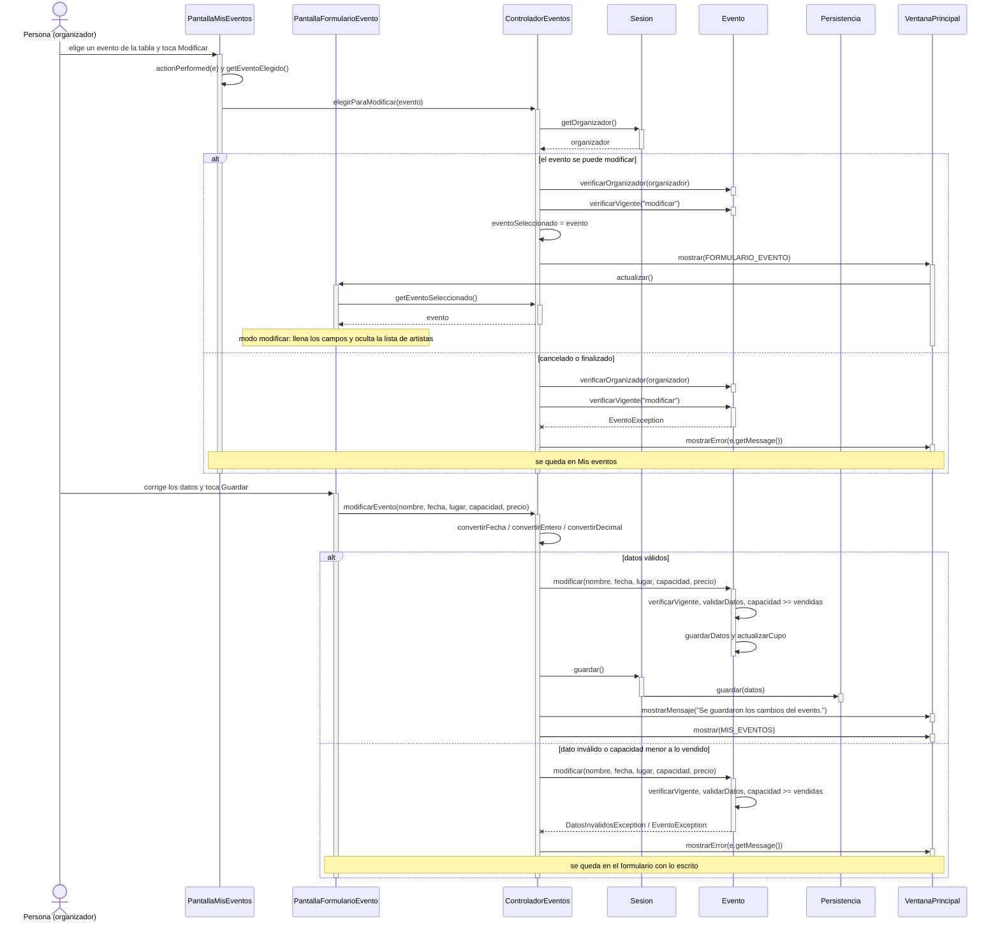

# CU04 — Modificar evento · Diagrama de secuencia

[← Volver al p8](../p8-diagramas-de-secuencia.md) · Caso de uso: [CU04](../../analisis/casos-de-uso.md#cu04--modificar-evento)

El organizador elige un evento en "Mis eventos", toca *Modificar*, corrige los datos en el formulario y toca *Guardar*. Pasa por **dos pantallas**, por eso el controlador recuerda el evento en `eventoSeleccionado`.

## Diagrama

## Paso a paso

1. **`PantallaMisEventos`** toma la fila elegida y busca el `Evento` en `eventosMostrados`. Si no hay fila elegida, muestra "Elegí un evento de la tabla." y no llama al controlador.
2. **`ControladorEventos.elegirParaModificar`** controla dos cosas **antes** de abrir el formulario: que el evento sea del organizador (`verificarOrganizador`) y que no esté cancelado ni finalizado (`verificarVigente`). Así no se completa un formulario para nada.
3. Guarda el evento en `eventoSeleccionado` y muestra el formulario. `PantallaFormularioEvento.actualizar()` ve que hay un evento seleccionado, pasa a modo modificar, llena los campos y oculta la lista de artistas (los artistas se cambian en el CU06).
4. Al tocar *Guardar*, el formulario llama a `modificarEvento` con los textos. El controlador los convierte y le pide al evento que se modifique.
5. **`Evento.modificar`** vuelve a controlar que esté vigente, valida los datos con el mismo método que el constructor (`validarDatos`) y no deja bajar la capacidad por debajo de las entradas vendidas. Después actualiza el estado: si con la nueva capacidad no quedan lugares, pasa a `AGOTADO`, y al revés.
6. Si todo está bien, se guarda y se vuelve a "Mis eventos" con la tabla recargada.

## Elementos, patrones y decisiones

| Elemento | Qué muestra |
|---|---|
| **Estado en el controlador** | `eventoSeleccionado` une las dos pantallas del caso de uso. Si es `null`, el formulario está en modo crear (CU03). |
| **GRASP Experto** | Las reglas (vigente, datos válidos, capacidad) están en `Evento`. |
| **Sin código repetido** | El mismo formulario sirve para crear y modificar; `validarDatos` lo usan el constructor y `modificar`. |

- **`verificarVigente` se llama dos veces** (en `elegirParaModificar` y dentro de `modificar`). La primera es para avisar temprano; la segunda es la que protege la regla, aunque alguien llame a `modificar` desde otro lado.
