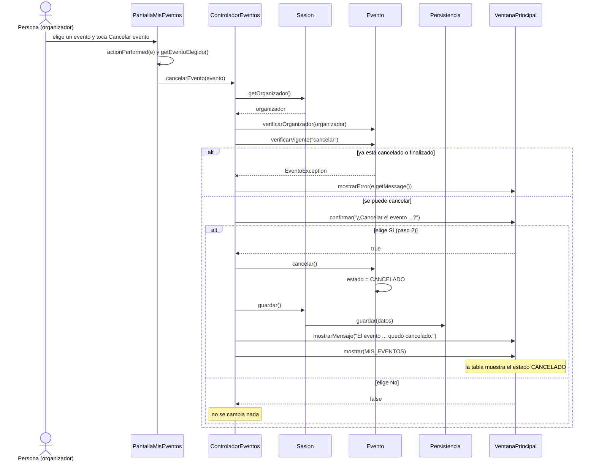

# CU05 — Cancelar evento · Diagrama de secuencia

[← Volver al p8](../p8-diagramas-de-secuencia.md) · Caso de uso: [CU05](../../analisis/casos-de-uso.md#cu05--cancelar-evento)

El organizador elige un evento en "Mis eventos", toca *Cancelar evento* y confirma. El evento pasa a `CANCELADO` y ya no se pueden comprar entradas.

## Diagrama

## Paso a paso

1. **`PantallaMisEventos`** busca el evento de la fila elegida y llama a `cancelarEvento`. Si no hay fila elegida, avisa y no llama al controlador.
2. **`ControladorEventos.cancelarEvento`** controla primero que el evento sea del organizador y que esté vigente. Así no se pregunta "¿seguro?" por algo que después va a fallar (mismo criterio que el CU14).
3. Pide la confirmación con `ventana.confirmar(...)` (paso 2 del caso de uso). Si la persona dice que no, termina sin cambiar nada.
4. **`Evento.cancelar()`** vuelve a controlar que esté vigente y pone el estado en `CANCELADO` (paso 3).
5. Se guarda y se vuelve a mostrar "Mis eventos" para que la tabla diga `CANCELADO`.

## Elementos, patrones y decisiones

| Elemento | Qué muestra |
|---|---|
| **Enum `EstadoEvento`** | El estado solo puede ser uno de los cuatro valores; no hay textos mal escritos. |
| **GRASP Experto** | `Evento` decide si se puede cancelar y cambia su propio estado. |
| **`VentanaPrincipal.confirmar`** | El controlador pregunta sin usar Swing directamente. |

- **Las compras ya hechas de ese evento no se tocan acá.** El evento cancelado ya no aparece para comprar (CU07) ni se puede agregar al carrito (CU09), y `Carrito.verificarDisponibilidad` lo rechaza al confirmar (CU10). Como dice el p3, las compras ya hechas no se cancelan solas: el cliente las cancela con el CU14.
