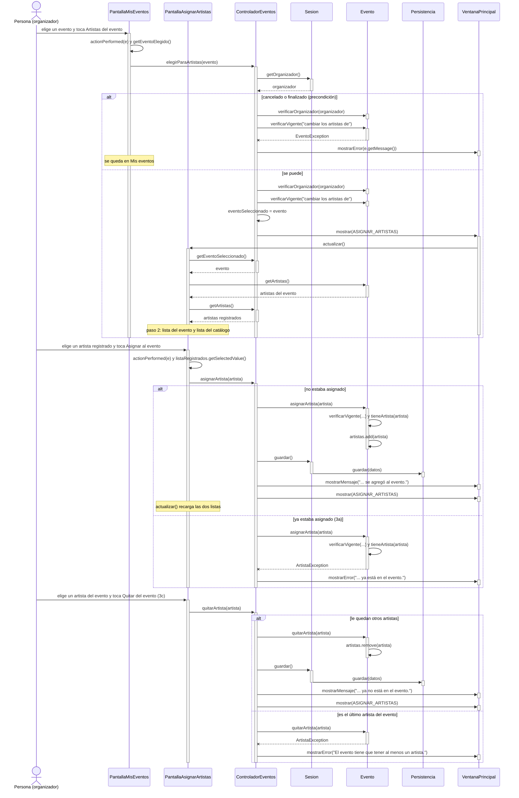

# CU06 — Asignar artistas a un evento · Diagrama de secuencia

[← Volver al p8](../p8-diagramas-de-secuencia.md) · Caso de uso: [CU06](../../analisis/casos-de-uso.md#cu06--asignar-artistas-a-un-evento)

El organizador elige un evento en "Mis eventos" y toca *Artistas del evento*. Ve dos listas: los artistas del evento y todo el catálogo. Elige un artista del catálogo y toca *Asignar al evento*, o uno del evento y toca *Quitar del evento*.

## Diagrama

## Paso a paso

1. **`PantallaMisEventos`** busca el evento de la fila elegida y llama a `elegirParaArtistas`. Si no hay fila elegida, avisa y no llama al controlador.
2. **`ControladorEventos.elegirParaArtistas`** controla que el evento sea del organizador y que no esté cancelado ni finalizado (precondición del CU06). Recién ahí guarda el evento en `eventoSeleccionado` y abre la pantalla.
3. **`PantallaAsignarArtistas.actualizar()`** le pide al controlador el evento seleccionado y arma las dos listas: los artistas del evento (`Evento.getArtistas()`) y el catálogo completo (`ControladorEventos.getArtistas()`).
4. Al tocar *Asignar al evento*, la pantalla toma el artista elegido en la lista de la derecha y llama a `asignarArtista`. **`Evento.asignarArtista`** vuelve a controlar que el evento esté vigente y que el artista no esté ya (3a). Si todo está bien, lo agrega; el controlador guarda y vuelve a mostrar la pantalla.
5. *Quitar del evento* es igual, con `Evento.quitarArtista`, que no deja quitar el último artista (3c): un evento siempre tiene al menos uno (D-002).
6. **3b (el artista no está registrado):** el botón *Nuevo artista* lleva a `PantallaArtistas` (CU15). Ese paso no pasa por el controlador, porque solo cambia de pantalla.

## Elementos, patrones y decisiones

| Elemento | Qué muestra |
|---|---|
| **GRASP Experto** | `Evento` es quien tiene su lista de artistas, así que es quien controla repetidos y el mínimo de uno. |
| **Estado entre pantallas** | `eventoSeleccionado` guarda el evento elegido en "Mis eventos" para usarlo en la otra pantalla. Es el mismo atributo que usa el CU04. |
| **Jerarquía de excepciones** | `ArtistaException` (repetido, último) y `EventoException` (evento cancelado) se capturan juntas con un solo `catch (SistemaException e)`. |

- **Se elige un artista por vez.** El caso de uso dice "uno o más", pero con uno por vez cada error (3a) se refiere a un solo artista y el código queda más simple. Asignar varios es tocar el botón varias veces.
- **`verificarVigente` se llama dos veces:** en el controlador para no abrir la pantalla en vano, y dentro de `Evento` para que la regla se cumpla siempre, aunque alguien llame directo al modelo.
