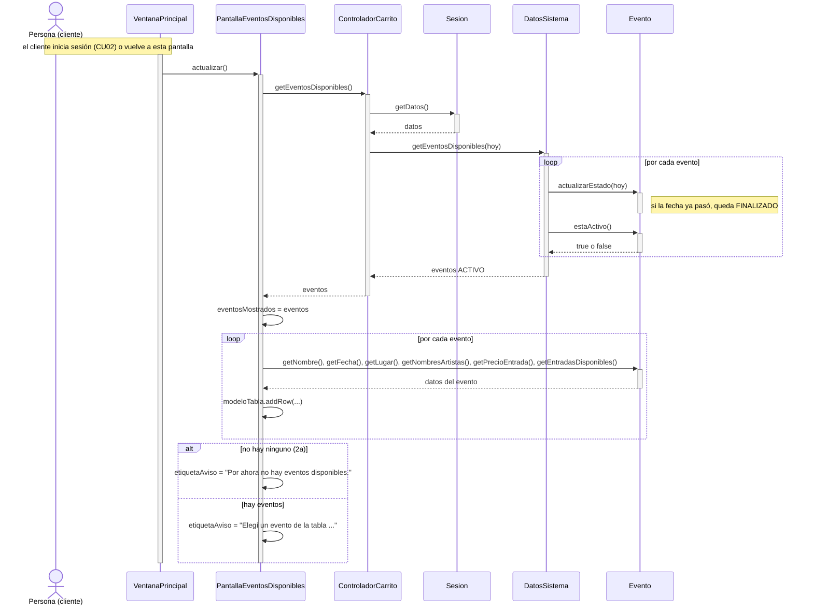

# CU07 — Consultar eventos disponibles · Diagrama de secuencia

[← Volver al p8](../p8-diagramas-de-secuencia.md) · Caso de uso: [CU07](../../analisis/casos-de-uso.md#cu07--consultar-eventos-disponibles)

El cliente inicia sesión y ve la tabla de eventos a los que todavía puede comprar entradas. La tabla se vuelve a armar cada vez que se muestra la pantalla.

## Diagrama

## Paso a paso

1. Cada vez que la ventana muestra la pantalla (después del login o al volver del carrito o del historial), llama a **`actualizar()`**.
2. La pantalla le pide la lista a **`ControladorCarrito.getEventosDisponibles()`**, que se la pide a **`DatosSistema`** con la fecha de hoy.
3. **`DatosSistema.getEventosDisponibles`** recorre todos los eventos. A cada uno le pide que actualice su estado (uno cuya fecha ya pasó se vuelve `FINALIZADO`) y se queda solo con los que están `ACTIVO`. Los `AGOTADO`, `CANCELADO` y `FINALIZADO` no se muestran.
4. La pantalla guarda la lista en `eventosMostrados` (en el mismo orden que las filas) y arma una fila por evento. La columna "Artistas" usa `Evento.getNombresArtistas()`.
5. **2a:** si la lista está vacía, lo dice en la misma pantalla con una etiqueta.

## Elementos, patrones y decisiones

| Elemento | Qué muestra |
|---|---|
| **Polimorfismo** | `VentanaPrincipal.mostrar` llama a `actualizar()` sin saber qué pantalla es. |
| **GRASP Experto** | `DatosSistema` tiene la lista de todos los eventos y los filtra; cada `Evento` sabe si está activo y arma los nombres de sus artistas. |
| **MVC** | La pantalla solo lee datos para mostrarlos; no decide qué evento está disponible. |

- **El aviso de "no hay eventos" va en la pantalla y no en un diálogo:** un diálogo aparecería cada vez que el cliente entra o vuelve a la pantalla.
- Este caso de uso no guarda nada: solo consulta.
