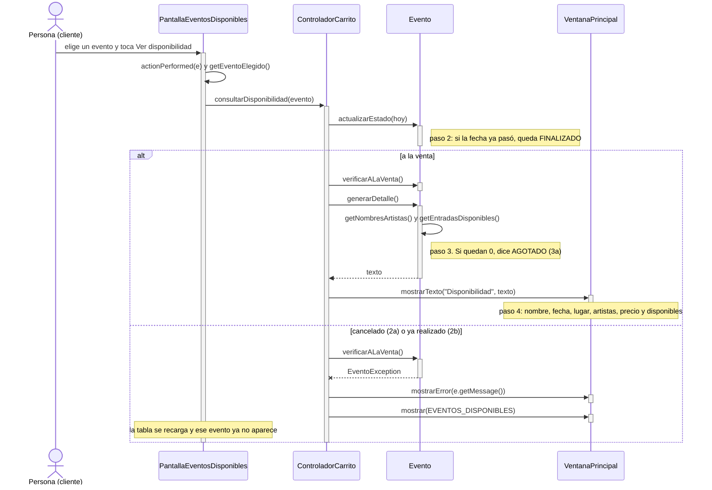

# CU08 — Consultar disponibilidad de entradas · Diagrama de secuencia

[← Volver al p8](../p8-diagramas-de-secuencia.md) · Caso de uso: [CU08](../../analisis/casos-de-uso.md#cu08--consultar-disponibilidad-de-entradas) (extiende [CU07](CU07-consultar-eventos-disponibles.md))

El cliente elige un evento en la tabla y toca *Ver disponibilidad*. Ve un diálogo con los datos del evento y cuántas entradas quedan.

## Diagrama

## Paso a paso

1. **`PantallaEventosDisponibles`** busca el evento de la fila elegida (`eventosMostrados.get(fila)`) y llama a `consultarDisponibilidad`. Si no hay fila elegida, avisa y no llama al controlador.
2. **`ControladorCarrito.consultarDisponibilidad`** le pide al evento que actualice su estado con la fecha de hoy: la tabla se armó antes y el evento pudo haber pasado de fecha (paso 2 del caso de uso).
3. **`Evento.verificarALaVenta()`** lanza `EventoException` si el evento está cancelado (2a) o finalizado (2b), cada uno con su mensaje. El controlador lo muestra y recarga la tabla.
4. Si está a la venta, **`Evento.generarDetalle()`** arma el texto. Las entradas disponibles las calcula el mismo evento (capacidad menos vendidas, paso 3). Si no queda ninguna, el texto dice "0 (AGOTADO)" (3a).
5. El controlador muestra el texto con `ventana.mostrarTexto(...)`. El cliente lo cierra y sigue en la misma pantalla.

## Elementos, patrones y decisiones

| Elemento | Qué muestra |
|---|---|
| **GRASP Experto** | `Evento` sabe su estado, cuántas entradas le quedan y cómo describirse. El controlador no calcula nada. |
| **Jerarquía de excepciones** | `EventoException` con un mensaje distinto para cada flujo alternativo. |
| **Reutilización** | `verificarALaVenta` es el mismo control que usa `verificarDisponibilidad` cuando se agregan entradas al carrito (CU09 incluye CU08). |

- **No se guarda nada:** `actualizarEstado` puede cambiar el estado en memoria, pero se vuelve a calcular cada vez que se listan los eventos, así que no hace falta guardar.
- **El caso 3a (agotado) no se ve desde la tabla:** la tabla solo muestra eventos `ACTIVO` (CU07), y un evento agotado no lo está. El texto "AGOTADO" queda listo por si el equipo decide mostrar también los agotados (ver D-008 en la bitácora del 24/10).
