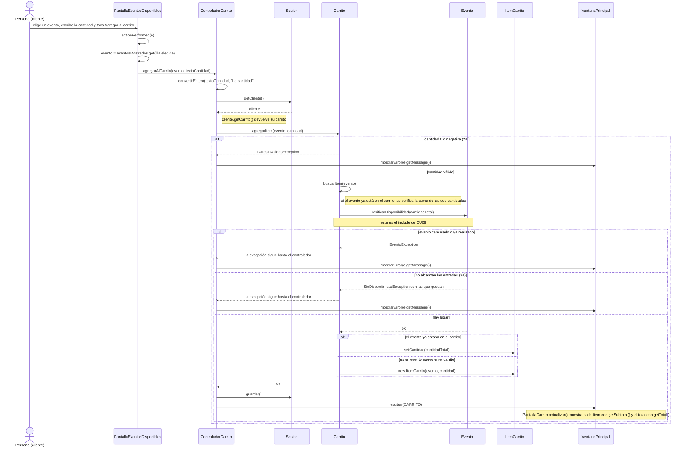

# CU09 — Agregar entradas al carrito · Diagrama de secuencia

[← Volver al p8](../p8-diagramas-de-secuencia.md) · Caso de uso: [CU09](../../analisis/casos-de-uso.md#cu09--agregar-entradas-al-carrito) (incluye [CU08](../../analisis/casos-de-uso.md#cu08--consultar-disponibilidad-de-entradas))

El cliente elige un evento en la tabla de `PantallaEventosDisponibles`, escribe cuántas entradas quiere y toca *Agregar al carrito*. Si hay lugar, ve el carrito actualizado; si no, ve cuántas entradas quedan.

## Diagrama

Cuando hay un error, el cliente **se queda en `PantallaEventosDisponibles`** para corregir la cantidad (ver [p9](../p9-diagrama-de-navegacion.md#3-cliente)).

## Paso a paso

1. **`PantallaEventosDisponibles.actionPerformed`** toma la fila elegida de la tabla y busca el `Evento` en su lista `eventosMostrados` (la misma lista con la que armó la tabla, en el mismo orden). Si no hay fila elegida, muestra un aviso y no llama al controlador.
2. **`ControladorCarrito.agregarAlCarrito`** convierte la cantidad a número, busca el carrito del cliente que inició sesión y llama a `Carrito.agregarItem`.
3. **`Carrito.agregarItem`**:
   - Si la cantidad es 0 o negativa, lanza `DatosInvalidosException` (2a).
   - Con `buscarItem(evento)` se fija si ese evento ya está en el carrito. Si está, la cantidad a verificar es la que ya tenía **más** la nueva. Así no se puede esquivar el límite agregando de a poco.
   - Le pide al evento `verificarDisponibilidad(cantidadTotal)`. **Esto es CU08 incluido en CU09.**
4. **`Evento.verificarDisponibilidad`** revisa, en este orden:
   - si está `CANCELADO` o ya pasó su fecha → `EventoException` ("El evento fue cancelado", "El evento ya se realizó");
   - si `getEntradasDisponibles()` (capacidad menos vendidas) es menor que lo pedido → `SinDisponibilidadException`, con un mensaje "Quedan N entradas" y el número guardado en `getDisponibles()` (3a).
5. **Si hay lugar**, el carrito actualiza el ítem existente o crea uno nuevo (GRASP Creador: el carrito contiene los ítems).
6. El controlador guarda (el carrito se guarda dentro del `Cliente`) y muestra `PantallaCarrito`, que recalcula subtotales y total.

**Alternativo 5a (cambiar cantidad o quitar un ítem):** desde `PantallaCarrito`, *Cambiar cantidad* llama a `ControladorCarrito.cambiarCantidad` → `Carrito.cambiarCantidad`, que hace la misma verificación con `Evento.verificarDisponibilidad`. *Quitar* llama a `quitarItem` → `Carrito.quitarItem`. No se dibujan aparte porque siguen la misma forma.

## Elementos, patrones y decisiones

| Elemento | Qué muestra |
|---|---|
| **Include CU09 → CU08** | Es la llamada a `Evento.verificarDisponibilidad`: siempre se hace antes de agregar. |
| **GRASP Experto** | El evento sabe cuántas entradas le quedan; el carrito sabe qué ítems tiene; el ítem sabe su subtotal. |
| **GRASP Creador** | `Carrito` crea `ItemCarrito`. |
| **Jerarquía de excepciones** | `SinDisponibilidadException` hereda de `EventoException`, que hereda de `SistemaException`. El controlador las captura a todas con un solo `catch`. |

- **Agregar al carrito no ocupa lugares.** Las entradas recién se descuentan del evento cuando se paga (CU10). Por eso, al confirmar, se vuelve a verificar todo el carrito.
- **El `Evento` del carrito es el mismo objeto que está en `DatosSistema`**, no una copia. Si el organizador lo cancela, el carrito lo "ve" en la próxima verificación.
