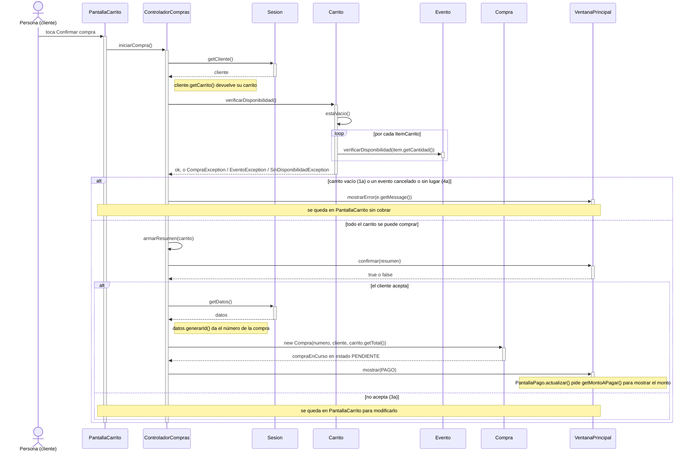
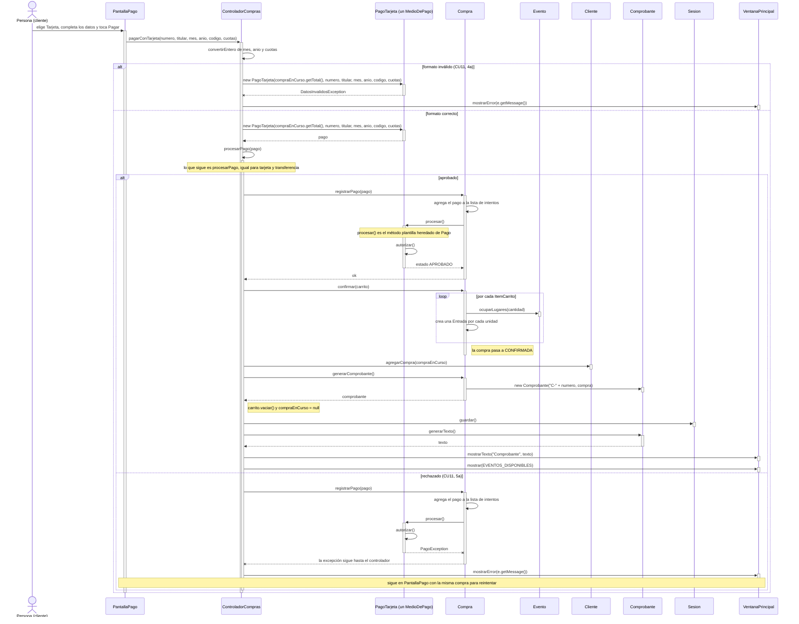
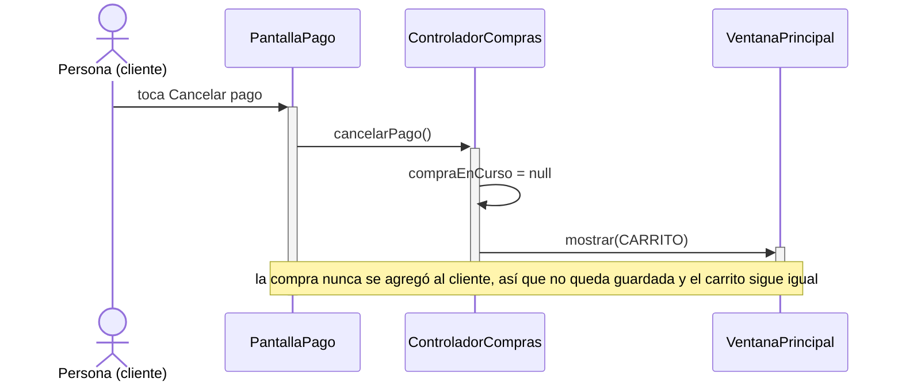

# CU10 — Confirmar compra (con CU11 y CU12) · Diagramas de secuencia

[← Volver al p8](../p8-diagramas-de-secuencia.md) · Casos de uso: [CU10](../../analisis/casos-de-uso.md#cu10--confirmar-compra), [CU11](../../analisis/casos-de-uso.md#cu11--realizar-pago) y [CU12](../../analisis/casos-de-uso.md#cu12--generar-comprobante)

CU10 incluye CU11 (pagar) y CU12 (generar el comprobante). Pasan por dos pantallas, así que se dibujan en tres partes:

1. [Confirmar el carrito](#1-confirmar-el-carrito-cu10-pasos-1-a-4): `PantallaCarrito` · *Confirmar compra*.
2. [Pagar y cerrar la compra](#2-pagar-y-cerrar-la-compra-cu11-cu10-pasos-6-a-8-y-cu12): `PantallaPago` · *Pagar*.
3. [Cancelar el pago](#3-cancelar-el-pago-cu11-2a): `PantallaPago` · *Cancelar pago*.

Entre la parte 1 y la 2, el `ControladorCompras` recuerda la compra en su atributo `compraEnCurso` (ver p7).

## 1. Confirmar el carrito (CU10, pasos 1 a 4)

### Paso a paso

1. **`ControladorCompras.iniciarCompra`** busca el carrito del cliente y le pide `verificarDisponibilidad()`.
2. **`Carrito.verificarDisponibilidad`** lanza `CompraException` si está vacío (1a). Si no, le pide a **cada** evento `verificarDisponibilidad(cantidad)`. Se verifica de nuevo aunque ya se verificó al agregar (CU09), porque desde entonces el organizador pudo cancelar un evento (4a).
3. **`armarResumen`** (método privado del controlador) arma un texto con cada evento, cantidad y subtotal, y el total. La ventana lo muestra con `confirmar(resumen)`: un diálogo de sí o no.
4. **Si el cliente acepta**, se crea la `Compra` en estado `PENDIENTE` con el total del carrito y se guarda en `compraEnCurso`. Todavía **no** se agrega al cliente ni se guarda en el archivo: si el cliente se arrepiente, simplemente se descarta.

## 2. Pagar y cerrar la compra (CU11, CU10 pasos 6 a 8, y CU12)

**Con transferencia** es igual. Cambian solo las dos primeras llamadas: la pantalla llama a `pagarConTransferencia(cbu, numeroOperacion)` y el controlador crea un `new PagoTransferencia(monto, cbu, numeroOperacion)`. Después llama al **mismo** `procesarPago(pago)`. Por eso `procesarPago` recibe un `MedioDePago` y no una clase concreta: no se repite código.

### Paso a paso

1. **`pagarConTarjeta`** convierte mes, año y cuotas a número y crea el `PagoTarjeta`. El constructor valida el formato (16 dígitos, vencimiento no pasado, código de 3 dígitos, cuotas 1, 3, 6 o 12). Si algo está mal, lanza `DatosInvalidosException` (CU11, 4a) y el pago ni siquiera se registra.
2. **`procesarPago(pago)`** (privado) llama a `compraEnCurso.registrarPago(pago)`.
3. **`Compra.registrarPago`** agrega el pago a su lista de intentos **antes** de procesarlo. Así, si se rechaza, el intento queda registrado (CU11, 5a).
4. **`Pago.procesar()`** es el **Template Method**: llama a `autorizar()`, que cada subclase implementa a su manera, y según el resultado pone el estado en `APROBADO` o `RECHAZADO`. Si se rechazó, lanza `PagoException`. `Compra` no sabe si es tarjeta o transferencia: solo conoce la interfaz `MedioDePago` (**Strategy**).
5. **Si se rechaza**, la excepción sube hasta el controlador, que muestra el motivo. `compraEnCurso` sigue igual, con el intento rechazado en su lista, y el cliente puede volver a tocar *Pagar* con otros datos u otro medio.
6. **Si se aprueba**, el controlador llama a `Compra.confirmar(carrito)`, que vuelve a comprobar que hay un pago aprobado y, por cada ítem, ocupa los lugares en el evento y crea una `Entrada` por unidad, con código `numero-n` (por ejemplo `15-1`, `15-2`). La compra pasa a `CONFIRMADA` (CU10, paso 6).
7. Recién ahora la compra se agrega al cliente (`Cliente.agregarCompra`) y forma parte del historial.
8. **CU12:** `Compra.generarComprobante()` crea el `Comprobante` con número `C-15` (GRASP Creador).
9. Se vacía el carrito (CU10, paso 8), se descarta `compraEnCurso`, se guarda todo y se muestra el texto del comprobante (`Comprobante.generarTexto()`) en un diálogo. Al aceptarlo, el cliente vuelve a la pantalla de eventos.

## 3. Cancelar el pago (CU11, 2a)

## Elementos, patrones y decisiones

| Elemento | Qué muestra |
|---|---|
| **Strategy** (`MedioDePago`) | `Compra.registrarPago` funciona igual con tarjeta o transferencia. Agregar otro medio no cambia `Compra`. |
| **Template Method** (`Pago.procesar` con `autorizar`) | Los pasos del pago están escritos una sola vez en `Pago`; cada subclase solo dice cómo se autoriza. |
| **GRASP Creador** | `Compra` crea sus `Entrada` y su `Comprobante`, porque los contiene. |
| **GRASP Controlador** | `ControladorCompras` guarda el estado entre las dos pantallas (`compraEnCurso`). |
| **Sin código duplicado** | `procesarPago` es el mismo para los dos medios de pago. |

- **Los lugares se ocupan después de que se aprueba el pago**, no antes. Así, si el pago se rechaza, no hay nada que deshacer.
- **¿Puede cambiar la disponibilidad entre la verificación de la parte 1 y el pago?** No: la aplicación es de escritorio y la usa una persona por vez. Mientras el cliente está en `PantallaPago`, nadie más puede cancelar un evento ni comprar entradas.
- **El pago es simulado** (ver p1 y p6): se rechazan las tarjetas terminadas en `0000` y las transferencias con número de operación terminado en `000`. Sirve para mostrar el caso 5a en la demo.
