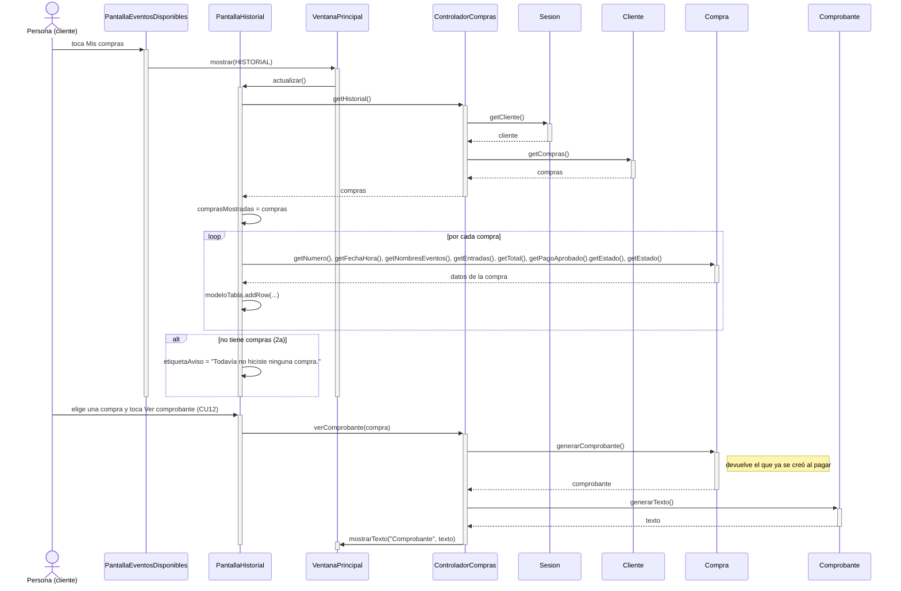

# CU13 — Consultar historial de compras · Diagrama de secuencia

[← Volver al p8](../p8-diagramas-de-secuencia.md) · Caso de uso: [CU13](../../analisis/casos-de-uso.md#cu13--consultar-historial-de-compras) (lo extienden [CU12](../../analisis/casos-de-uso.md#cu12--generar-comprobante) y [CU14](CU14-cancelar-compra.md))

El cliente toca *Mis compras* y ve una tabla con sus compras. Desde ahí puede ver el comprobante de una (CU12) o cancelarla (CU14).

## Diagrama

## Paso a paso

1. *Mis compras* solo cambia de pantalla, así que `PantallaEventosDisponibles` llama directo a `ventana.mostrar(HISTORIAL)`.
2. **`PantallaHistorial.actualizar()`** le pide las compras a `ControladorCompras.getHistorial()`, que se las pide al cliente que inició sesión.
3. La pantalla guarda la lista en `comprasMostradas` y arma una fila por compra: número, fecha de compra, eventos, cantidad de entradas, total, estado del pago y estado de la compra.
4. **2a:** si la lista está vacía, lo dice en la misma pantalla con una etiqueta.
5. *Ver comprobante* toma la compra de la fila elegida y llama a `verComprobante`. **`Compra.generarComprobante()`** devuelve el comprobante que se creó al pagar, sin generar otro número. **`Comprobante.generarTexto()`** arma el texto, que se muestra en un diálogo.
6. *Cancelar compra* está dibujado en el [CU14](CU14-cancelar-compra.md).

## Elementos, patrones y decisiones

| Elemento | Qué muestra |
|---|---|
| **GRASP Experto** | El cliente tiene sus compras; la compra sabe qué eventos tiene y arma los nombres; el comprobante arma su texto. |
| **Polimorfismo** | `compra.getPagoAprobado()` devuelve un `MedioDePago`: la pantalla no sabe si fue tarjeta o transferencia. |
| **Herencia** | `PantallaHistorial` hereda de `Pantalla` y usa `crearTabla`, `formatearFecha` y `formatearPrecio`. |

- **Una compra por fila, no una entrada por fila.** Una compra puede tener muchas entradas. La cantidad se muestra en la tabla, y los códigos de cada entrada están en el comprobante.
- **Si el organizador canceló un evento, el historial lo aclara** con "(CANCELADO)" al lado del nombre. La compra no se cancela sola (D-003): el cliente decide si la cancela.
- **Solo aparecen compras confirmadas o canceladas.** La compra entra al historial recién cuando se paga (`Cliente.agregarCompra`).
- Este caso de uso no guarda nada: solo consulta.
