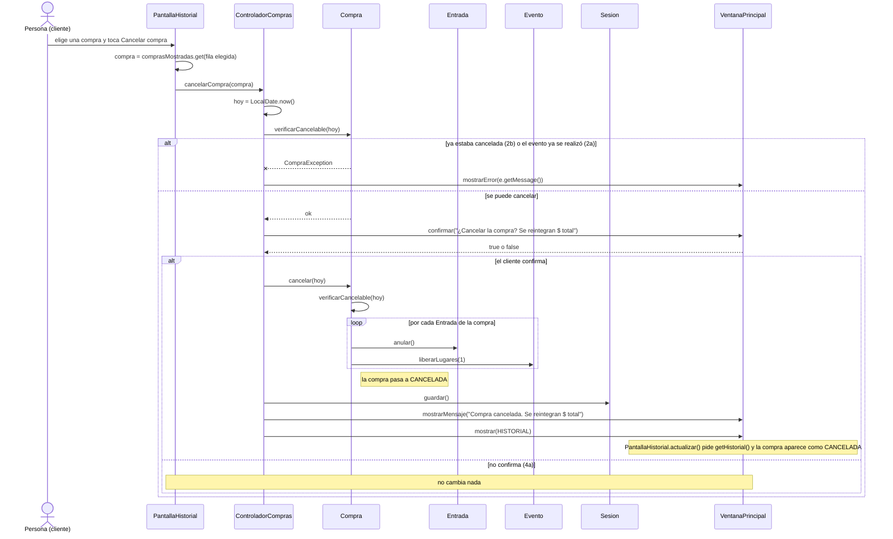

# CU14 — Cancelar compra · Diagrama de secuencia

[← Volver al p8](../p8-diagramas-de-secuencia.md) · Caso de uso: [CU14](../../analisis/casos-de-uso.md#cu14--cancelar-compra)

Desde `PantallaHistorial`, el cliente elige una compra y toca *Cancelar compra*. Si se puede cancelar, el sistema le muestra el monto a reintegrar y le pide confirmación. Al confirmar, se anulan las entradas, se liberan los lugares en los eventos y la compra queda `CANCELADA`.

## Diagrama

## Paso a paso

1. **`PantallaHistorial.actionPerformed`** toma la compra de la fila elegida (de su lista `comprasMostradas`) y llama a `cancelarCompra(compra)`.
2. **`ControladorCompras.cancelarCompra`** toma la fecha de hoy y le pregunta a la compra si se puede cancelar **antes** de pedir confirmación, para seguir el orden del caso de uso: primero se verifica (paso 2) y después se pregunta (paso 3).
3. **`Compra.verificarCancelable(hoy)`** lanza `CompraException` si:
   - la compra ya está `CANCELADA` (2b), o
   - alguna de sus entradas es de un evento cuya fecha es hoy o ya pasó (2a). RF15 dice "antes de la fecha del evento", así que el mismo día ya no se puede.
4. Si se puede, la ventana muestra el monto (`compra.getTotal()`) y pregunta sí o no. Si el cliente dice que no (4a), no se toca nada.
5. **`Compra.cancelar(hoy)`** vuelve a llamar a `verificarCancelable` (así la regla se cumple aunque otro código llame a `cancelar` sin verificar antes). Después, por cada entrada:
   - `Entrada.anular()` la pasa a `ANULADA`;
   - `Evento.liberarLugares(1)` resta una entrada vendida, y si el evento estaba `AGOTADO` vuelve a `ACTIVO`.

   Al final, la compra pasa a `CANCELADA`.
6. El controlador guarda y muestra el mensaje con el reintegro. El historial se recarga y muestra la compra cancelada.

## Elementos, patrones y decisiones

| Elemento | Qué muestra |
|---|---|
| **GRASP Experto** | La compra sabe si se puede cancelar (tiene sus entradas y su estado); cada entrada se anula sola; cada evento libera sus lugares. |
| **Bajo acoplamiento** | El controlador no recorre las entradas ni toca los eventos: solo le pide a la compra que se cancele. |
| **Jerarquía de excepciones** | `CompraException` cubre los dos alternativos (2a y 2b) con mensajes distintos. |

- **La fecha de hoy la pasa el controlador** (`LocalDate.now()`), en lugar de que `Compra` la busque sola. Así, en los tests de la E13 se puede probar con cualquier fecha.
- **El reintegro no mueve dinero** (ver p1: el pago es simulado). Queda registrado porque la compra pasa a `CANCELADA` con su total (ver D-006 en la bitácora del 19/10).
- **Si el evento fue cancelado por el organizador**, la compra se puede cancelar igual, siempre que su fecha no haya llegado (D-003).
