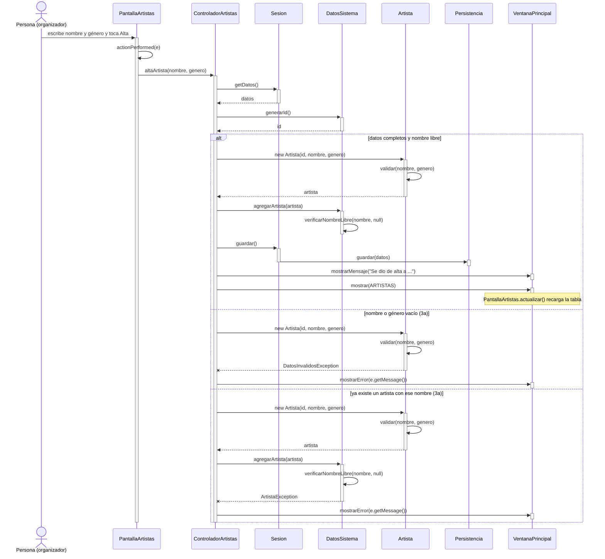
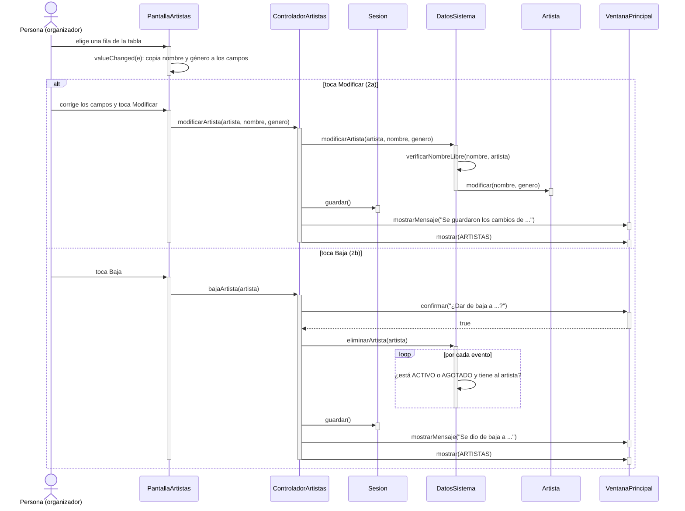

# CU15 — Gestionar artistas · Diagrama de secuencia

[← Volver al p8](../p8-diagramas-de-secuencia.md) · Caso de uso: [CU15](../../analisis/casos-de-uso.md#cu15--gestionar-artistas)

El organizador entra a *Gestionar artistas*, ve el catálogo en una tabla y puede dar de alta un artista (flujo principal), modificarlo (2a) o darlo de baja (2b). Los tres botones siguen la misma forma; abajo están los tres caminos.

## Diagrama: alta (flujo principal)

## Diagrama: modificar (2a) y baja (2b)

Si `modificarArtista` o `eliminarArtista` lanzan una excepción (nombre repetido, dato vacío o artista que está en un evento vigente), se va al `catch` y se muestra el mensaje, igual que en el alta. Si en la confirmación se elige "No", `bajaArtista` termina sin hacer nada.

## Paso a paso

1. **Alta:** `PantallaArtistas.actionPerformed` ve que se tocó *Alta* y le pasa los dos textos a `ControladorArtistas.altaArtista`.
2. El controlador pide un id a `DatosSistema` y crea el `Artista`. El constructor valida que nombre y género no estén vacíos.
3. `DatosSistema.agregarArtista` controla, con `verificarNombreLibre`, que no haya otro artista con el mismo nombre (sin importar mayúsculas) y lo agrega.
4. Se guarda, se avisa y se vuelve a mostrar `PantallaArtistas`, que en `actualizar()` recarga la tabla y vacía los campos.
5. **Modificar (2a):** al elegir una fila, la tabla avisa a la pantalla (`valueChanged`) y esta copia los datos a los campos. Al tocar *Modificar*, el controlador llama a `DatosSistema.modificarArtista`, que controla que el nombre nuevo no sea de **otro** artista y después llama a `Artista.modificar`.
6. **Baja (2b):** el controlador pregunta "¿Dar de baja a ...?". Si se acepta, `DatosSistema.eliminarArtista` recorre los eventos y no deja borrar un artista que está en uno `ACTIVO` o `AGOTADO`.

## Elementos, patrones y decisiones

| Elemento | Qué muestra |
|---|---|
| **GRASP Experto** | Las reglas que necesitan todo el catálogo (nombre repetido, artista en un evento) están en `DatosSistema`, que tiene las listas. La de "no vacío" está en `Artista`. |
| **Observer** | La pantalla escucha los botones (`ActionListener`) y la tabla (`ListSelectionListener`). |
| **Sin código repetido** | `verificarNombreLibre` lo usan el alta y la modificación. |

- **Modificar pasa por `DatosSistema`** y no va directo a `Artista.modificar`: si no, se podía renombrar un artista con el nombre de otro.
- **Un artista de un evento cancelado o finalizado sí se puede dar de baja**: ese evento ya no se va a hacer.
